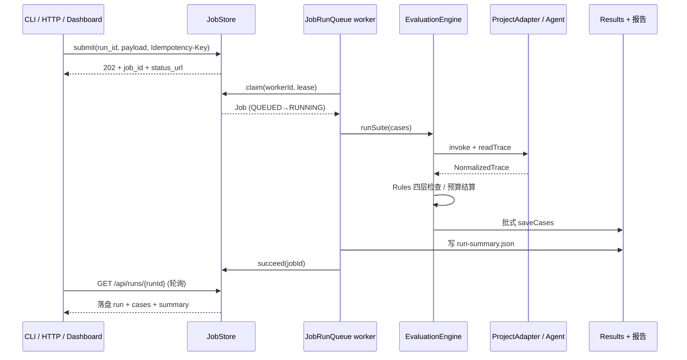
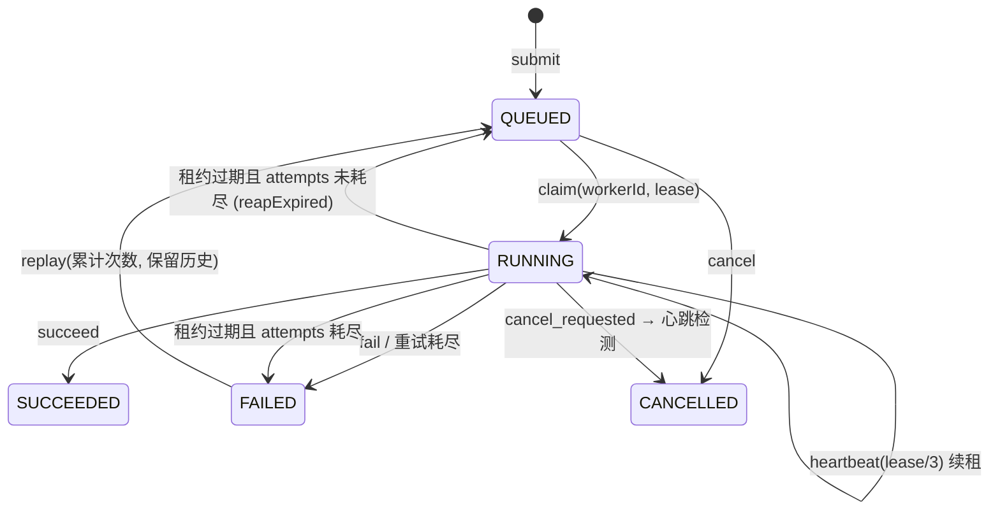
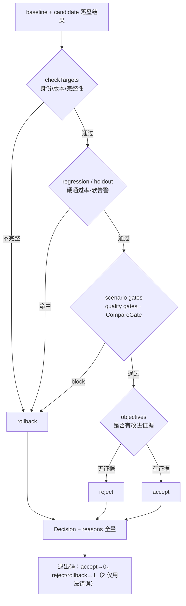

# Assay 面试准备与简历写法（整合版）

> **本文件是两份材料的整合版**：原 `assay-interview-prep.md`（13 章）与 `assay-interview-supplement.md`（44 题补充问答 + 实战手册）合并重排为五个部分；supplement 文件已删除，以本文件为准。
>
> 当前版本：2026-11-11。内容按当前代码、Dashboard 和 CI 状态描述，不保留历史中间过程；面试官只看得到当前仓库的代码与 README，看不到演进过程，全文只讲「现在是什么设计、为什么这样设计、边界在哪」。
>
> 适用场景：Agent 应用 / AI 平台 / 评测质量 / Java 后端岗位。
> 项目事实：Java 17、Maven 3.9、16 个模块、核心零运行时依赖；193 个主代码文件、约 2.80 万行主代码、91 个测试文件、约 1.29 万行测试；514 项 Java 测试（1 项按环境跳过）；聚合行覆盖 83.7% / 分支 67.9%；GitHub Actions Windows/Linux 双平台。
> 仓库：https://github.com/Ricardu255/Assay
>
> **全文口径已逐条回当前代码核实**，以下六处最容易讲错，先记牢：
>
> 1. `ApiTokenFilter`：`Bearer ` 后为空**直接返回 null**，不会回退到 `X-API-Key`；只有 Authorization 缺失或非 Bearer 前缀时才读 `X-API-Key`。
> 2. `SecurityStartupCheck`：`server.address` 为空或域名解析失败都**视为不安全**，`0.0.0.0 (all interfaces)` 只是告警里的显示文案。
> 3. `assay-integration-tests` **以 test scope 被 `app/pom.xml` 显式依赖**，注释说明正是为了让 JaCoCo 聚合包含跨模块集成测试、且不打进发行 jar；这解释了 core 模块级 47.8% 与聚合 86.6% 的差异。
> 4. `assay-agentscope` 与 extensions 不进聚合是因为**没有被 app 声明为依赖**；enforcer 禁的是 spring / micrometer / otel 进入 app 与核心，两件事不要混。
> 5. 退出码：`evolve` 的决策映射是二值的——accept → `0`，reject / rollback → `1`；`2` 在 README 与 `AssayCli` 类注释里声明为「用法错误或结果需人工复核」，但代码里 `2` 的可见路径都在用法/参数校验，评测决策链不产生它，运行期异常走 `1`；按契约讲、被追问时如实说明实现边界。
> 6. 心跳回调：`heartbeat` 返回 false **或** `isCancelRequested` 为真都会停 worker，异常只记 WARN 等下个 tick。
>
> 数字统一为当前报告：514 项 Java 测试（1 skipped / 0 失败）、83.7% 行 / 67.9% 分支、16 模块、21 个 CLI 命令、5 个 HTTP 端点、`CompareGate` 10 个数值阈值 + 1 个 `missing_metric` 严重度键。
>
> **2026-11 新增口径**：指标层（ToolPermission / LoopDetection / G-Eval）、`synth` / `attack`、`calibrate`、Dashboard 指标历史、凭据与常见 PII 脱敏；确定性指标基准达到 10 万条 / 28s（4GB 堆、490MB 结果，不含真实模型）。本文后续出现的旧「10k 基准」仍指 2026-10 的 file/JDBC 四组对照，两者不要混用。
>
> **阅读顺序**：先读「快速口径速查」；第一部分（一～四）用于项目介绍与全貌；第二部分（五～九）是简历与表达（简历写法、逐句防守表、讲解注意事项、STAR 稿、口径禁语、反问清单）；**第三部分是全部约 130 个问答按 9 个主题收拢后的主体**（每主题自浅入深：速查 → 深答 → 深挖专题 → 当前版本速答 → S 题三段式 → 快问快答）；第四部分是实战演练（模拟脚本、白板图、走读路线、追问链、质疑应答、设计题、当场验证命令）。
>
> **用法定位：这是知识库和底牌，不是台词本。** 面试时先讲设计逻辑（「为什么这么做、不这么做会怎样」），数字只在被追问时给；忘了具体数字就说量级和机制原因。例：TraceDiff 不要背「300 步降级、20 条后续差异、12 个 changed_paths」，而是说「LCS 最坏 O(n×m)，为了防大 Trace 拖垮评测做了步数上限和降级，同时为了报告体积可控对差异条目做了截断」——具体数值被追问再给。防守表与数字口径表只用于考前自检。

---

## 快速口径速查（先读这一页）

### 数字口径表（当场可验证）

| 数字 | 准确口径 | 现场验证方式 | 不能说成 |
|---|---|---|---|
| **16 个模块** | 根 `pom.xml` 的 `<module>` 数 | `grep -c '<module>' pom.xml` | 「14 个微服务」 |
| **21 个 CLI 命令** | `AssayCli` 的 `CommandLine.Spec` 数 | `grep -c 'new CommandLine.Spec(' assay-cli/src/main/java/io/assay/cli/AssayCli.java` | 「21 个」 |
| **5 个 HTTP 端点** | `POST /api/runs`、`GET /api/runs`、`GET /api/runs/{runId}`、`GET /api/runs/{runId}/cases`、`GET /api/ping` | 打开 `assay-server/src/main/java/io/assay/server/api/RunController.java` | 「完整 REST API」 |
| **10 种规则操作符** | `RuleConfig.OPERATORS` | `sed -n '18,21p' assay-core/src/main/java/io/assay/rules/RuleConfig.java` | 「十几种」 |
| **7 项多智能体指标** | `MultiAgentMetrics` 的 `put(...)` 键 | `grep -o 'put("[a-z_]*"' assay-core/src/main/java/io/assay/metrics/MultiAgentMetrics.java \| sort -u` | 「包含正确率」 |
| **10 个数值阈值 + 1 个严重度键** | `CompareGate.DEFAULT_SEVERITIES` 共 11 项，`missing_metric` 只配 severity | `grep -c 'Map.entry(' assay-core/src/main/java/io/assay/compare/CompareGate.java` → 11 | 「10 类可配阈值」不精确；正确说法是「10 个数值阈值，每类可设 block/warning，另加 missing_metric 严重度」 |
| **514 项 Java 测试 / 1 skipped** | 各模块 surefire 汇总，随新增测试变动 | `find . -path '*/target/surefire-reports/*.txt' -not -path './.assay/*' -print0 \| xargs -0 grep -h 'Tests run:'` | 「365 个用例覆盖所有场景」 |
| **83.7% 行 / 67.9% 分支** | `app/target/site/jacoco-aggregate/jacoco.csv` 聚合口径 | 打开 `app/target/site/jacoco-aggregate/index.html` | 「全项目 82%」——`assay-agentscope` 不在聚合范围，由模块级门禁单独看 |
| **1,754–3,727 cases/s** | 10,000 条合成用例、20 workers（**线程池**）、file/JDBC × echo/agent 四组，**端到端含归一化+规则+落盘+报告、不含模型调用**，单次运行、含 JVM 启动；**跨度来自存储类型和适配器复杂度**（文件+echo 最快、JDBC+四步 Agent 最慢），不是用例大小（生成脚本只有两个固定模板） | `sed -n '45,62p' docs/benchmark.md`；`scripts/generate_cases.py` | 「真实 Agent 吞吐」「生产容量」 |
| **2.7–5.7 s** | 同上四组整轮 wall time（2,683 / 4,020 / 4,011 / 5,703 ms） | 同上 | 「排查从 X 小时缩短到 X 分钟」——项目内没有人工排查基线 |

**一个容易被当场翻车的口径差异**：`assay-core/target/site/jacoco/jacoco.csv` 单独看只有约 **47.8%** 行，聚合报告里 `Assay Distribution/assay-core` 分组是 **86.6%**。原因是 core 大量行为测试放在 `assay-integration-tests`，而该模块以 **test scope** 被 `app` 显式依赖，只有聚合报告会把这些覆盖计入；模块级报告不包含。被问「core 覆盖率多少」要答聚合口径并主动解释。聚合分组还有 `assay-store-file` 90.4%、`assay-store-jdbc` 83.5%、`assay-runtime` 80.6%、`assay-cli` 69.8%、`assay-agentscope` 模块级 77.3%。

> 口径原则：**只报能当场打开报告验证的数字**。凡涉及「接入了多少业务 Agent」「回归集提升百分之多少」「排障耗时下降多少」的效果类数字，仓库里没有分母，只能按本人真实经历填，不能从合成基准换算。引用口述稿时，把其中的数字按本表核对（详见「口径提醒与禁语」）。

### 入口、产物、默认值

| 类别 | 内容 |
|---|---|
| 三套入口 | CLI（完整能力，20 命令） / Server API（5 端点，只提交与查询） / Dashboard（JDK `HttpServer`，默认只读，加 `--worker` 才开放提交与取消） |
| 提交返回 | `202` + `run_id` / `job_id` / `status` / `status_url`（`/api/runs/{runId}`）；评测由 worker 异步执行 |
| 一次 run 的产物 | `results.json`（机器契约）、`cases.jsonl`（可追加可恢复的事实流）、`report.md`（人读）、`scenario_stats.json`、`review_queue.jsonl`、`run-summary.json`（worker 收尾合并） |
| 对比/演化产物 | `compare.json`；`evolution.json` / `evolution_report.md`（含 `case_transitions`、`rule_deltas`）；`auto_evolution.json`；`scope_audit.json` + `diff.patch` |
| 关键默认值 | `workers=1`、`workerThreads=2`、`timeoutSeconds=30`、`retries=0`、`jobLeaseSeconds=60`、`pollMillis=500`、`jobMaxAttempts=1`（这是 Spring server 配置默认；CLI `queue submit` 的 `--max-attempts` 默认 3）、`authTokens` 空、`failOnInsecureBinding=false` |
| 退出码契约 | 决策映射是二值：`evolve` 里 `accept` → `0`，reject 与 rollback → `1`（`EvolutionCommands` 的 `"accept".equals(decision) ? 0 : 1`）。README:394 与 `AssayCli` 类注释另声明 `2` = 用法错误或结果需人工复核，但代码里 `2` 的可见路径都在用法与参数校验，评测路径不产生；运行期异常走 `1`（详见「口径提醒与禁语」） |
| 配置格式 | 严格校验的 JSON（不用 YAML，避免解析器依赖与隐式类型），密钥走环境变量 |

---

# 第一部分　定位与全貌


## 一、项目定位

### 1.1 一句话

Assay 是一个与领域解耦的 Agent 自动评测、诊断、人工审核、回归和版本演化框架：把候选 Agent/Skill 的 Trace 归一化，执行四层评测，输出硬门禁、软告警、首错诊断和 accept / reject / rollback 决策，但最终收货权始终在人手里。

### 1.2 30 秒口述版

“我做过一个叫 Assay 的 Agent 评测框架。它解决的不是 Agent 能不能跑，而是改完之后能不能安全发布、退化能不能定位。它通过适配器把不同 Agent 的 Trace 转成统一契约，跑结构、行为、一致性、反馈四层评测，再用 improvement、regression、holdout 三套数据比较基线和候选，给出 accept / reject / rollback；如果退化，会定位到第一处步骤差异。项目是 Java 17、核心零运行时依赖，文件/JDBC 双存储，514 项测试，Windows/Linux CI 都跑通。”

### 1.3 2 分钟口述版

1. **背景**：Agent 迭代很快，单次运行能跑通不代表能发布；线上 Trace 很多，但“看 Trace”不等于“做发布决策”。现有观测平台擅长存储和展示，指标库擅长单次打分，缺的是版本对比、发布门禁和退化定位的闭环。
2. **做法**：Assay 用 `ProjectAdapter` 回答四个问题：怎么调用 Agent、怎么把原生 Trace 转成 `NormalizedTrace`、哪些规则是硬门禁、哪些是软质量。核心层只依赖标准 Trace 和规则，不依赖具体 Agent 框架。
3. **评测**：结构层看 Trace 完整性和硬门禁；行为层看步数、重试、延迟、重复步骤和模块错误；一致性层对高价值节点做多次运行；反馈层把隐式负反馈变成人工复核候选。
4. **演化**：baseline 和 candidate 在 improvement / regression / holdout 三个数据集上跑同一套用例，按策略输出 accept / reject / rollback。新增了场景门禁、绝对质量门禁、规则通过率、P95 和样本覆盖。
5. **诊断**：对“基线通过、候选失败”的用例，`TraceDiff` 用 LCS 对齐 `module/action`，定位第一处步骤增删、替换、字段变化、报错或最终输出差异；直接复用已经评测过的 Trace，不重跑 Agent。
6. **结果**：核心零运行时依赖，存储可替换为文件或 JDBC；514 项 Java 测试；CI 覆盖 Windows/Linux；示例可稳定复现 rollback 和首错定位；还支持零代码接入 normalized / OpenInference / OTLP 外部轨迹。

### 1.4 5 分钟 / 白板顺序

1. **问题**：版本迭代的发布决策缺少可追溯证据。
2. **契约**：`NormalizedTrace` + 四能力适配器。
3. **评测**：四层 + 硬/软门禁。
4. **演化**：三数据集 + 决策 + 门禁。
5. **诊断**：用例状态迁移 + LCS 首错 + 失败聚类。
6. **可靠性**：批式落盘、恢复、文件锁、路径安全。
7. **结果与取舍**：测试、CI、零依赖、单机文件存储。

---


## 二、架构与核心流程

### 2.1 架构图

```text
Case JSONL ──► EvaluationEngine ──► CaseResult / NormalizedTrace
                   │                        │
Adapter ───────────┘                        ├─► ResultStore（JSONL + 锁 + 恢复）
（HTTP / Java / 离线 / OTLP）               ├─► Reporting（results.json / report.md）
                                            └─► Dashboard（默认只读；--worker 可提交队列）

Baseline run ─┐
              ├─► EvolutionEngine ──► comparisons ──► decision
Candidate run ┘        │                  │
                       │                  ├─ case_transitions + TraceDiff
                       │                  ├─ rule_deltas
                       │                  └─ scenario / quality gates / objectives
                       └─► evolution.json / evolution_report.md / Dashboard
```

### 2.2 一次评测的生命周期

1. 读取 JSONL 用例，校验 ID 唯一、内容非空。
2. 适配器调用 Agent，拿到原生 handle。
3. `readTrace` 转成 `NormalizedTrace`。
4. `Rules` 执行结构、行为、一致性、反馈检查。
5. `CaseResult` 汇总硬通过/软告警。
6. `ResultStore` 按批次落盘，运行结束压缩结果。
7. `Reporting` 生成 `results.json`、`report.md`、场景统计、审核队列、few-shot 候选。
8. Dashboard 只读展示。

### 2.3 模块地图

| 模块 | 职责 |
|---|---|
| `assay-core` | `model`、`engine`、`rules`、`evolve`、`release`、`compare`、`report`、`json`、`support`、`Results` 接口 |
| `assay-store-file` | `ResultStore`、`FileJobStore`、JSONL 落盘、锁、恢复 |
| `assay-store-jdbc` | `JdbcResultStore`、`JdbcJobStore`、事务、`SELECT FOR UPDATE`、JDBC 契约 |
| `assay-dashboard` | 默认只读 Dashboard；`--worker` 开放队列提交；总览/结论卡/多智能体页签/静态资源 |
| `assay-runtime` | `autoevolve`、`audit`、`diff`、`http`、`opentrace`、`process`、`review`、`selection`、`trace`、`workspace`、`llm` 适配器 |
| `assay-agentscope` | AgentScope Java 2.0 typed event → `NormalizedTrace` 适配与事件录制器；不进入 core |
| `assay-examples` | 示例适配器，只用于演示与测试，不进入核心依赖 |
| `assay-cli` | `AssayCli`、`CommandLine`、命令注册与分发 |
| `assay-server` | Spring Boot HTTP API、Security、Actuator、Validation |
| `assay-integration-tests` | 跨模块集成测试（80 项） |
| `app` | 纯分发模块；shade 成 `app/target/assay.jar` |
| `extensions/*` | Starter、Micrometer、OTel，均不反向污染 core |

---


## 三、核心设计决策与取舍

| 决策 | 原因 | 代价 |
|---|---|---|
| 核心零运行时依赖 | 可移植、易部署、无供应链负担 | JSON、HTTP Server、存储都要自己写，测试量更大 |
| `ProjectAdapter` 四能力契约 | 领域解耦，不绑定 LangChain/OTel/厂商 | 适配器需要自己做 Trace 归一化 |
| 内建工具链序列规则 | 顺序、参数、嵌套块可审计，避免脚本引擎的安全/移植问题 | DSL 变大，复杂逻辑仍需适配器暴露结构化字段 |
| `Results` 接口 + 文件/JDBC 双实现 | 单机零依赖、断点恢复简单；需要数据库时可切换 | JDBC schema 需自己迁移；锁/事务语义要按数据库验证 |
| Maven reactor 拆分 | core 零依赖、扩展可选、边界可验证 | POM/目录更多，测试要随包迁移 |
| 可选 Spring Boot Starter | 企业集成友好，不污染核心 | 扩展模块，已纳入 reactor；发布仍需单独配置 |
| `EvaluationListener` + Micrometer/OTel | 可观测、可扩展，默认 no-op | 指标基数/span 层级需要设计；adapter/rules/llm/store 子 span 已做 |
| LLM 只做建议 | 可复现、可审计、抗 prompt injection | 语义判断能力有限，需要人工复核 |
| 诊断只做“第一处可见差异” | 可解释、可测试、不重跑 Agent | 不是因果根因，非确定性轨迹可能误报 |
| 默认只读 Dashboard | 安全、无需构建、报告不可被界面改写 | 队列提交需显式 `--worker`；没有在线编辑和多人协作 |
| 硬/软门禁分离 | 发布判定必须确定，质量问题可人工看 | 规则设计需要领域参与 |

---


## 四、当前版本能力清单

- **评测与准出**：`NormalizedTrace` + 结构/行为/一致性/反馈四层评测；improvement/regression/holdout 三数据集对比；accept/reject/rollback 决策；门禁违规、指标变化、首错证据可审计。
- **首错定位**：`TraceDiff` 用 LCS 对齐 `module/action`，定位首个步骤增删、替换、字段变化、报错或最终输出差异；复用已评测 Trace，不重跑 Agent；支持 `case_transitions` 和失败聚类。
- **工具调用量化**：`sequence_contains` / `sequence_eq` 有序序列断言；`args` 参数子集匹配；嵌套连续块；规则通过率、跨 run 趋势和样本覆盖。
- **外部轨迹**：normalized、OpenInference、OTLP attribute array、Phoenix `traces` / `resourceSpans`；按 `case_id` 校验覆盖，缺失用例硬失败。
- **存储与恢复**：文件 JSONL / JDBC 双实现；有界批次落盘、断点恢复、跨进程文件锁、内容哈希与身份清单；JDBC 使用 `DatabaseMetaData` 迁移，`run_id` 索引与 `reindex-jobs` 回填。
- **异步队列**：`JobStore` 文件/JDBC 双实现；submit/worker/jobs/cancel/replay/prune；worker 租约、心跳续租、租约过期回收、幂等提交、重试/退避。
- **Dashboard**：纸雕档案视觉；总览趋势与测试集健康；运行详情结论卡、场景/规则进度条、多智能体页签；版本对比/演化/自动演化/范围审计/发布验证。
- **集成**：Spring Boot Starter、Micrometer 指标、OpenTelemetry Span、AgentScope 2.0 typed event 适配。
- **工程**：16 模块 Maven reactor、核心零运行时依赖；Checkstyle/SpotBugs/JaCoCo 门禁；Windows/Linux CI；Docker 多阶段构建。

---

# 第二部分　简历与表达

## 五、简历写法

> 格式：项目名 + 时间、技术栈、项目简介、核心内容；独立完成写“独立设计并实现”，团队项目写“负责核心模块设计与实现”。

### 5.1 简历精简版（推荐直接投递）

> **简历是鱼饵，面试文档是渔网。** 精简版只留核心价值与技术钩子（LCS、不重跑、失败簇、LLM 隔离、可审计、零依赖、at-least-once），诱导面试官来追问细节；数字、格式清单、实现细节一律不写，被追问时用 5.1b 完整版和防守话术接招。口径仍与防守表一致（首错定位 / 首个可见分歧步骤）。

```text
Assay — Agent 评测与发布准出平台                  2026.10 - 至今
技术栈：Java 17、Maven、Spring Boot、JDBC、Micrometer、OpenTelemetry、AgentScope、Docker

核心内容：
1. 发布准出与首错定位
设计 Trace 归一化与四层评测体系（结构/行为/一致性/反馈），隔离 LLM 非确定性风险；基于 improvement/regression/holdout 三集对比输出可审计的 accept/reject/rollback 决策；利用 LCS 对齐两次落盘 Trace，不重跑 Agent 即可定位首个可见分歧，并按角色/差异类别/模块/动作归并失败簇。
2. 统一 Trace 接入与归一化
设计统一适配契约（Java/HTTP/离线文件/AgentScope），将多源异构 Trace 归一化；把不同 Agent 框架的差异收敛在适配层，核心只认归一化后的统一轨迹，为四层评测、版本对比和首错诊断提供稳定输入。
3. 异步调度与资产回流
设计带租约续租、租约过期回收、重试退避和幂等提交的异步任务队列，支持文件/JDBC 双存储与 Dashboard 一键提交；将人工复核结论归档为可复用数据集样本，回流下一轮评测。
```

### 5.1b 完整对照版（口述素材与防守表底稿，不直接放简历）

> 饱和版：细节和数字都在这里。用途有两个——①被追问时展开的具体素材；②防守表左栏逐句对照的底稿。**不要把它直接贴上简历**（细节写在纸上没人记得住，反而像流水账）；数字口径以「快速口径速查」为准。

```text
Assay — Agent 评测与发布准出平台                  2026.10 - 至今
技术栈：Java 17、Maven、Spring Boot、JDBC、Micrometer、OpenTelemetry、AgentScope、Docker

项目简介：Assay 是一个与领域解耦的 Agent 评测与发布准出平台，解决 Agent 版本迭代中“改完能不能发、退化在哪一步”的问题。它把不同 Agent 的 Trace 归一化为统一契约，执行结构/行为/一致性/反馈四层评测，并在 improvement/regression/holdout 三套数据集上对比基线与候选，输出可审计的 accept/reject/rollback 与首个可见分歧步骤；配套文件/JDBC 双存储、带租约的异步队列、CLI/HTTP API 和本地 Dashboard。工程上为 Java 17、16 模块 Maven 工程，核心零运行时依赖，514 项 Java 测试（聚合行覆盖 83.7% / 分支 67.9%），Windows/Linux CI 全绿。

核心内容：
- 发布准出与首错定位：设计 Trace 归一化 + 结构/行为/一致性/反馈四层评测，以 10 种规则操作符量化工具链调用（顺序一致 / args 参数子集 / 嵌套连续块），按 hard / soft / candidate 三级判定且 LLM 不进硬门禁；在 improvement / regression / holdout 三套数据集上按 10 个可配数值阈值对比基线与候选，输出可审计的 accept / reject / rollback 结论及门禁违规证据；用 LCS 对齐两次已落盘的 Trace，不重跑 Agent 即可给出首个可见分歧步骤、状态迁移和失败聚类。
- 多源 Agent 接入与统一观测：设计统一接入层，覆盖 Java 适配器（类 / JAR）、HTTP 接口、离线 Trace 导出文件（normalized / openinference / openai 三格式，兼容 OTLP resourceSpans 与 Phoenix 包装）和 AgentScope typed events，归一化为统一 Trace；采集 7 项多智能体指标（步骤 / 模型 / 工具调用、交接、权限拒绝、重复步、Agent 数），经 Dashboard、Micrometer、OpenTelemetry 展示与上报；enforcer 把 Spring / Micrometer / OTel 挡在核心之外，核心只依赖 JDK。
- 异步调度与资产回流：设计带租约续租（60 s）、租约过期回收、指数退避重试与幂等提交（同键不同 payload 报冲突）的异步任务队列，语义为 at-least-once、零中间件，文件 / JDBC 双存储；打通 Dashboard 一键提交与取消（加 --worker 才开放写权限），把人工复核结论按 improvement / regression / holdout 角色归档为可复用样本，回流下一轮评测；本地 1 万条合成用例基准整轮 2.7–5.7 s（20 workers、单次运行、含 JVM 启动）。
```

### 5.2 按岗位调整顺序

- **Agent 评测 / 质量岗**：四层评测与门禁 → 三数据集演化 → 工具链序列规则（顺序/参数/嵌套）→ 规则历史趋势 → TraceDiff → 外部轨迹/可观测性。
- **Java 工程岗**：Maven reactor/零依赖 → 模块拆分 → 文件/JDBC 存储与恢复 → 并发/隔离 → Listener/Micrometer/OTel → 10k 基准与 CI。
- **平台 / 全栈岗**：Dashboard 规则统计与趋势 → 零构建前端 → CLI/HTTP 接入 → 存储与恢复 → 可观测性。

关键词：

- 评测：Agent Evaluation、Release Gate、Trace Normalization、Rule Operators（10）、hard/soft/candidate、Tool-Chain Sequence、Multi-Agent Metrics（7）、Rule Trend、Regression Diagnosis、Holdout、P95。
- Java：Maven Reactor、JDBC、Crash Recovery、File Lock、ClassLoader、JUnit 5、At-least-once / Lease / Idempotency、Benchmark。

### 5.3 一行版

“Java 17 实现的零依赖 Agent 评测与版本演化框架，支持 Trace 归一化、四层评测、三数据集演化、工具链序列规则、规则历史趋势、首错定位、文件/JDBC 存储、异步任务队列和 Micrometer/OTel 可观测性。”

### 5.4 注意事项

- 放在 MiniCode / Ragent 之后，作为“质量保障/工程化”的差异化项目；投 AI 平台/评测岗可放第一个。
- 不写“生产级”“百万级”；这个项目是本地/单机工程，写“零依赖、可移植、可复现”更加分。
- 技术栈只写有把握被追问的；GitHub 链接可选，项目时间按实际填。
- 每条 bullet 尽量是“问题 → 动作 → 证据”，不要只列模块名。

### 5.5 可替换 bullet 库

能力型：

- 评测颗粒度：10 种规则操作符（含 `sequence_eq` / `sequence_contains`、`args` 子集匹配）+ hard/soft/candidate 三级判定 + 10 个可配数值阈值 + 7 项多智能体指标，适合放在第一条 bullet 开头替代「四层评测」四个名词。
- 工具链序列断言：有序子序列/严格一致、args 参数子集、嵌套连续块，可定位缺失步骤、参数偏差和首个乱序。
- 规则通过率与跨 run 趋势：按 suite 查看规则退化、抖动和样本覆盖变化，而不是只看单次总分。
- 核心零运行时依赖，CLI、Dashboard、文件/JDBC 存储可独立替换，HTTP/Java/OpenInference/OTLP 接入共用同一套评测契约。

可靠性型：

- 批式落盘、断点恢复、跨进程锁和 trace id 校验，重跑不会混入旧结果。
- 零依赖 Listener + 可选 Micrometer/OTel 扩展，输出 run/case/batch 与 adapter/rules/llm/store 阶段信号。

性能 / 易用型：

- Dashboard 在大量历史报告下保持快速加载，规则通过率可按 suite 查看跨 run 趋势。
- 异步任务队列支持 worker 租约、心跳续租、租约过期回收、协作取消和最大重试；`serve --worker` 后可在 Dashboard 单击提交/取消。
- 纸雕 Dashboard 提供结论卡、进度条、多智能体页签和任务队列一键提交；HTTP Agent 可通过页面向导或 `quickstart` 接入。
- 本地 1 万条合成用例基准整轮 2.7–5.7 s（20 workers、file/JDBC × echo/agent 四组、单次运行、含 JVM 启动），文件存储比 H2 快 1.4–1.5×。

### 5.6 不要写什么

- 不写“根因定位”“首个错误步骤”；统一写“首错定位”“首个可见分歧步骤”，LCS 给的是排障起点，不是因果结论。
- 不写“生产级”“百万级 QPS”“真实 LLM 基准已跑”；当前是本地 10k 合成基准，外部真实 Agent 未跑。
- 不写“准确率 99%”；没有生产标注集和统计显著性检验。
- 不把参考 Agent 的吞吐写成真实 Agent 吞吐；模型/网络延迟会主导真实场景。
- 不写没做过的多租户、权限、分布式调度，不填 Redis/Kafka；这些是明确的边界。
- 不写“17 项 Node 测试”（仓库核不到来源），不把 core 模块级 47.8% 当对外覆盖率；一律报聚合 83.7% 行 / 67.9% 分支。

## 六、简历逐句防守表（配套「五、简历写法」）

> **用法**：考前自检清单，不是面试台词。每个数字先记住它背后的机制和量级（为什么需要这个设计、大概什么数量级），具体数值被追问时再给；讲不出机制的数字宁可不报。

左栏是 **5.1b 完整对照版逐句文本**（5.1 精简版每个钩子的防守都在这些行里：LCS / 不重跑 / 失败簇 → 「用 LCS 对齐」与「归并失败簇」两行；LLM 隔离 → 四层评测行；可审计 → 决策行；零依赖 / Enforcer → enforcer 行；at-least-once / 租约 / 过期回收 / 幂等 → 队列行；数据回流 → 归档行）。每行都要做到：**被问到时能立刻翻到代码，且知道哪句不能说**。新增的量化句都按「快速口径速查」核对过，报数前可现场跑一遍验证命令。

| 原句 | 一定会被问 | 支撑代码 | 应答要点 | 禁语 / 建议改法 |
|---|---|---|---|---|
| 「发布准出与**首错定位**」 | 「LCS 凭什么叫首错？为什么强调“可见”？」 | `TraceDiff.compare`、报告 `alignment` / `no_visible_divergence` | 给的是首个可见分歧步骤 + 状态迁移 + 失败聚类，是排障起点不是因果结论；轨迹完全一致但用例失败时写 `no_visible_divergence` | 旧稿的「根因定位」「首个错误步骤」已弃用，任何场合都别再写 |
| 「以 10 种规则操作符量化工具链调用……hard / soft / candidate 三级判定」 | 「10 种是哪 10 种？三级怎么分？」 | `RuleConfig.OPERATORS`、`CaseChecks.apply` | eq / ne / contains / not_contains / min / max / in / exists / sequence_contains / sequence_eq；hard 判失败、soft 告警、candidate 只进人工复核，LLM 不进硬门禁 | 不说「自动判断答案正确率」 |
| 「在 improvement / regression / holdout 三套数据集上对比」 | 「holdout 怎么防污染？」 | `EvolutionPolicyEvaluator.checkHoldout` / `checkTargets`、`ReviewSamples.ROLES` | 目标身份/版本先校验，holdout 独立判定；人工晋级带 `dataset_role` | 不说「系统强制隔离」，目前是配置 + 流程约束 |
| 「按 10 个可配数值阈值……输出**可审计的** accept / reject / rollback」 | 「阈值有哪几类？『可审计』具体指什么？谁执行发布？」 | `CompareGate.DEFAULT_SEVERITIES`、`Decision(decision, reasons)`、`Reporting` 的 Decision evidence / Run lineage | 11 项里 10 个是数值阈值、`missing_metric` 只配 severity；severity 分 block / warning / info；**可审计 = 全量条件列表 + 数值对比 + 证据路径 + 基线/候选运行血缘**，报告是数据不是日志，人能回看每条为什么被拦；退出码契约见「口径提醒与禁语」，最终发布由人或 CI | 不说模糊的「10 类可配阈值」；不说「自动上线 / 自动回滚」；不把「可审计」说成「自动归因」 |
| 「按角色/差异类别/模块/动作**归并失败簇**」 | 「聚类怎么聚的？会不会重复计数？」 | `Reporting.appendCaseTransitions`（Failure clusters 节）、`EvolutionComparison` 的 `failed_checks` | 不是相似度聚类，是按 `(role, category, module, action)` 四元组分组；**三个数据集里发生回归的用例都进簇**，一张表、第一列就是角色；**一个用例只进一个簇**（归簇用首个分歧），各簇条数相加等于回归用例数；每簇给命中条数和前 5 个样例 | 不说「自动定位根因」；不承认「一个用例进多个簇、条数重复计」——实现不是这样 |
| 「用 LCS 对齐两次已落盘的 Trace，不重跑 Agent」 | 「输入从哪来？为什么不用逐位置比？」 | `EvolutionComparison`、`TraceDiff` | 输入是两次已评测的持久化结果，诊断链路零 Agent 调用；按 `module/action` 对齐，>300 步降级为 positional | 「秒级」要挂基准口径；实现上限（300 / 20 / 12）别写进简历 |
| 「离线 Trace 导出文件（normalized / openinference / openai，兼容 OTLP `resourceSpans` 与 Phoenix 包装）」 | 「OTLP 是实时接收吗？AgentScope 算哪种？」 | `AdapterLoader`、`HttpProjectAdapter`、`TraceFileAdapter`、`AgentScopeTraceAdapter` | 适配器 / HTTP 是调用入口，Trace 是**离线导出文件解析**；AgentScope 是 typed event 映射，不是观测平台导出 | 不说「实时 OTLP 接收」「支撑 X 个业务 Agent」——仓库只有示例 adapter |
| 「采集 7 项多智能体指标」 | 「7 项分别是什么？含正确率吗？」 | `MultiAgentMetrics` | steps / model_calls / tool_calls / handoffs / denied_tools / max_repeated_step / agents | 不说「包含正确率 / 准确率」 |
| 「enforcer 把 Spring / Micrometer / OTel 挡在核心之外，核心只依赖 JDK」 | 「整个平台是不是跑在 Spring Boot 上？」 | `app/pom.xml` enforcer、`NormalizedTrace`、`System.Logger` | core / runtime 用 JDK `System.Logger`，server 才用 SLF4J；enforcer 只禁 spring / micrometer / otel 进 app + 核心 | 不说「全平台跑在 Spring Boot 上」；别把「agentscope 不进聚合」和 enforcer 混为一谈 |
| 「带租约续租（60 s）、租约过期回收……幂等提交……at-least-once、零中间件」 | 「用什么中间件？exactly-once 吗？『过期回收』和『续租』是两套机制吗？」 | `JobStore` / `JobRunQueue.reapExpired` / `RetryPolicy` / `IdempotencyConflictException` | 文件 / JDBC 自研、零中间件；租约 60s、心跳 lease/3、指数退避 + 抖动、同键不同 payload 报冲突；**回收只有一种触发方式——租约过期**，不是另有任务级超时；靠固定 run id / resume / run lock 保证不混数据 | 不填 Redis / Kafka；不说 exactly-once；**不说「任务级超时 / 超时杀任务」**，硬兜底只有单次调用超时 + 租约过期回收 |
| 「文件 / JDBC 双存储」 | 「两套结论会不会不一致？」 | `CaseChecks`、`Values`、`assay-integration-tests` 契约测试 | 业务语义抽公共类、常量在接口、同一套测试跑两个实现 | 不说「任意数据库可跑」 |
| 「Dashboard 一键提交与取消（`--worker` 才开放写权限）」 | 「默认就能提交吗？」 | `DashboardServer`、`--worker`、`RunController` | 默认只读展示，加 `--worker` 才开放队列提交 / 取消；Server API 是另一套 5 端点 | 不把 Dashboard 和 Server 说成一个服务 |
| 「归档为可复用样本，回流下一轮评测」 | 「飞轮转起来了吗？提升多少？」 | `ReviewSamples`、`promote-review`、`review_history` | 字段齐全可导出 JSONL；当前 `examples/*.jsonl` 是 1–2 行演示数据，**没有分母** | 不说「提升 X%」；旧稿「形成评测资产闭环」已换成具体动作 |
| 「本地 1 万条合成用例基准整轮 2.7–5.7 s」 | 「这是真实 Agent 吞吐吗？」 | `docs/benchmark.md` | 10,000 条合成 JSONL、20 workers、file/JDBC × echo/agent 四组、单次运行含 JVM 启动；文件存储比 H2 快 1.4–1.5× | 不写「真实 Agent 吞吐」「生产容量」「排查 X 小时→X 分钟」 |
| 「514 项 Java 测试（聚合行覆盖 83.7% / 分支 67.9%）」 | 「core 单模块怎么只有 47.8%？」 | surefire 汇总、`app/target/site/jacoco-aggregate` | 只报聚合口径；core 行为测试大量在 `assay-integration-tests`，以 test scope 被 `app` 依赖，只有聚合报告计入 | 不说「全项目 82%」；不写「17 项 Node 测试」（仓库核不到来源） |

**若采用带业务效果的模板**（「X 小时→X 分钟」「支撑 X 个业务 Agent」「回归集提升 X%」「基于 Redis/Kafka」）：四类数字仓库里都没有依据，只能来自本人真实经历；其中 Redis/Kafka 与实现矛盾，**绝对不要填**。可用真实数字替换的是「万条用例整轮评测 2.7–5.7 s」「4 类接入源 / 3 种 Trace 导出格式」「零中间件依赖」。

## 七、讲解时的注意事项

1. **先讲问题，再讲架构**：不要一上来念模块。
2. **强调“证据”和“人的决定权”**：这是项目和普通评测脚本的区别。
3. **不要过度承诺**：不说“生产级”“大规模”“准确率 99%”；说“本地可复现、JDBC/Starter/Micrometer/OTel 可用、10k 合成用例文件/JDBC 基准、外部真实 Agent 未跑、示例可复现 rollback”。
4. **主动说取舍**：文件存储 vs 数据库、LLM 不进硬门禁、诊断是辅助证据。面试官更看重你知道边界。
5. **准备一个具体 bug**：首选半行 UTF-8；并发岗备「多写者混写」、性能岗备「Dashboard 卡顿」，三个完整 STAR 见深答 22。
6. **准备一张架构图**：适配器 → 评测 → 演化 → 诊断 → 存储/报告/Dashboard。
7. **被问“你个人做了什么”**：按模块讲你负责的设计和实现；如果是独立项目，明确说独立完成；如果是团队，讲清边界。
8. **被问“为什么不用现成框架”**：先肯定现成工具，再说 Assay 补的是发布决策和领域解耦，不是重复造观测平台。

## STAR 稿与设计难点速览

面试官问「最难的地方」时，讲**当前系统里仍在起作用的权衡**比描述一次具体故障更站得住，也更容易现场翻到代码。每题 60–90 秒。

#### STAR-1：多写者下的状态一致性

- **S / T**：一份 run 的结果由三方接触——引擎写终态、worker 收尾写 `run-summary.json`、API 同时读落盘记录/队列记录/summary。存在时间窗，若各报各的状态，前端会看到「已完成却拿不到 summary」或「结果可查却显示运行中」。
- **A**：`RunService.finalizing()` 明确定义「落盘已是终态但 job 仍 RUNNING」的窗口，窗口内统一返回队列状态；落盘记录权威、summary 只是可选装饰，读不到按 DEBUG 跳过；读路径按 store/queue 可用性分级降级并分别留 DEBUG / WARN。
- **R**：API 对外状态单调、无跳变；故障时部分可用而非整体不可用，日志级别能区分「能力不支持」与「真故障」。
- **追问防守**：「为什么不直接等 worker 写完再返回终态？」→ 落盘与队列是两个独立持久化介质，无法原子提交；选的是「对外呈现一致」而不是「底层强一致」。

#### STAR-2：at-least-once 下结果不混

- **S / T**：租约过期会回收任务，另一个 worker 可能重跑同一个 case；跨进程实现 exactly-once 成本很高，但结果一旦混入重复或不同来源数据，发布结论就不可信。
- **A**：四层防线——`claim` 原子（文件锁 / `FOR UPDATE`）；job payload 固定 `run_id`；`resume` 校验 adapter / suite / source / metadata 与 case SHA-256 manifest，不一致拒绝复用；`Results.RunLock` 跨进程串行写同一 run 目录。
- **R**：重复执行**可能发生但不会污染结果**；预算在 resume 时把历史消耗计入，避免重启绕过上限；失败分可重试 / 耗尽终态 / 人工 `replay` 三类，历史不抹除。
- **追问防守**：「这不还是浪费算力吗？」→ 是，明确用算力换结果可信度；进一步优化可以在 claim 前查完成标记，但那属于优化不是正确性前提。

#### STAR-3：把「非确定性」挡在硬门禁之外

- **S / T**：Agent 本身非确定、LLM 判卷不可复现、外部 Trace 常缺指标；都进准出判定的话，同一份代码两次运行可能给出不同结论，门禁失去意义。
- **A**：硬门禁只吃能从 Trace 客观计数的信号（四层检查、7 项多智能体指标、规则通过率）；LLM 不参与判定——只在这一条用例已被规则判为可疑之后才被调用，结果写进 `llm_review` 字段，不改 `hard_pass`、不计软告警、也不决定是否进复核队列；`audit-scope` 的 finding 要回真实 diff 行校验（「只能提档不能降档」是 `select-tests` 那边 AI 的约束：它只能把测试模式往更重的方向提，不能降）；缺失指标保留 `null` 不补 0，用 `metric_coverage` 记录；首错诊断明确标注为证据而非门禁。
- **R**：结论可复现、可审计；代价是系统不回答「答案语义对不对」，这部分交给人工复核与反馈层。
- **追问防守①「那不就等于没评质量吗？」** → 评的是可复现的行为与结构质量；语义质量通过人工复核结论回流成数据集样本，形成下一轮的确定性断言。
- **追问防守②「同一版本跑两次，准出结论会不会变？」（准出系统的信任底线，必须能一句话接）** → 硬门禁判定是**纯函数**：给定归一化 Trace 与规则/阈值配置，`hard_pass`、`reasons` 与 `Decision` 唯一且可重放，链路里没有随机数和模型调用；非确定性只存在于一致性层（多次运行）与反馈层（LLM 建议），而这两层默认不进硬门禁。所以同一版本在硬门禁层面的结论不变——这正是把 LLM 挡在门禁外的直接收益。会变的部分（一致性告警、复核建议）本身就是「需要人看」的信号，不是决策。**边界**：跨版本对比时的样本集若被修改，结论会变，这是数据集换了而不是判定不确定，靠 manifest 内容哈希识别并拒绝复用。

#### 三个难点的速览表

| 难点 | 复杂在哪 | 当前设计的答案 |
|---|---|---|
| 多写者状态一致性 | 引擎写终态、worker 写 summary、API 同时读三处 | `finalizing()` 统一窗口内对外状态；落盘权威、summary 装饰；读路径分级降级留痕 |
| at-least-once 下结果不混 | 跨进程无法廉价实现 exactly-once，租约过期会重复执行 | 原子 `claim` + 固定 `run_id` + `resume` 身份/manifest 校验 + `Results.RunLock` |
| 确定性评测的边界 | Agent 非确定、LLM 不可复现、指标可能缺失 | 硬门禁只放确定性信号；缺失指标 `null` + `metric_coverage`；首错是「第一处可见差异」；Trace 超 300 步降级按位比较并在 `alignment` 标注 |

## 八、口径提醒与禁语（配套第七章）

### 讲述口径

1. 准出是**给出决策、证据与退出码契约**，最终发布由人或 CI 执行，不说「自动上线」。
2. 首错是 LCS 对齐后的**首个可见分歧步骤**，不是因果根因；轨迹完全一致但用例失败时报告写 `no_visible_divergence`。
3. 默认单机 / 本地 Dashboard；多实例队列要共享 JDBC 或共享文件目录。不承诺生产级多租户、权限体系与百万级并发。
4. 10k 合成用例基准（1,754–3,727 cases/s、整轮 2.7–5.7 s）只说明框架在确定性负载下的调度/规则/存储开销，不是真实 Agent 吞吐，也不是生产容量。
5. 只报能现场打开报告验证的数字：当前 514 项 Java 测试（1 skipped、0 失败）、聚合 83.7% 行 / 67.9% 分支、16 模块、双平台 CI；报数前重跑「现场可运行验证清单」第一行命令。
6. 退出码按「二值映射 + 契约边界」讲：`accept` 是 `0`，`reject` 和 `rollback` 都是 `1`；`2` 按 README:394 与 `AssayCli` 类注释的契约是「用法错误或结果需人工复核」，被追问实现时如实说明「可见代码路径都在用法/参数校验，评测决策链不产生 2，运行期异常走 1」，不要编造某个命令会因复核返回 2。

### 禁语对照

| 不要说 | 改成 |
|---|---|
| 精准根因 / 因果定位 | 首个可见分歧步骤、状态迁移、失败聚类 |
| 自动上线 / 自动回滚 | 输出决策、证据与退出码，由人或 CI 执行 |
| 生产级 / 百万级并发 / 多租户 | 本地可复现、单机或共享 JDBC 多进程、多租户是明确边界 |
| 真实 Agent 吞吐 3,727 cases/s | 10k 合成用例、单次运行、含 JVM 启动的框架固定开销基线 |
| 全项目零依赖 | 核心模块零运行时框架依赖（JDK `System.Logger`；server 复用 Boot 的 SLF4J） |
| 实时 OTLP 接收 / 接了 X 个业务 Agent | 离线解析 OTLP/Phoenix 导出文件；仓库只有示例 adapter |
| 回归集提升 X% / 排障从 X 小时到 X 分钟 | 项目内无分母；这类效果数字只能来自本人真实经历 |
| exactly-once / Redis / Kafka | at-least-once；文件/JDBC 自研队列，零中间件 |
| 门禁全绿所以代码规范 | 阈值有意放宽只拦极端情况，覆盖率不说明规范到位 |
| 「2 表示需人工复核」当成已实现的行为 | 契约这么声明；代码里 2 的可见路径在用法/参数校验 |
| LLM 输出走 schema 校验 / LLM 只能提档不能降档 | 评测里的 LLM 只写 `llm_review`，不改判定、不决定复核入列；解析是宽松 JSON + `parse_error` 标记；提档降档是 `select-tests` 选测那边的约束 |
| 重试按错误类型分类（瞬时错误重试、配置错误不重试） | 捕获到的异常一律进重试，不区分类型；已经有结论的（含候选被拒）不重试 |

### 考前自检

- [ ] 能用一句话说清「这不是观测平台，也不是打分库」
- [ ] 能报出四层对应的 `Rules` 方法名，以及 hard/soft/candidate 的判定落点
- [ ] 能说清 LCS 的对齐 key、忽略字段、三个上限常量、`no_visible_divergence`
- [ ] 能画出提交→落盘→对比→诊断的时序，并指出哪一步不重跑 Agent
- [ ] 能解释 `claim` 在两个 store 里各自怎么保证原子
- [ ] 能解释「核心零依赖」是 enforcer 强制的，以及为什么 server 用 SLF4J 不算破例
- [ ] 能报出 10 操作符 / 7 指标 / 10 数值阈值 + `missing_metric` / 20 命令 / 5 端点的准确口径
- [ ] 能主动说出三条边界：首错非根因、合成基准非生产吞吐、准出不自动上线
- [ ] 被问「你个人做了什么」时，能按模块讲清设计与实现边界

## 九、反问清单（面试尾声问对方的问题）
- 团队现在怎么做 Agent 发布？是看通过率、人工评审，还是有正式门禁？
- Trace 标准是 OTel/OpenInference/Phoenix，还是自研协议？
- 质量指标里，哪些是硬门禁，哪些只做告警？
- badcase 从线上回流到评测集，链路有多长？
- 这个岗位前三个月最希望解决的质量问题是什么？

---

# 第三部分　主题问答（全部问答按主题收拢）

> 原先分散在「30 题速查、22 题深答、快问快答、七个深挖专题、可观测 / 工程化专项追问、当前版本问答、S1–S44」的约 130 个问答，现全部按 9 个主题收拢，同一主题的问答不再跨章跳跃。每个主题自浅入深：**速查（一句话）→ 深答（易被追问的展开）→ 深挖专题（应对「再往下讲一点」，建议按「输入输出 → 算法 → 边界 → 测试 → 取舍」的顺序讲）→ 当前版本速答（按现状一句话）→ S 题（三段式：答 30 秒 / 要点 / 边界）→ 快问快答**。时间紧时只看每主题的「速查」和「深答」。

## 主题一　项目定位与动机
> 收录：速查 A1–A3 · 深答 1–3 · 当前版本速答 1 题。

### 1.1 速查（一句话回答）

**A1. 为什么做 Assay？和 LangSmith、Phoenix、Ragas 有什么区别？**

- 一句话：观测平台解决“看得到”，指标库解决“打得分”，Assay 解决“能不能发、退化在哪”。
- 展开：LangSmith/Phoenix 强在 Trace 存储、实验和可视化；Ragas/DeepEval 强在单次指标。Assay 消费这些 Trace，补的是版本对比、三数据集发布门禁、首错诊断和人工最终结论。它不替代观测平台，而是接在观测之后做发布决策。
- 追问：为什么不用现成平台？答：可以接，但发布策略、硬/软门禁、人工审核和领域规则需要可定制的闭环；Assay 的适配器可以接 HTTP、Java、离线轨迹。

**A2. 一句话介绍 Assay，为什么叫这个名字？**

- 一句话：像冶金厂对一批金属取样化验，Assay 对候选 Agent 取样、过门禁、给结论，但收货决定权在人手里。
- 展开：它不是“自动改代码/自动上线”的工具，而是产出证据和判定，避免把“测试通过”直接等同于“可以发布”。

**A3. 这个项目最难的地方是什么？**

- 一句话：不是规则引擎，而是让决策可复现、可追溯、不混数据。
- 展开：要保证 baseline/candidate 可比（版本身份、数据集、配置），缺失指标不能变 0，异常退出能恢复，隐藏回归不能只看通过率；诊断还要复用同一批 Trace，不能重跑。
- 追问：最难的 bug？见 H5。
### 1.2 深答（被追问时的展开）
#### 1. 为什么做 Assay？和 LangSmith / Phoenix / Ragas 有什么区别？

**考察点**：你是不是在重复造轮子，是否理解评测和可观测性的边界。

**回答**：

观测平台解决的是“看得到”：Trace 存储、检索、可视化、实验管理；指标库解决的是“打得分”：单次回答的相关性、忠实度、上下文质量。Assay 解决的是第三个问题：**改完之后能不能发、退化在哪一步**。

所以它消费 Trace，而不是替代 Trace 平台。核心链路是：适配器归一化 Trace → 四层评测 → baseline/candidate 三数据集对比 → 发布决策 → 首错诊断 → 人工最终结论。它补的是版本对比、硬/软门禁、诊断和人工审核的闭环。

差异点有三个：一是领域解耦，`ProjectAdapter` 四能力契约不绑定 LangChain、OTel 或某个厂商；二是发布导向，accept/reject/rollback 和退出码是给 CI 用的；三是可追溯，诊断复用已经评测过的 Trace，不重跑 Agent。

**可追问**：那为什么不直接用 LangSmith 的 experiment？答：可以接它的 Trace，但发布策略、关键用例、人工审核和领域规则需要可定制；Assay 可以把 LangSmith/Phoenix 当作 Trace 来源。

#### 2. 为什么用 Java，不用 Python？零运行时依赖的代价是什么？

**考察点**：技术选型是否有理由，是否知道代价。

**回答**：

这个项目的目标用户是 Java 团队，Agent 可能通过 HTTP、SDK、子进程接入，评测框架本身要能打成单个 jar、在 CI 里直接跑。Java 17 的 record、强类型、并发工具和 JUnit 很适合做契约、存储和并发控制；零运行时依赖则让部署和离线运行更简单。

代价也很明确：JSON 编解码、文件存储、HTTP Server、路径校验都要自己写，代码量和测试量更大；没有 YAML、没有数据库、没有现成的 Web 框架。我的判断是，这个项目的核心价值在“可移植 + 可审计”，所以接受这些代价；如果团队已经有 Python 评测栈，这套架构也完全可以换语言实现，契约和决策逻辑是语言无关的。

**可追问**：为什么不用 YAML？答：核心零依赖，JSON 已经够用，而且严格校验更容易做；YAML 的隐式类型和解析器依赖会引入额外风险。

#### 3. 这个项目最难的地方是什么？最有价值的点是什么？

**考察点**：你是否只会写功能，还是理解系统性问题。

**回答**：

最难的不是规则引擎，而是**让决策可复现、可追溯、不混数据**。具体包括：baseline 和 candidate 必须可比（版本身份、数据集、配置一致）；缺失指标不能变成 0；异常退出后要能恢复且不能把两次实验混在一起；通过率不变时还要能发现用例一进一出；诊断必须复用同一批 Trace，不能重跑。

最有价值的点是把“测试通过”推进到“可以发布/不可以发布，以及为什么”。报告里有硬失败、软告警、场景分布、首错步骤和证据路径，人工结论单独存储，不覆盖自动报告。这个“证据 + 判定 + 人的决定权”的组合，是它和普通评测脚本最大的区别。

**可追问**：最难的 bug？见第 22 题。

### 1.3 当前版本速答（按现状一句话）
#### 1. 用一句话介绍 Assay？

Assay 是一个与领域解耦的 Agent 评测与发布准出平台：把候选 Agent 的 Trace 归一化，执行四层评测，基于 improvement/regression/holdout 对比给出 accept/reject/rollback，并给出首个可见分歧步骤；最终收货权始终在人手里。


---

## 主题二　架构、模块与接入契约
> 收录：速查 B 组 · 深答 4–5、17 · 深挖专题：Starter · 当前版本速答 3 题 · S1–S4 · 快问快答 6 条。

### 2.1 速查（一句话回答）

**B1. 为什么要 `ProjectAdapter` 四能力？为什么不直接接 OTel？**

- 一句话：四个问题把“领域”和“框架”切开：怎么调用、怎么读 Trace、哪些硬门禁、哪些软质量。
- 展开：HTTP、Java SDK、子进程、离线文件都只是适配器实现；框架核心只依赖 `NormalizedTrace` 和 `Rule`。OTel 是 Trace 来源之一，不是框架的依赖。
- 追问：适配器会不会很重？答：领域项目只做归一化，评测、存储、报告、Dashboard 都复用。

**B2. `NormalizedTrace` 为什么这样设计？**

- 一句话：一个稳定契约，既保留完整性字段，又给领域规则留 `fields`。
- 展开：`trace_id` / `final_output` 是完整性硬条件；`events` 给行为层；`fields` 给领域规则；`feedback` 放隐式信号；`target_type/id/version` 用于演化版本匹配；`raw` 保留原始证据。
- 追问：为什么不直接存原始 JSON？答：评测层需要稳定路径和统一语义；原始 JSON 放 `raw`，不参与规则。

**B3. 四层评测怎么分工？硬门禁和软告警怎么划？**

- 一句话：结构/行为是确定性门禁，一致性/反馈只产生复核候选。
- 展开：结构层看 Trace 完整性和硬门禁；行为层看步数、重试、延迟、重复步骤、模块错误；一致性层对多次运行做对比；反馈层把显式负反馈、重复提问、改写问题变成候选。
- 追问：为什么一致性不直接判失败？答：非确定性 Agent 的差异需要人看，不能自动判 badcase。

**B4. 规则为什么用“路径 + 操作符”，而不是写 Java 断言？**

- 一句话：规则是数据，才能序列化、审计、给 HTTP 用户零代码配置。
- 展开：`actual` 从 Trace 读路径，`expected` 从用例 `expected` 读路径或用固定 `value`；支持 `eq/ne/contains/not_contains/min/max/in/exists`。工具链、参数这类复杂逻辑可以让适配器暴露成 `fields.tool_chain`，再用规则比较。
- 追问：复杂断言怎么办？答：写适配器或在领域侧计算成字段；框架不引入脚本引擎。
### 2.2 深答（被追问时的展开）
#### 4. 为什么要 `ProjectAdapter` 四能力？怎么避免绑定某个 Agent 框架？

**考察点**：领域解耦是否真的落地。

**回答**：

四能力是把领域项目必须回答的问题固定下来：怎么调用 Agent（`callAgent`）、怎么把原生 Trace 转成标准契约（`readTrace`）、哪些规则是硬门禁（`hardGates`）、哪些只是软质量（`softQuality`）。框架核心只依赖 `NormalizedTrace` 和 `Rule`，不关心底层是 HTTP、Java SDK、子进程还是离线文件。

避免绑定的关键有两点：一是标准 Trace 是稳定契约，领域字段放 `fields`，框架只读路径；二是适配器可以独立打包，通过 `META-INF/services` 或类名加载，框架和领域项目可以分开发布。HTTP 和 `trace_file` 配置则让不写 Java 的用户也能接入。

**可追问**：适配器很重怎么办？答：领域侧只做归一化和规则声明，评测、存储、报告、Dashboard 全部复用；适配器 jar 会被整体读入内存，不长期占用文件句柄，Windows 上可以直接替换。

#### 5. `NormalizedTrace` 为什么这样设计？哪些字段是必须的？

**考察点**：数据模型是否支撑评测、诊断和版本对比。

**回答**：

`trace_id` 和 `final_output` 是完整性硬条件，缺失就直接硬失败；`events` 给行为层和首错诊断；`fields` 给领域规则；`feedback` 放显式负反馈、重复提问、改写问题等弱信号；`target_type/id/version` 用于演化时校验版本身份；`raw` 保留原始证据，方便排查。

不直接拿原始 JSON 做规则，是因为不同 Agent 的字段命名和嵌套完全不同，评测层需要稳定的路径和统一语义。领域项目在 `readTrace` 里做一次归一化，后面所有规则、报告、诊断都复用这个契约。

**可追问**：没有 Trace 怎么办？答：结构层直接硬失败，不会静默跳过；外部轨迹缺少某个 case 也是硬失败。
#### 17. 外部轨迹怎么做到零代码？OpenInference / OTLP 怎么兼容？怎么保证可比性？

**考察点**：接入能力和工程细节。

**回答**：

`trace_file` 适配器读 JSON，按 `case_id` 关联用例，不需要写 Java。normalized 格式就是 `NormalizedTrace.toJson()`；OpenInference 读 `openinference.span.kind`、`tool.name`、`input.value`、`output.value`、token 等语义属性；OTLP 读 `resourceSpans/scopeSpans` 和 `{key, value:{stringValue}}` 属性数组。

可比性靠四点：同一套用例、同一套规则、target 身份/版本校验、重复 case 拒绝；用例在导出里缺失时硬失败，不静默跳过。`target_type/id/version` 可以覆盖文件里的目标身份，保证 evolve 的版本匹配。

**可追问**：流式/SSE 支持吗？答：当前只支持同步 JSON；流式需要另做采集和聚合，不在核心范围。


### 2.3 深挖专题：Spring Boot Starter——集成而不污染核心

#### 2.3.1 定位

`extensions/assay-spring-boot-starter` 是可选模块，不改变核心零依赖。它只做三件事：

1. 根据 `assay.store.type` 装配 `ResultStore` 或 `JdbcResultStore`。
2. 在存在 `ProjectAdapter` bean 时装配 `EvaluationEngine`。
3. 提供 `assay.workers`、`assay.timeout-seconds`、`assay.retries` 等配置。

#### 2.3.2 条件装配

- `@ConditionalOnProperty` 区分 file/JDBC。
- `@ConditionalOnBean(ProjectAdapter.class)`：没有适配器就不创建 Engine，避免框架猜怎么调 Agent。
- `@ConditionalOnMissingBean`：用户可覆盖任何 bean。
- `@AutoConfiguration` + `AutoConfiguration.imports`，不依赖组件扫描。

#### 2.3.3 测试

- 文件存储 + 有 Adapter → `ResultStore` + `EvaluationEngine`。
- JDBC + DataSource → `JdbcResultStore`。
- 没有 Adapter → 只有 `Results`，没有 `EvaluationEngine`。

#### 2.3.4 追问

- **“Starter 会不会把 Spring 带进核心？”** 不会；Starter 依赖 `assay`，反向不成立。
- **“为什么不自动装配 Dashboard？”** Dashboard 是可选运行时，涉及端口/生命周期/安全；当前让用户显式启动，避免隐式绑定 8080。
- **“JDBC 配置怎么给？”** Starter 只消费 `DataSource`，不猜 URL/用户名/密码；连接池和迁移由 Spring 应用负责。
- **“怎么发布？”** 已进入 Maven reactor，根目录 `mvn test` 会构建主项目、Starter、Micrometer 和 OTel；发布到 Maven Central 仍需额外的发布插件/签名配置。
### 2.4 当前版本速答（按现状一句话）
#### 1. 为什么核心零依赖？16 个模块怎么分？

核心只用 JDK，方便离线、可移植和审计；JDBC、Spring Boot、Micrometer、OTel、AgentScope 都放在外围模块。Maven Enforcer 禁止 `app/core` 引入 Spring/Micrometer/OTel，保证边界不被破坏。

模块大致分四层：

1. 核心：`assay-core`。
2. 存储与运行时：`assay-store-file`、`assay-store-jdbc`、`assay-runtime`、`assay-agentscope`。
3. 接入与分发：`assay-cli`、`assay-server`、`assay-dashboard`、`app`。
4. 集成与示例：`extensions/*`、`assay-examples`、`assay-integration-tests`。

#### 2. Dashboard 现在能做什么？

- 总览：运行数、通过率、失败/复核信号、7 天趋势、测试集健康。
- 运行详情：顶部结论卡、用例与 Trace、场景分布、规则统计、多智能体页签、原始数据。
- 版本对比：PASS/WARNING/BLOCK、指标对比、场景切片、退化用例、首错、规则变化。
- 版本演化/自动演化：accept/reject/rollback、候选轮次、检查点与 run lineage。
- 范围审计/发布验证：越界发现与 diff、regression→smoke→full 阶段。

#### 3. AgentScope 适配做了什么？

把 AgentScope Java 2.0 的 typed event 映射成 `NormalizedTrace`：

- 模型调用、工具调用、subagent 暴露、权限拒绝、超迭代 → 普通 trace 事件。
- 生成 `steps / model_calls / tool_calls / handoffs / denied_tools / max_repeated_step / agents` 指标。
- 适配层独立成 `assay-agentscope`，不进入核心和默认发行包。
- Dashboard 在报告包含 `multi_agent` 时展示「多智能体」页签。

### 2.5 S 题：系统全貌与对外入口（S1–S4）

**S1. 这个系统解决什么问题？一次评测从提交到出结论经过哪些组件？**

**答**：解决「Agent 版本能不能发布、退化在哪一步」，不是「怎么调用 Agent」。

**要点**：
- 链路：入口（CLI / HTTP / Dashboard）→ 构造 `RunSpec` → 异步提交到 `JobStore` → worker 租约 `claim` → `EvaluationEngine` 经 `ProjectAdapter` 调用 Agent、把原生记录归一化为 `NormalizedTrace` → `Rules` 四层检查 → `Results` 批式落盘 → 报告 / Dashboard → 版本对比（`compare` / `evolve`）→ 对回归用例用 `TraceDiff` 做首错诊断 → 人工复核回流数据集。
- 时序图见「三张必须会画的白板图」时序图，逐类走读见「现场代码走读脚本」。

**收尾**：核心只认统一 Trace 与规则，不认任何 Agent 框架。

**S2. 系统对外有哪几类入口？各自职责边界是什么？**

**答**：三套并存：**CLI** 完整能力、**Server API** 只负责提交与查询、**Dashboard** 默认只读展示。

**要点**：
- CLI（`assay.jar`，20 个 `CommandLine.Spec`）：`run` / `compare` / `evolve` / `review` / `select-tests` / `audit-scope` / 队列命令族。
- Server API（Spring Boot）：只有 5 个端点，提交与查询。
- Dashboard（JDK `HttpServer`）：默认只读展示落盘报告，加 `--worker` 才开放队列提交 / 取消。
- 设计上是「一个只读界面 + 一个写接口 + 一个完整命令行」，写能力都收口到同一个 `JobStore`。

**边界**：别把三者混答成一个服务。

**S3. HTTP 提交评测后返回什么？客户端怎么跟踪结果？**

**答**：`202` + `run_id` / `job_id` / `status` / `status_url`，客户端轮询 `GET /api/runs/{runId}`。

**要点**：
- `RunController.start` 用 `ResponseEntity.accepted()` 返回 202；body 由 `JobRunQueue.submit` 组装，`status` 由 `RunJobs.status(job.status())` 映射（初始 queued）。
- 提交不执行评测，只落一条持久化 job。
- 详情在 worker 写完 `run-summary.json` 后合并出 `hard_failures` / `case_count` / `budget` / `retry_policy` / `circuit_breaker` 等字段（`RunService.SUMMARY_KEYS`）；`GET .../cases` 取逐用例结果；run 不存在才 404。

**S4. 一次运行会产出哪些文件？分别给谁看？**

**答**：**JSON 是机器契约、Markdown 给人看、JSONL 是可追加可恢复的事实流**，不要说成一套报告。

**要点**：`results.json` / `cases.jsonl` / `report.md` / `scenario_stats.json` / `review_queue.jsonl` / `run-summary.json`（worker 收尾合并）；对比与演化产物见「快速口径速查」的产物表。
### 2.6 快问快答补充
- **适配器 jar 被占用怎么办？** 加载时整体读入内存，不长期持有文件句柄，Windows 上可直接替换。
- **支持流式/SSE 吗？** 当前只支持同步 JSON；流式需要另做采集和聚合。
- **支持多轮会话吗？** Trace 的 events 可以表达多步，但没有 session store；多轮需要适配器提供完整会话轨迹。
- **Spring Boot Starter 会不会污染核心？** 不会；Starter 是独立扩展，核心不反向依赖 Spring，且没有 `ProjectAdapter` 就不装配 Engine。
- **Dashboard 为什么不再卡？** catalog 和 rule-history 共用摘要缓存，按文件 mtime/size 失效；只缓存元数据和 `rule_stats`，不缓存完整 results，最多 512 个摘要。
- **不懂 Java 的人怎么用？** `assay.cmd` 双击示例；`assay quickstart` 三问生成配置、跑评测、开报告；发行包只需 Java 17，不需要 Maven。

---

## 主题三　评测体系与准出门禁
> 收录：速查 C 组 · 深答 6–13 · 深挖专题：门禁设计、评测资产闭环 · 当前版本速答 4 题 · S10–S16 · 快问快答 5 条。本主题体量最大，评测 / 质量岗的绝对核心。

### 3.1 速查（一句话回答）

**C1. 为什么 LLM 不能参与硬门禁？**

- 一句话：硬门禁必须可复现、可审计、抗注入，LLM 做不到稳定。
- 展开：LLM 输出有随机性、成本、延迟和 prompt injection 风险；Assay 让 LLM 只产出语义分析、疑似模块、修改建议和 few-shot 候选，报告里明确标注“非权威”。
- 追问：那语义质量怎么评？答：软质量规则 + 人工复核；后续可接校准过的 LLM-as-judge，但不进硬门禁。

**C2. 缺失指标为什么保留 `null`，不补 0？**

- 一句话：缺失不是零；补 0 会把“没测到”伪装成“表现很好”。
- 展开：`metric_coverage` / `objective_coverage` 记录 `sample_count`、`missing_count`、`case_count`；必需目标覆盖不全直接 rollback；显式测量到的 0 仍然是 0。测试覆盖了“缺失”和“真实零值”的区分。
- 追问：聚合溢出？答：非有限结果视为缺失，不产生 Infinity。

**C3. accept / reject / rollback 的判定逻辑？**

- 一句话：rollback 是「不能自动准出，需要人决定重跑/补数据还是回退」，reject 是「结论可信但没证明变好」，accept 是「变好且保护集没超退化」。
- 展开：rollback 覆盖版本身份不匹配、run 不完整、任何硬失败（含一致性配 hard）、必需指标缺失、样本不足、场景门禁/质量门禁不通过；reject 主要来自 improvement 未达到最低改善（或没有任何改善证据）；所有理由都写入 `reasons`，报告和 Dashboard 可追溯。「破坏了不能坏的」是早期意图，别拿它当定义——否则一致性硬失败归 rollback 就讲不通。
- **不要把「退回稳定版」写进 rollback 的定义**：`verdict` 只返回一个字符串 `"rollback"`，但 `rollback` 列表里混着两类——**不可信类**（`target identity or version does not match`、`run is incomplete (budget exhausted)`、`required metric is missing`、`quality gate has no evaluated cases`、`needs at least N cases`）后续动作是重跑/补数据；**不准出类**（`candidate has hard failures`、`hard pass rate decreased`、`soft warnings exceeded`、`exceeds the absolute maximum`、`exceeded maximum regression`、门禁不达标）后续动作才是回退。两者在决策码上同值（CI 都是 `1`），只能靠 `reasons` 文案区分——**出口粒度不够是真实缺口**，别讲成「设计上有层次」。

**C4. 为什么需要 improvement / regression / holdout 三个集？**

- 一句话：一个证明“改好了”，一个防止“改坏了”，一个防止“只对生成候选的样本有效”。
- 展开：improvement 是候选声称要解决的问题；regression 是已经确认、不能复发的历史能力；holdout 是候选生成过程没见过的留出样本。baseline 和 candidate 必须跑同一套用例，并校验 target 身份/版本。
- **三集怎么来的（必答，否则下一个问题就是「role 谁填」）**：role **不是用例里的字段**，而是三份独立文件——`EvolutionCommands` 里 `datasets.put("improvement", CaseLoader.loadCases(args.path("improvement"), ...))`，同理 regression / holdout。所以「这条用例是什么角色」取决于它被放在哪个文件、传给哪个参数。
- **空集/缺集的处理要准确**：`EvolutionEngine.run` 先查 `!datasets.containsKey(role)` 抛「evolution datasets require: ...」，再查 `datasets.get(role).isEmpty()` 抛「evolution datasets must not be empty」——**是启动即失败，不是跳过、也不是 reject**。这个选择是有意的：静默跳过等于把「必须证明改善」这道门关掉。
- **互斥没有校验（缺口）**：系统不检查同一 `case_id` 是否同时出现在两个文件里；重叠时它会按两个角色各判一次、各算一次指标，不会去重也不告警。互斥全靠人维护。
- **移出用例的后果**：从某集移走一条，对那一集来说就是「缺失」——恢复旧运行时 manifest 逐 case 比对会判 `missing case_id` 并拒绝复用，历史对比出现空缺。这是改用例数据的必然代价，不是系统级豁免。

**C5. scenario gates、quality gates、objectives 的区别？**

- 一句话：scenario 看切片，quality 看候选自身是否可接受，objectives 看相对基线的数值变化。
- 展开：scenario gate 可按场景设最低样本、最低通过率、允许退化；quality gate 按角色设最低硬通过率、最大回归数、最大关键回归数、最小样本；objective 支持 mean/sum/min/max/p50/p95/p99、最小改善、最大退化和绝对上限 `maximum`。
- 追问：为什么要三套？答：它们回答不同问题，不能用一个总通过率替代。

**C6. 怎么防“通过率不变但用例一进一出”的隐藏回归？**

- 一句话：逐用例状态迁移 + 回归条数门禁，而不是只看聚合通过率。
- 展开：`case_transitions` 把用例分成稳定通过、回归、恢复、持续失败；`maximum_task_regressions` / `maximum_critical_task_regressions` 按条数拦。默认 `require_regression_pass` 能兜住 regression 集的硬失败，但在 holdout/improvement 或放宽策略时，条数门禁更明确。
- 追问：关键用例怎么标？答：用例 `metadata.critical = true`。

**C7. P95 怎么算？小样本怎么办？**

- 一句话：线性插值，同时报告有效样本数；小样本用最小样本门禁和置信区间约束。
- 展开：P95 用排序后线性插值（R-7），不是简单取第 95% 个；报告展示 `样本数/用例数`；quality gate 有 `minimum_samples`；场景通过率用 Wilson 区间，避免把 1/1 读成 100% 的精确能力。
### 3.2 深答（被追问时的展开）
#### 6. 四层评测怎么分工？为什么一致性和反馈不直接判失败？

**考察点**：是否理解确定性评测和非确定性评测的边界。

**回答**：

结构层看 Trace 完整性、硬门禁和软质量；行为层看步数、重试、延迟、重复步骤、模块错误；一致性层对高价值节点做多次运行，比较结果是否稳定；反馈层把显式负反馈、重复提问、改写问题变成人工复核候选。

一致性和反馈不直接判失败，是因为它们本身就是不确定信号：模型有随机性，用户反馈也可能有噪声。直接把差异判成 badcase，会制造大量误报；更合理的做法是进入 review queue，由人确认后再晋级到 regression/improvement/holdout。

**可追问**：那硬门禁会不会太松？答：硬门禁只放确定性、可复现的规则；质量问题用软告警和人工复核兜底。

#### 7. 硬门禁和软告警的边界？为什么 LLM 不能参与硬门禁？

**考察点**：发布判定的可靠性意识。

**回答**：

硬门禁是“不通过就不能发布”的确定性规则，比如 Trace 完整性、关键路由、必要字段、安全规则；软告警是“值得人看”的质量信号，比如回答长度、风格、语义建议。硬门禁必须可复现、可审计、抗 prompt injection，LLM 做不到稳定，所以只做语义分析、疑似模块、修改建议和 few-shot 候选，报告里明确标注非权威。

这也是一个产品原则：LLM 可以加速分析，但不能替代发布责任。即使以后接 LLM-as-judge，也应该先做校准、只进软质量或人工复核，不直接进硬门禁。

**可追问**：LLM 分析失败怎么办？答：失败不影响评测事实，报告里记录错误，硬门禁照常运行。

#### 8. 规则为什么用“路径 + 操作符”？工具链、参数这种复杂逻辑怎么表达？

**考察点**：规则引擎的扩展性和边界。

**回答**：

规则是数据，才能序列化、审计、给 HTTP 用户零代码配置。`actual` 从 Trace 读路径，`expected` 从用例的 `expected` 读路径，或者用固定 `value`；操作符支持 `eq/ne/contains/not_contains/min/max/in/exists`，以及 `sequence_contains/sequence_eq`。

工具链不再要求适配器手工拍平：序列规则默认取 `events` 的 `module/action` 作为步骤 key；步骤可带 `args`，按事件 `fields` 做子集匹配；嵌套数组表示必须连续的步骤块。例如：

```json
{"name":"tool_chain","actual":"events","operator":"sequence_contains",
 "value":["Router/route",[{"step":"Tool/search","args":{"query":"refund"}},"Tool/answer"]]}
```

失败时给出缺失步骤、参数差异或首个顺序不匹配，运行页用步骤 chips 展示实际/期望序列。

**可追问：为什么不做脚本引擎？** 脚本会带来执行安全、可审计性和跨语言移植问题；当前规则已经覆盖路由、字段、包含、范围、工具顺序和参数子集。更复杂的领域逻辑仍可由适配器暴露成结构化字段，而不是把 DSL 变成通用编程语言。

#### 9. 缺失指标为什么保留 `null`，不补 0？覆盖率怎么用？

**考察点**：数据完整性意识。

**回答**：

缺失不是零。补 0 会把“没测到”伪装成“表现很好”，比如没有 Token 数据却显示成本为 0、没有 Trace 却显示延迟为 0。Assay 保留 `null`，同时记录 `metric_coverage` / `objective_coverage` 的 `sample_count`、`missing_count`、`case_count`；必需目标覆盖不全直接 rollback，显式测量到的 0 仍然是 0。

测试里专门区分了“缺失”和“真实零值”，也覆盖了聚合溢出：非有限结果视为缺失，不产生 Infinity。这样报告不会给出虚假的精确值。

**可追问**：那缺失太多怎么办？答：先修适配器或数据采集；如果业务允许缺失，把目标设为非必需，但报告仍展示覆盖率。

#### 10. accept / reject / rollback 的判定逻辑？阈值怎么定？

**考察点**：发布决策是否清晰、可解释。

**回答**：

`rollback` 的准确定义是「**不能自动准出，需要人决定重跑/补数据还是回退**」：regression/holdout 硬失败（含一致性规则配成 hard 后的失败）、通过率下降、场景门禁/质量门禁不通过、版本身份不匹配、必需指标缺失、样本不足都归这里。`reject` 是「结论可信但没证明变好」：improvement 没有达到最低改善，或没有任何可度量改善证据。`accept` 是「变好且保护集没超退化」。**「破坏了不能坏的」是最初的设计意图，实现上演化宽了，不要拿它当定义**。**也别把「退回稳定版」当定义**——`rollback` 底下压着两类后续动作不同的原因（不可信类要重跑，不准出类才回退），而决策码只有一个，只能在 `reasons` 里靠文案区分。所有理由写入 `reasons`，报告和 Dashboard 可追溯。

阈值不是拍脑袋：先看 baseline 和业务风险，关键场景从严格开始（比如关键用例 0 回归、通过率不低于 95%），用 holdout 验证，再根据历史波动调整。阈值应该版本化、可 review，不能拿 holdout 反复调参。

**可追问**：退出码怎么映射？答：`accept` → `0`，`reject` 和 `rollback` 都是 `1`——CI 层面只区分放行/不放行，决策差别在报告里；`2` 的契约是用法错误或需要人工复核，但评测路径不产生它，实际只在参数校验里出现。需要人看的运行不能看起来像通过，这个诉求目前是靠复核队列体现的，不是靠退出码。

#### 11. 为什么需要 improvement / regression / holdout 三个集？怎么防 holdout 污染？

**考察点**：是否理解评测集设计和过拟合。

**回答**：

improvement 证明候选声称要解决的问题；regression 防止已经修好的能力复发；holdout 是候选生成过程没见过的留出样本，防止只对生成候选的样本有效。baseline 和 candidate 必须跑同一套用例，并校验 target 身份/版本。

防污染的做法：holdout 不参与候选生成和调参；候选生成器只能看 improvement/regression；定期轮换或补充 holdout；报告按场景切片，避免只看总通过率；数据集内容哈希进入 run manifest，内容变了就拒绝复用。

**可追问**：holdout 也会被间接污染怎么办？答：至少保证流程隔离，并在报告里标注数据集版本和来源；更高要求是独立团队维护 holdout。

#### 12. scenario gates、quality gates、objectives 的区别？怎么防隐藏回归？

**考察点**：门禁模型是否清晰，是否考虑小样本和通过率陷阱。

**回答**：

scenario gate 看切片：某个场景的最低样本数、最低通过率、允许退化；quality gate 看候选自身是否可接受：按角色设最低硬通过率、最大回归条数、最大关键回归数、最小样本；objective 看相对基线的数值变化：mean/sum/min/max/p50/p95/p99、最小改善、最大退化、绝对上限。

隐藏回归靠逐用例状态迁移 + 条数门禁，而不是只看聚合通过率。`case_transitions` 把用例分成稳定通过、回归、恢复、持续失败；`maximum_task_regressions` 和 `maximum_critical_task_regressions` 按条数拦。默认 `require_regression_pass` 能兜住 regression 集的硬失败，但在 holdout/improvement 或放宽策略时，条数门禁更明确。

**可追问**：关键用例怎么标？答：用例 `metadata.critical = true`，回归清单会单独标记。

#### 13. P95 怎么算？小样本怎么办？

**考察点**：指标计算的严谨性。

**回答**：

P95 用排序后的线性插值（R-7），不是简单取第 95% 个；报告同时展示 `样本数/用例数`，避免把 1/1 读成 100% 的精确能力。quality gate 有 `minimum_samples`，样本不够时直接判“证据不足”，不会给出自信的通过结论；场景通过率用 Wilson 区间，小样本区间更宽。

均值会掩盖长尾，P95 更适合延迟、成本这类指标；但 P95 本身也需要样本量支撑，所以覆盖率和最小样本数必须一起看。

**可追问**：为什么不用 P99？答：支持 p99，但小样本下更不稳定；默认看 P95，按业务需要配置。

### 3.3 深挖专题：门禁设计——从规则到发布决策

#### 3.3.1 门禁模型的分层

| 层级 | 作用 | 例子 |
|---|---|---|
| 用例级硬门禁 | 单个用例必须通过 | Trace 完整、关键路由、安全规则 |
| 用例级软质量 | 产生告警/复核候选 | 回答长度、风格、疑似模块 |
| 场景门禁 | 防止小切片被平均值掩盖 | 高风险场景最低通过率、最大跌幅 |
| 绝对质量门禁 | 候选自身是否可接受 | 最低硬通过率、最大回归数、最大关键回归、最小样本 |
| 数值目标 | 相对基线的改善/退化 | latency、tokens、cost、业务字段 |
| 演化决策 | 汇总成 accept/reject/rollback | 版本发布结论 |

关键原则：**硬门禁是确定性的；LLM 只做建议；任何 rollback 都优先于 reject/accept。** 另外记住三个门禁数组（`objectives` / `scenario_gates` / `quality_gates`）默认都是空的——不配就不参与判定，默认生效的只有 `require_regression_pass` 等布尔与数值开关。

#### 3.3.2 决策顺序

`EvolutionPolicyEvaluator.decide` 的实际顺序：

1. 版本身份/目标不匹配 → rollback。
2. regression 集：候选硬失败（如果 `require_regression_pass`）、通过率下降、软告警增加 → rollback。**注意通过率下降那条是无条件检查**，关掉 `require_regression_pass` 也照样拦。
3. holdout 集：候选硬失败（如果 `require_holdout_pass`）、通过率跌幅超限、软告警增加 → rollback。
4. scenario gates：场景缺失、样本不足、通过率低于下限、跌幅超限、软告警增加 → rollback。
5. quality gates：样本不足、绝对通过率低于下限、回归条数/关键回归条数超限 → rollback。
6. objectives：必需指标缺失、相对退化超限、绝对上限超限 → rollback；improvement 未达到最低改善 → reject。
7. 没有 rollback/reject，且满足改善要求（或策略不要求改善）→ accept；否则 reject。

这个顺序很重要：**rollback 是“不能发”，reject 是“没证明能发”**；两者都不等于通过。

**两个容易漏的机制细节**：① **短路**——`verdict` 里 `if (!rollback.isEmpty()) return new Decision("rollback", rollback)`，命中回滚就直接返回，`reject` 列表和 `improvementEvidence` 都不再产出，报告里也只有回滚原因；所以「run 没跑完」那轮报告看不到候选到底有没有改善，这是刻意的（结论不可信时谈改善没意义），但要知道信息被丢弃了。② **「通过率」特指硬通过率**——`hard_pass_rate_delta` 的分子分母都只含 hard 级检查，软告警单独走 `soft_warning_delta`，所以「软告警变多拉低总通过率」不会触发通过率下降，只会触发软告警增量检查。

**必须主动认的缺口：improvement 集自身退化不检查。** `checkRegression` 只读 `comparisons.get("regression")`，improvement 集既不查全过也不查 `hard_pass_rate_delta`，它只回答「有没有改善证据」。反例成立：improvement 硬通过率 90%→80%、软告警 5→10，但目标指标质量分 0.8→0.9 达标，回归与 holdout 未退化，quality gates 默认为空 → **accept**。辩解可以说「证明变好是 improvement 的职责，protected 性质由另外两集承担」，但要承认这在「同一集内部指标互相矛盾」时兜不住；补法是给 improvement 也配质量门禁或目标指标的 `maximum_regression`，能配，但默认没配。

**多个目标指标是「与」关系**：`checkObjectives` 对每个 objective 逐个判，任一 `delta < minimumImprovement` 就往 `reject` 里加一条，没有加权、也没有「达到 N 个即可」的配置，所以「质量分大涨、延迟差一点没到线」整体 reject。另外三个阈值的性质与适用范围不同：`maximum` 是**候选指标值本身的绝对天花板**（`candidateNumeric > maximum` → rollback），与基线无关；`maximum_regression` 和 `minimum_improvement` 是**相对基线的差值**；前两者对三个 role 都检查，**只有 `minimum_improvement` 只在 role=improvement 上检查**。

**默认值与改善证据（被追问「给我决策矩阵」时按这个答，别只答「回归优先」）**：`EvolutionPolicy()` 的默认是 `require_regression_pass=true`、`require_holdout_pass=false`、`max_holdout_hard_pass_drop=0`、`max_regression_soft_warning_increase=0`、`require_improvement=true`，三个门禁数组（objectives / scenario_gates / quality_gates）**默认为空**。**「改善证据」有三条来源，第三条最容易答漏**：① improvement 集 `hard_pass_rate_delta > 0`（`checkImprovement`）；② improvement 集 `soft_warning_delta < 0`（`checkImprovement`）；③ **配了的目标指标在 improvement 集上改善量为正**（`checkObjective` 里 `role == "improvement"` 且 `delta > 0` → `improvementEvidence.add("objective improved: ...")`）。所以「配了质量分、最低改善 0.05、实际 0.8→0.9」**算改善**，不会被「没有可度量改善」拒掉；但它同时受 `minimumImprovement` 约束——改善量没到那条线会在更早的 `checkObjective` 里直接 reject（理由是最低改善未达成），两个条件不是一回事。**缺口**：通过率和软告警这两条没有最小幅度门槛、没有显著性检验，任意 >0 即算；**软告警也没有绝对条数门槛**——质量门禁只有硬通过率和回归条数，场景门禁限制的是软告警**增量**，所以「告警 50→48 条」在硬门禁都过的情况下可以 accept。于是三个常被构造的场景：

① **回归集挂 1 条 → rollback**。这是最容易答错的一条：`require_regression_pass=true` 时，只要 `regression.candidate.hard_failures > 0` 就回滚——**是「这一集不能有任何硬失败」，不是「新增回归为零」**；而且 `hard_pass_rate_delta < 0` 是**无条件**检查，即使把 `require_regression_pass` 关掉，净通过率下降照样回滚。**结论要说得更狠一点**：`maximum_task_regressions` 在 regression 集上基本轮不到生效，只在「一进一出、净持平」时才可能被判断，它的独立价值主要在 improvement 集（那一集不查全过、不查通过率下降）。所以「配两步就能放宽回归」是错的，**不要把它说成默认允许挂一两条**。另：`hard_failures` 是候选集硬失败**总数**，基线本来就挂的用例也算，默认同样回滚；系统**没有按用例的豁免名单**，所谓单独放行只能是关掉全过开关（整集粒度）或修好/移出那条用例。

② holdout 通过率下降（默认容忍 0）→ **rollback**，即使 improvement 很好。

③ 所有门禁都过但 improvement 既没升也没降 → **reject**（理由 `candidate produced no measurable improvement`），不是 accept。

注意 holdout 默认不要求全过，只禁下降——「holdout 差但 improvement 好」在默认策略下仍是 rollback。

**决策到退出码的映射是二值的**：`evolve` 命令返回 `"accept".equals(decision) ? 0 : 1`——accept 是 0，**reject 和 rollback 都是 1**。退出码 `2` 只出现在用法/参数校验，评测决策链不产生「需要人工复核」这个码。别把「三种退出码对应三种决策」当结论讲。

#### 3.3.3 三类门禁的区别

**Scenario gate** 看切片：

```json
{
  "scenario": "high-risk",
  "roles": ["regression", "holdout"],
  "minimum_case_count": 5,
  "minimum_hard_pass_rate": 1.0,
  "maximum_hard_pass_rate_drop": 0,
  "maximum_soft_warning_increase": 0
}
```

适合“高风险场景不能有任何回归”，防止 1 条关键用例被 99 条普通用例平均掉。**`scenario` 来源**：`EvalCase.scenario` 字段，缺省值是 `default`（不是空）；没配 `default` 的场景门禁，这些用例就不参与场景判定——门禁是 opt-in 的，漏标只能靠用例评审发现。

**Quality gate** 看候选自身：

```json
{
  "roles": ["regression", "holdout"],
  "minimum_hard_pass_rate": 0.95,
  "maximum_task_regressions": 0,
  "maximum_critical_task_regressions": 0,
  "minimum_samples": 10
}
```

适合“候选必须达到绝对下限”，以及“通过率不变但用例一进一出”的隐藏回归。

**Objective** 看数值：

```json
{
  "name": "latency_p95",
  "metric": "latency_ms",
  "direction": "minimize",
  "aggregation": "p95",
  "minimum_improvement": 0,
  "maximum_regression": 50,
  "required": false,
  "maximum": 1200
}
```

`maximum` 是候选的绝对上限，和基线无关；`minimum_improvement` 只在 improvement 集用于 reject；`maximum_regression` 在所有角色用于 rollback。

#### 3.3.4 隐藏回归的完整例子

假设 baseline 和 candidate 都是 10 条用例、5 条通过：

- baseline 通过：A、B、C、D、E
- candidate 通过：A、B、C、D、F
- 通过率都是 50%，`hard_pass_rate_delta = 0`
- 但 `case_transitions.regressed = [E]`，`recovered = [F]`

如果只看通过率，会误判“没有退化”；`maximum_task_regressions = 0` 会直接 rollback。**这个例子的前提要说清**：默认 `require_regression_pass=true` 时，regression 集有硬失败已经先回滚了，所以 `maximum_task_regressions` 的独立价值体现在两种场景——把全过开关关掉、或者把它配在 improvement 集上（improvement 集不检查硬失败全过）。不管哪条先命中，逐用例清单本身都有用：它告诉人“退化的是 E，不是整体不行”。

#### 3.3.5 阈值怎么定

1. **从基线开始**：先跑 baseline，得到通过率、延迟、Token、成本分布。
2. **按业务风险分层**：关键场景/关键用例用绝对下限；普通场景允许小幅波动。
3. **用 holdout 验证**：阈值不能只在 improvement 上调；要看保护集。
4. **看样本量**：样本少时用 `minimum_samples` 和 Wilson 区间，不要用 1/1 下结论。
5. **版本化**：策略文件进 git，阈值变更要 review；不要拿 holdout 反复调参。
6. **定期复盘**：线上 badcase 回流后，更新 regression/improvement，再调整阈值。

#### 3.3.6 常见追问

- **“门禁会不会太严，导致什么都发不出去？”** 硬门禁只放确定性、高价值的规则；软质量走告警和人工复核；quality gate 有 `minimum_samples`，避免小样本误杀。
- **“多个门禁冲突怎么办？”** 任何一个 rollback 都优先；`reasons` 会列出所有违规项，报告里能看出是哪个角色、哪个规则。
- **“怎么避免为了过门禁而过拟合？”** holdout 不参与候选生成；threshold 版本化；场景切片；不要反复用 holdout 调参。
- **“LLM 能不能做门禁？”** 可以辅助分析，但不进硬门禁；最多做软质量或人工复核，并需要校准。
- **“怎么调试一个 rollback？”** 先看 `reasons`，再看 `comparisons.*.case_transitions` 的 regressed，最后看 `first_divergence` 和失败规则；报告和 Dashboard 是同一份数据。
### 3.4 深挖专题：评测资产闭环——从失败 case 到 regression 集

#### 3.4.1 链路

```text
失败 case
→ review_queue.jsonl
→ 人工 review
→ reviews/ 人工结论
→ export regression / few-shot
→ promote-review 晋级
→ improvement / regression / holdout
→ 下一次 evolve
```

对应命令：

```bash
### 3.5 当前版本速答（按现状一句话）
#### 1. 四层评测分别是什么？

- **结构层**：Trace、最终输出、硬门禁与软质量字段是否完整。
- **行为层**：步数、重试、延迟、重复步骤、模块错误和工具调用序列。
- **一致性层**：对高价值节点做多次运行，差异默认只进入人工复核候选。注意口径：**「只告警」是默认 severity，不是能力限制**——`CaseChecks.apply` 是规则级判定（failed hard → `hard_pass=false`），所以重要的一致性规则可以配成 hard 进硬门禁；另外 `minimum_samples` 默认 block 级，样本不足直接进 rollback，这是它作为「准出资格」而不是「判死某条用例」的作用路径。
- **反馈层**：隐式反馈只生成候选，不自动判定 badcase。

#### 2. 为什么要 improvement / regression / holdout 三套数据？

- improvement：证明候选确实解决了目标问题。
- regression：保证老功能没有被弄坏。
- holdout：不参与调参，降低“只对特定样本有效”的过拟合风险。

三套数据共同决定 accept/reject/rollback，而不是只看单次总分。

#### 3. accept / reject / rollback 怎么定？

- **accept**：改善成立，regression/holdout 没有超出策略允许的退化。
- **reject**：没有达到最低改善，或存在策略不允许的质量问题。
- **rollback**：出现关键回归、目标身份不匹配、运行不完整或硬门禁失败。

所有结论都带证据：指标变化、规则通过率、场景切片、首错步骤和 run lineage。

#### 4. 工具调用质量怎么量化？

- `sequence_eq`：严格顺序一致。
- `sequence_contains`：有序子序列，允许中间插入其他步骤。
- `args`：只匹配期望参数，允许实际参数有额外字段（参数子集）。
- 嵌套连续块：支持 subagent/多阶段工具链。
- 失败时指出缺失步骤、参数差异或首个乱序位置。

### 3.6 S 题：评测能力与确定性边界（S10–S16）

**S10. Agent 调用可能失控，评测怎么限制资源？**

**答**：`EvaluationBudget` 是 run 级上限，两个维度独立可选：`maxTotalTokens`、`maxCostUsd`；先按预扣额预留、拿到 Trace 后按实际结算。

**要点**：
- 框架在 adapter 返回前不知道真实消耗，所以按 `reserveOutputTokens` / `reserveCostUsd` 预扣；并发用例共享预留额度避免超卖。
- 预算用尽后余下用例跳过、不写入失败结果也不进通过率，run 状态记 `budget_exhausted`（不是 `passed`），`skipped_case_count` 记数量。
- `compare` 会因 `run_completeness` 阻断比较，`evolve` 直接给 `rollback`；恢复时把历史消耗计入，防止重启绕过预算。

**S11. 外部 Agent 持续失败时，`CircuitBreaker` 怎么工作？**

**答**：进程内、零第三方依赖（刻意留在 core），状态机 `CLOSED → OPEN → HALF_OPEN`，所有转换 `synchronized`。

**要点**：
- 连续失败达 `failureThreshold` 进 OPEN 并设 `openUntilNanos`；冷却期内 `beforeCall()` 直接抛 `CircuitOpenException` 跳过外部调用。
- 冷却结束转 HALF_OPEN，只放一个探针（`probeInFlight`），成功回 CLOSED、失败回 OPEN。
- `disabled()` 用阈值 0 表示不启用；时钟用 `LongSupplier` 注入以便测试；engine 里 adapter 与 reviewer 各有一个独立 breaker。

**S12. `MultiAgentMetrics` 的 7 项指标是什么？为什么没有「正确率」？**

**答**：`steps` / `model_calls` / `tool_calls` / `handoffs` / `denied_tools` / `max_repeated_step` / `agents`，全部可从 Trace 结构**客观计数**。

**要点**：不依赖模型打分或人工标注，因此能进硬门禁、跨版本稳定比较；答案正确性属于规则层与人工复核（反馈层、`review_queue`），放进来会引入非确定性。

**收尾**：指标设计跟着「能否确定性复现」走，与「LLM 不进硬门禁」是同一原则。

**S13. 离线 Trace 支持哪些格式？怎么保证不同来源可比？**

**答**：`TraceFileAdapter` 的 `format` 只接受三种：`normalized` / `openinference` / `openai`，都解析成同一个 `NormalizedTrace` 后才进评测。

**要点**：
- `openinference`：Phoenix / OpenTelemetry 的 span 属性约定，兼容扁平属性、OTLP attribute 数组与 `resourceSpans` 包装。
- `openai`：OpenAI Agents SDK 的 JSONL span 导出，需要 case metadata 的 `trace_ref` 指定 trace id。
- 规则、报告、TraceDiff 不关心来源；可比性靠 `case_id_attribute`（默认 `assay.case_id`；normalized 用 `case_id`）对齐用例 id、目标身份/版本显式配置、以及「缺失 case 落为硬失败并给出明确消息」而不是静默丢弃。

**S14. `AgentScopeTraceAdapter` 为什么做 typed event 映射，而不直接吃 JSON？**

**答**：AgentScope 的 `AgentEvent` 有类型，适配层按 `getType()` 把模型调用、工具调用、handoff、HITL/权限拒绝、超迭代分别转成统一 `TraceEvent`。

**要点**：多智能体计数挂到 `trace.fields.metrics`，用首个事件 id 作 trace id，保留 `sessionId` / `replyId` / `agentName`；**只有这一个地方知道 AgentScope 类型**，引擎、规则、报告始终只面对 `NormalizedTrace`，换框架或升级版本时改动局部化。

**边界**：代价是要维护映射契约测试。

**S15. `select-tests` 和 `audit-scope` 里 AI 的结论能直接采信吗？**

**答**：不能。两者都是「确定性规则 + 可选 `JsonReviewer`」双层：确定性规则总先跑，reviewer 只能提建议、且被严格约束。

**要点**：
- `TestSelectionService`：`MODE_RANK` 是 `smoke(0) < regression(1) < full(2)`，reviewer **只能提高档位，不能降低或否决**；`ai_provider` 限 none/local/remote，`confidence_threshold` 必须在 [0,1]。
- `ScopeAudit`：确定性规则标记每个变更文件；reviewer 的 finding 要带 `path` / `line` / `line_side`（删除用 base、新增用 target），并**回到真实 diff 行校验**才保留；prompt 明确把 diff 当不可信数据、允许必要的跨模块改动、不确定时用 `insufficient_evidence`。

**收尾**：全项目一致立场——LLM 只产生建议与复核候选，硬结论由确定性逻辑给出。

**S16. 自动演化改文件时，路径与操作怎么约束？**

**答**：`TextFileOperation` 只允许 `write` / `delete` / `move` 且互斥校验；`SafePath.require` 强制正斜杠相对路径。

**要点**：
- `write` 必须给 content、`move` 必须给 destination；非 move 给 destination 或非 write 给 content 都直接拒绝。
- 路径禁：反斜杠、冒号（同时挡 Windows 盘符和备用数据流）、绝对路径、控制字符、以空格或点结尾的段。
- `require(field, null)` 放行是有意契约——非 move 操作的 destination 本来就必须为 null，校验发生在使用点。
- 再往外是 `TextArtifactWorkspace`、`ExclusiveFileLock` 与容器/进程隔离。
### 3.7 快问快答补充
- **退出码怎么映射？** `accept` → `0`，`reject` / `rollback` → `1`；`2` 是「用法错误或需要人工复核」的契约值，评测决策链不产生，可见路径只在参数校验。需要人看的运行靠复核队列体现，不靠退出码。
- **重复 trace id 怎么处理？** 落为硬失败，并且不重复记数。
- **超时和重试怎么做？** 单次调用有 timeout；重试是显式 `--retries`，可能重复调用有副作用的接口，默认不重试。
- **怎么评估评测器本身？** agreement、FP/FN、field accuracy、repeat stability + 人工校准。
- **怎么评工具调用顺序？** `sequence_contains` 要求有序子序列，`sequence_eq` 要求完全一致；步骤 key 默认取 `events` 的 `module/action`，支持 `args` 参数匹配和嵌套连续块，运行页会用 chips 展示实际/期望序列。

---

## 主题四　演化与首错诊断
> 收录：速查 D 组 · 深答 14–16 · 深挖专题：TraceDiff · 当前版本速答 1 题。

### 4.1 速查（一句话回答）

**D1. `TraceDiff` 怎么对齐？为什么不用逐位置比较？**

- 一句话：按 `module/action` 做 LCS 对齐，插删一步不会把后面全部误判。
- 展开：先找最长公共子序列作为锚点，未匹配区间再判断步骤新增/缺失/替换/重排；匹配上的步骤比较 error、status、fields；所有差异按候选步骤排序，取第一处。超过 300 步退化为按位置比较，并在 `alignment` 标注。
- 追问：为什么不用编辑距离？答：LCS 足够、可实现、结果可解释；编辑距离还要定义替换代价。

**D2. 为什么忽略 span_id、时间字段？会不会漏问题？**

- 一句话：这些字段每次运行都会变，不代表行为变化；忽略是为了让首错有意义。
- 展开：默认忽略 `span_id`、`parent_span_id`、时间/耗时字段；用例可用 `metadata.trace_diff_ignore` 追加。耗时问题由指标和门禁负责，不靠轨迹 diff；诊断是辅助证据，不是硬门禁，误报/漏报由人工复核兜底。

**D3. 为什么诊断不重跑 Agent？**

- 一句话：复用已经评测过的 Trace，证据和报告才是同一批。
- 展开：重跑对非确定性/线上 Agent 不成立，也可能产生和原报告不一致的轨迹；Assay 的 `case_transitions` 直接读 baseline/candidate 的 run 结果，成本低、可复现。

**D4. 轨迹完全一致但用例失败，怎么解释？**

- 一句话：归为 `no_visible_divergence`，说明失败来自相同数据上的规则或运行完整性问题。
- 展开：可能原因包括规则检查的字段不在 steps/final_output 里、重复 trace id、trace 缺失、适配器执行错误。报告会保留失败规则和 Trace 证据，提示人工复核。

**D5. 首错定位的准确性/置信度怎么保证？**

- 一句话：不造“置信度”，用确定性类别、字段路径和测试保证可解释。
- 展开：`step_added/removed/changed/reordered/fields/error/status/final_output/trace_fields/missing_trace` 都有明确语义；测试覆盖插入不级联、字段变化、删除步骤、缺失 Trace、输出变化；用故意退化的夹具验证。它是“第一处可见差异”，不是因果根因，结论交给人工。

**D6. 外部轨迹怎么做到零代码？OpenInference/OTLP 怎么兼容？**

- 一句话：`trace_file` 适配器读 JSON，按 `case_id` 关联用例，不需要写 Java。
- 展开：normalized 格式就是 `NormalizedTrace.toJson()`；OpenInference 读 `openinference.span.kind`、`tool.name`、`input.value`、`output.value`、token 等语义属性；OTLP 读 `resourceSpans/scopeSpans` 和 `{key, value:{stringValue}}` 属性数组。用例缺失时硬失败，不静默跳过；`target_*` 覆盖目标身份，保证 evolve 版本匹配。
### 4.2 深答（被追问时的展开）
#### 14. `TraceDiff` 怎么对齐？为什么不用逐位置比较？

**考察点**：算法选择和可解释性。

**回答**：

按 `module/action` 做 LCS，先找最长公共子序列作为锚点，再处理未匹配区间：长度相同的配对判断替换/重排，剩余的是新增或缺失；匹配上的步骤比较 error、status、fields；所有差异按候选步骤排序，取第一处。超过 300 步退化为按位置比较，并在 `alignment` 里标注。

不用逐位置比较，是因为前面插入一步会让后面全部错位，首错会误报在第一步；也不用编辑距离，因为要定义替换代价，解释成本更高。LCS 足够、可实现、结果可解释。

**「乱序」这一类是后处理判出来的，不是 LCS 自带的**：LCS 只给出哪些步骤匹配、哪些没匹配上，光看结果分不清「改了」和「挪位了」。所以 `compareGap` 在未匹配区间里按位置配对，**配对两步的签名相同就标 `step_reordered`（乱序），签名不同才标 `step_changed`（替换）**，剩余多出来的才判新增或缺失。局限要主动说：移动距离很远、两头落在不同未匹配区间的同一步，可能被拆成「一次删除 + 一次新增」，这时候类别不准——这是启发式，不是严格的最小编辑序列。

**签名的来源与参数口径（被追问「签名谁定义、自由文本参数怎么办」时必答）**：签名不是对齐时临时猜的，`module` / `action` 是归一化阶段 `events` 上的结构化字段，忽略哪些噪音字段也是配置（`metadata.trace_diff_ignore`）；参数比较发生在匹配上的步骤之间，比的是 `error` / `status` / `fields` 这类结构化字段，等价于子集比较。**明确不做语义等价判断**——自由文本是不是「同一个意思」交给一致性层和反馈层报警，不放进对齐，否则对齐本身引入非确定性，首错就不可复现了。新增工具不需要改对齐逻辑，只需适配器把它映射成 `module` / `action`。忽略列表配错的风险由 `SequenceRulesTest` / `TraceDiff` 的固定用例兜。

**序列顺序必须说准（旧稿曾错写成「不依赖原始顺序」，已纠正）**：LCS 是序列算法，**它必然依赖顺序**。`TraceDiff.steps()` 直接按 `trace.get("events")` 的数组下标构建序列，**比对前不做任何排序**；忽略的是 `span_id` / 父 ID / 时间与耗时这些**字段**，不是顺序。所以正确的口径是「忽略噪音字段、按落盘顺序对齐」，不是「不依赖顺序」。边界：同一层级的并发步骤若落盘顺序本身不稳定，序列不唯一，LCS 结果也会跟着不稳——这是首错可信度的真实上限；能兜的只有「适配器按调用链落事件 + 对齐基于同一份落盘结果 + 差异密集时降级为清单」。被问「那和集合比较有什么区别」答：集合比较丢掉重复步与相对位置，`sequence_contains` 类规则和「首个乱序」定位都需要顺序信息。

**可追问**：为什么只报第一处？答：第一处可见差异对定位最有价值；后续差异也会保存在 `divergences` 里，供深入排查。

#### 15. 为什么忽略 span_id、时间字段？非确定性轨迹怎么办？准确性怎么保证？

**考察点**：是否理解“诊断是辅助证据，不是硬门禁”。

**回答**：

`span_id`、`parent_span_id`、时间/耗时字段每次运行都会变，不代表行为变化；默认忽略，用例可以用 `metadata.trace_diff_ignore` 追加。耗时问题由指标和门禁负责，不靠轨迹 diff。

非确定性轨迹可能合法地走不同路径，所以诊断只进入报告和人工复核，不直接改变发布判定。准确性靠确定性类别、字段路径、测试和故意退化夹具保证；它是“第一处可见差异”，不是因果根因，不造“置信度”这种不可验证的数字。

**可追问**：漏报怎么办？答：诊断是辅助；硬门禁仍由规则和指标保证。误报/漏报通过人工复核和补充规则迭代。

#### 16. 为什么诊断不重跑 Agent？轨迹完全一致但用例失败，怎么解释？

**考察点**：证据一致性。

**回答**：

重跑对非确定性/线上 Agent 不成立，也可能产生和原报告不一致的轨迹；Assay 的 `case_transitions` 直接读 baseline/candidate 的 run 结果，证据和报告是同一批。

如果轨迹完全一致但用例失败，归为 `no_visible_divergence`：可能规则检查的字段不在 steps/final_output 里，可能重复 trace id，可能 Trace 缺失，可能适配器执行错误。报告保留失败规则和 Trace 证据，提示人工复核，而不是硬编一个原因。

**可追问**：重复 trace id 怎么处理？答：落为硬失败，并且不重复记数。

### 4.3 深挖专题：TraceDiff——从 LCS 到首错证据

#### 4.3.1 输入与输出

输入是两份 JSON 形态的 Trace（`NormalizedTrace.toJson()`），每份包含：

```json
{
  "trace_id": "trace-1",
  "final_output": {"route": "SUPPORT"},
  "events": [
    {"module": "IntentRouter", "action": "plan", "status": "ok", "duration_ms": 1, "error": null, "fields": {}},
    {"module": "IntentRouter", "action": "route", "status": "ok", "duration_ms": 2, "error": null, "fields": {"route": "SUPPORT"}}
  ],
  "fields": {"route": "SUPPORT"}
}
```

输出是 JSON 形态的诊断：

```json
{
  "alignment": "lcs",
  "baseline_steps": 2,
  "candidate_steps": 2,
  "divergence_count": 1,
  "first_divergence": {
    "category": "step_fields",
    "step": 2,
    "baseline_step": 2,
    "candidate_step": 2,
    "reason": "candidate step 2 IntentRouter/route fields.route changed",
    "changed_paths": ["route"],
    "baseline_values": ["SUPPORT"],
    "candidate_values": ["GENERAL"],
    "baseline": {"module": "IntentRouter", "action": "route", "status": "ok", "fields": {"route": "SUPPORT"}},
    "candidate": {"module": "IntentRouter", "action": "route", "status": "ok", "fields": {"route": "GENERAL"}}
  },
  "divergences": [],
  "divergences_truncated": false
}
```

注意：`first_divergence` 保留完整事件字段，后续 `divergences` 只保留摘要，避免 `evolution.json` 过大。

#### 4.3.2 算法步骤

1. **抽取步骤**：把每个事件转成 `Step(number, module, action, key)`，`key = module + "\0" + action`。
2. **LCS 对齐**：对两个 `key` 序列做最长公共子序列 DP；回溯得到匹配锚点。匹配优先，无法匹配时按 `dp[i+1][j] >= dp[i][j+1]` 跳过基线步骤，保证确定性。
3. **处理未匹配区间**：两个锚点之间的缺口，先按位置配对，判定 `step_changed` / `step_reordered`；剩余基线步骤是 `step_removed`，剩余候选步骤是 `step_added`。
4. **比较匹配步骤**：顺序是 `key → error → status → fields`。同一步骤的 error 变化优先于 status，status 变化优先于字段变化。
5. **字段 diff**：对 `fields` 做递归比较，map 按 key 并集、list 按下标、标量用 `ValueOps.equal`；记录叶子路径、baseline/candidate 值和截断标记。
6. **收尾**：如果没有任何步骤差异，再比较 `final_output`，最后比较 trace 级 `fields`；都没有差异就是 `no_visible_divergence`。
7. **排序**：按候选步骤号、再按基线步骤号排序，取第一条作为 `first_divergence`。
8. **上限**：超过 300 步退化为按位置比较，`alignment` 标为 `positional`；后续差异最多保留 20 条，`divergences_truncated` 标出截断。

#### 4.3.3 差异分类表

| category | 含义 | 步骤语义 |
|---|---|---|
| `step_added` | 候选多了一步 | 候选步骤号 |
| `step_removed` | 候选少了一步 | 缺失位置的候选步骤号 |
| `step_changed` | 同位置步骤换成了另一个 module/action | 候选步骤号 |
| `step_reordered` | 同一步骤换了位置 | 候选步骤号 |
| `step_fields` | 同一步骤的 `fields` 变化 | 候选步骤号 |
| `step_error` | 同一步骤的 error 变化 | 候选步骤号 |
| `step_status` | 同一步骤的 status 变化 | 候选步骤号 |
| `final_output` | 步骤一致，最终输出变化 | 无 |
| `trace_fields` | 步骤和输出一致，Trace 级字段变化 | 无 |
| `missing_trace` | 一侧没有可读 Trace | 无 |
| `no_visible_divergence` | 都一致，失败来自规则或运行完整性 | 无 |

#### 4.3.4 为什么用 LCS，而不是逐位置或编辑距离

- **逐位置**：前面插入一步会让后面全部错位，首错会误报在第一步。
- **编辑距离**：需要定义替换代价，解释成本高；LCS 的“匹配锚点 + 缺口处理”更直观。
- **LCS 的代价**：最坏 O(n×m) 时间和内存，所以有 300 步上限；超过上限退化，保证不会因为异常大 Trace 拖垮评测。
- **为什么降级成按位置比，而不是分块 LCS**：按位置比唯一的优点是线性、有上界、结果确定，并会在 `alignment` 里标出来；分块 LCS 或窗口对齐确实更准，是明确的改进方向，当前没做。这个取舍要正面讲成「能力边界」，不要说成「降级方案已经够好」。
- **确定性**：同样的输入一定得到同样的对齐和排序，便于复现和测试。
- **讲法提示（不背数字）**：先讲动机——「LCS 最坏 O(n×m)，为了防异常大的 Trace 拖垮评测，做了步数上限，超限降级为按位置比较并在 `alignment` 标注；为了让报告体积可控，对差异条目做了截断」。上限的具体数值（300 步、后续差异 20 条、`changed_paths` 12 条）是被追问时才给的实现细节；忘了就说量级与原因，不要主动报。

#### 4.3.5 忽略字段与噪声控制

默认忽略：

- `span_id`、`parent_span_id`
- `start_time`、`end_time`、`start_time_ms`、`end_time_ms`
- `timestamp`、`duration_ms`、`latency_ms`

原因：这些字段每次运行都会变，不代表行为变化。耗时问题由指标和门禁负责，不由 TraceDiff 负责。

用例可以通过 `metadata.trace_diff_ignore` 追加路径，例如：

```json
{"trace_diff_ignore": ["llm.response_id", "http.request_id"]}
```

路径匹配规则是“精确命中或以 `entry + "."` 开头”，所以忽略 `llm.response_id` 不会误伤 `llm.model`。

#### 4.3.6 边界案例

| 场景 | 行为 |
|---|---|
| 基线/候选都没有 Trace | `missing_trace`，原因写“双方都没有可读 Trace” |
| 只有候选缺少 Trace | `missing_trace`，候选侧缺失 |
| 候选多一步 | `step_added`，步骤号是候选位置 |
| 候选少一步 | `step_removed`，步骤号是缺失位置的候选步骤号 |
| 同一步骤参数变化 | `step_fields`，`changed_paths` 精确到叶子 |
| 同一步骤报错 | `step_error`，优先于字段差异 |
| 步骤全一致、答案变化 | `final_output` |
| 步骤全一致、答案和 Trace 字段都一致 | `no_visible_divergence` |
| 超过 300 步 | `alignment = positional`，可能把插入后的步骤都标成变化 |
| 字段 diff 超过 12 条 | `changed_paths_truncated = true`，只保留前 12 条 |

#### 4.3.7 测试与验证

`TraceDiffTest` 覆盖：

- 插入一步不级联
- 同一步骤换工具
- 参数字段变化
- 默认忽略 `span_id`，自定义忽略 `response_id`
- 最终输出变化
- Trace 字段变化
- 删除步骤的候选位置
- 缺失 Trace
- 同一步骤 error 优先于 fields
- 完全一致时的 `no_visible_divergence`

`EvolutionTest` 再用故意退化的夹具验证端到端：`rollback`、`case_transitions.regressed`、`first_divergence.category = step_fields`、`step = 2`、`changed_paths = ["route"]`。

#### 4.3.8 面试追问

- **“怎么保证第一处是真的第一处？”** 按候选步骤号排序；LCS 锚点保证对齐；同一步骤内按 error → status → fields 的固定优先级。
- **“如果两个步骤一模一样，LCS 怎么处理？”** 相同 key 会匹配；重复步骤可能导致对齐歧义，但排序和 tie-break 是确定性的，极端情况下退化为位置比较。
- **“为什么只报第一处？”** 第一处对定位最有价值；后续差异保存在 `divergences`，只是不展开完整字段。
- **“准确率是多少？”** 不造准确率数字；用确定性类别、字段路径、边界测试和人工复核保证可解释性。它是“第一处可见差异”，不是因果根因。
- **“怎么扩展？”** 可以增加可配置的 step key、语义 diff、跨多条 Trace 的聚类，或把 `TraceDiff` 升级成规则的一部分；但当前优先保持辅助证据定位。
### 4.4 当前版本速答（按现状一句话）
#### 1. 首错定位为什么不需要重跑 Agent？

诊断只读已经评测过的 Trace。`TraceDiff` 用 LCS 对齐基线与候选的 `module/action`，把差异归为步骤新增、删除、替换、字段变化、报错或最终输出变化；因此能定位“第一个可见分歧”，而不需要再次调用模型或工具。

**三个粒度别混着说**（被追问「诊断到底给了什么」时按这个拆）：① **用例级**是 `case_transitions` 的四态迁移（稳定通过 / 回归 / 恢复 / 持续失败）；② **单条轨迹级**是 `first_divergence`（首个可见分歧步骤，含类别、候选步骤号）；③ **版本级**是失败聚类——`Reporting` 按 `(role, category, module, action)` 归并成簇，每簇给 `count` 与前 5 个 case 样例，报告里有独立的 “Failure clusters” 一节并按数量排序。**范围要准确：三个数据集里发生回归的用例都会进簇**（`appendCaseTransitions` 遍历 `improvement` / `regression` / `holdout` 三个 role，簇的 key 第一段就是 role），不是只聚 regression。**一个用例只进一个簇**：簇的 category / module / action 全部取自 `first_divergence`（`first.get("category")` + `first.candidate` 的 `module`/`action`），不是「有几个差异就进几个簇」，所以各簇 `count` 相加等于回归用例数、不重复计数；代价是一个用例后续还坏了几步时，那些信息只留在明细表的 `failed_checks` 列里，不进聚类。聚类的定位是**人读的归并**，不做自动归因；更语义化的跨 Trace 聚类（例如按 embedding 相似度）是扩展方向，当前没有。


---

## 主题五　存储、可靠性与异步队列
> 收录：速查 E 组 · 深答 18 · 深挖专题：恢复机制、JDBC 存储 · 当前版本速答 2 题 · S17–S28 · 快问快答 5 条。

### 5.1 速查（一句话回答）

**E1. 断点恢复怎么保证不混数据？**

- 一句话：run identity + case manifest 哈希 + 数据集/版本身份校验，任何不一致都拒绝复用。
- 展开：每个 case 计算内容哈希，恢复时区分“新增 case”和“内容被改过”；结果按最多 32 条一批落盘，恢复时按 case 查有没有结果、跳过已落盘的（效果上最多补跑最后没写成的一批）；只允许最后一行未写完时截断；中间损坏明确报错。

**E2. 并发模型是什么？**

- 一句话：有界线程池 + 两倍 in-flight 窗口 + 适配器并发上限。
- 展开：`workers` 控制线程数，`maxInFlight = 2 × workers` 避免慢 case 饿死队列；批次最多 32 条；适配器可实现 `maxConcurrency`；结果写入用原子文件操作；同一 run 用文件锁保证只有一个持有者。

**E3. 为什么用文件锁而不是数据库？**

- 一句话：零依赖、单机可移植、足够覆盖当前场景；存储层用 `Results` 接口隔离。
- 展开：文件和锁的代价是没有分布式协调和水平扩展；如果要上团队服务，可以换 JDBC/SQLite/对象存储实现，引擎不用改。跨进程锁的测试会真的启动第二个 JVM 抢同一把锁。

**E4. 半行 JSON / UTF-8 字符写到一半怎么恢复？**

- 一句话：只截断最后一行未完成的记录，完整但缺换行的补分隔符，中间损坏不猜。
- 展开：恢复时会处理截断尾部、UTF-8 半字符、缺少换行和再次中断；中间日志损坏或缺少 case 身份会明确报错，避免生成虚假结果。适配器 jar 会被整体读入内存，不长期占用文件句柄，Windows 上可以直接替换。
### 5.2 深答（被追问时的展开）
#### 18. 断点恢复怎么保证不混数据？并发模型是什么？为什么用文件锁？

**考察点**：工程可靠性。

**回答**：

每次 run 有稳定 identity，每个 case 计算内容哈希；恢复时逐 case 比对——已落盘用例在新数据集中**缺失**或**内容哈希变了**才拒绝复用（报 `missing case_id` / `changed case_id`），**新增用例合并进 manifest 后继续评**，不会让前一半白跑；版本身份或执行配置不一致同样拒绝。结果按最多 32 条一批落盘，恢复时同样按 case 判断（`store.hasCase`），已落盘的跳过；只有最后一行未写完才允许截断，中间损坏明确报错。

并发用有界线程池，`maxInFlight = 2 × workers`，避免慢 case 饿死队列；适配器可以声明 `maxConcurrency`；写入用原子文件操作。同一 run 用文件锁保证只有一个持有者，第二个 JVM 会立即失败而不是排队。

用文件锁而不是数据库，是为了零依赖、单机可移植；代价是没有分布式协调。存储层只有 `Results` 一个接口，想换 JDBC/SQLite/对象存储，另写实现即可，引擎不用改。

**可追问**：半行 UTF-8 怎么恢复？答：只截断最后一行未完成记录，完整但缺换行补分隔符，UTF-8 半字符可恢复；中间损坏不猜。

### 5.3 深挖专题：恢复机制——从批次落盘到跨进程锁

#### 5.3.1 存储布局

```text
.assay/store/
├── runs/
│   └── <run-id>/
│       ├── run.json          # run 元数据、状态、配置
│       ├── manifest.json     # case_id -> 内容 SHA-256
│       └── cases.jsonl       # 追加写、后写覆盖
├── reviews/
│   └── <run-id>.jsonl        # 人工结论
├── evolutions/
│   └── <experiment-id>.json  # 演化审计记录
└── .locks/
    └── <run-id>.lock         # 一字节文件锁
```

#### 5.3.2 写入路径

1. `startRun`：新建或恢复 `run.json`；恢复时校验 adapter/suite/source/metadata（忽略 `case_count`）。
2. `saveCases`：把一批 `CaseResult` 归一化成 JSON，补上 `hard_pass` / `soft_warning_count`，一次性追加到 `cases.jsonl`。
3. `appendCases`：先修复上次中断的尾部，再追加；追加成功后更新内存缓存。
4. `finishRun`：读取所有 case，按 case id 排序重写 `cases.jsonl` 做压缩，再写最终状态。
5. `addCaseCheck`：对已经落盘的 case 追加一条检查，重新追加整条记录，后写覆盖。

批次大小由 `EvaluationEngine` 控制：`min(32, maxInFlight)`，即最多 32 条。**写入单位是批，恢复判断单位是 case**——`saveCases` 把整批序列化成字符串后**一次** `appendText` 追加（不是逐条 flush）；恢复时 `pendingCases` 逐条查 `store.hasCase(runId, caseId)`，有结果就跳过。**但要说清这层不原子**：`Files.writeString(APPEND)` 一次调用仍可能只写进去一部分，所以批内崩溃的实际结果是——已完整写入的行恢复时能读到并跳过，写了一半的那一行被截断、连同后面没写的重跑；这正是 `LogTail` 尾部修复存在的理由。所以既不是「整批重跑」（不是逐条 flush，已完整行不会重跑），也不是「逐条落盘」（一条条 flush 的话就不需要尾部修复），不需要记录「哪批已提交」这种批次标记。

#### 5.3.3 恢复校验

恢复不是“接着写”这么简单，要防止把两次实验混在一起：

1. **run 身份**：adapter、suite、source、metadata 必须一致；`case_count` 允许变化。
2. **case manifest**：每个 case 有内容 SHA-256；恢复时对比：
   - 旧 manifest 里有、新数据集没有 → `missing case_id`，拒绝；
   - 同 case 内容哈希不同 → `changed case_id`，拒绝；
   - 新数据集新增 case → 允许，合并进 manifest。
3. **legacy run**：没有 manifest 但有已保存 case → 拒绝恢复，避免无法判断内容是否变化。
4. **数据集/版本身份/执行配置**任一不一致 → 拒绝复用。

#### 5.3.4 尾部修复算法

`loadCases` 逐行读取 `cases.jsonl`，只允许**最后一行未完成**：

| 磁盘状态 | 行为 |
|---|---|
| 最后一行是完整 JSON + `\n` | 正常读取 |
| 最后一行是完整 JSON、缺 `\n` | 读取，并记录 `needsNewline=true`；下次追加前补 `\n` |
| 最后一行是半行 JSON | 解析失败，记录 `validLength=该行起点`；下次追加前截断 |
| 最后一行是半行 UTF-8 | 解码失败；同样只在未终止的最后一行容忍，截断 |
| 中间某行损坏 | 直接 `IllegalStateException`，不猜、不跳过 |
| 行里没有 `case.case_id` | 直接报错 |
| 重复 case | 后写覆盖（upsert 语义），读取时按 case id 排序 |

`appendCases` 在写入前用 `FileChannel.truncate(validLength)` 截断未完成尾部；如果 `needsNewline`，在内容前补 `\n`。追加失败时清空内存缓存，避免把未提交记录当成已提交。

#### 5.3.5 并发与锁

- 每个 run 一个 `.locks/<run-id>.lock`，用一字节 `FileChannel.tryLock`。
- 跨进程：第二个 JVM 拿不到锁，直接失败，不排队。
- 同 JVM：`OverlappingFileLockException` 也会被转成 `already running`。
- 锁的持有范围是整个 suite 执行；`try-with-resources` 关闭。
- 存储层只有 `Results` 接口；文件锁是当前实现的细节，换 JDBC 可以实现数据库锁。

#### 5.3.6 故障矩阵

| 故障点 | 结果 | 恢复 |
|---|---|---|
| 调用 Agent 后、写批次前崩溃 | 该批未落盘 | resume 逐 case 补跑（这批的 case 都没有结果） |
| 写 `cases.jsonl` 过程中崩溃 | 最后一行半行 | 下次启动截断尾部 |
| 写完一行但没写 `\n` | 完整行、缺换行 | 下次追加补 `\n` |
| UTF-8 字符写到一半 | 解码失败在最后一行 | 截断尾部 |
| 中间行损坏 | 明确报错 | 不自动修复，人工检查 |
| 两个进程同时跑同一 run | 第二个 `already running` | 等第一个结束或换 run id |
| resume 时 case 内容变了 | manifest 哈希不匹配 | 拒绝恢复，换新 run |
| 重复 trace id | 运行结束后加硬检查 | 报告里硬失败 |
| 适配器 jar 被替换 | 加载时整体读入内存 | 不会长期占用文件句柄 |

#### 5.3.7 语义：at-least-once，不是 exactly-once

这点面试时一定要主动说清楚：

- 已落盘的 case 不会丢；没落盘的（最多是最后一批）在 resume 时补跑——恢复按 case 判断，不是按批次标记。
- 因此 Agent 调用可能重复，框架不保证 exactly-once；有副作用的接口需要幂等，或者用稳定的 `run_id`/`case_id` 做去重。
- 批次越大，崩溃时丢得越多；批次越小，写入越频繁。当前上限 32 条是折中。

#### 5.3.8 测试

- `StoreRecoveryTest`：截断尾部、UTF-8 半字符、缺换行、再次中断、中间损坏、失败追加不产生虚假结果。
- `RunIntegrityTest`：空测试集/重复 case id 在建 run 前拒绝；数据集/版本身份/配置变化拒绝复用；批次重放；trace id 重复。
- `ConcurrencySafetyTest`：真的启动第二个 JVM 抢同一把锁；两个进程并发写不同 run 不丢数据。

#### 5.3.9 面试追问

- **“为什么不用数据库事务？”** 单机零依赖；文件锁和尾部修复覆盖当前场景。要上团队服务，换 `Results` 的 JDBC 实现和数据库锁。
- **“append 是原子的吗？”** 不是；所以需要尾部修复。`run.json`、`manifest.json` 这种小文件用临时文件 + 原子 move，避免半写。
- **“怎么保证不重复？”** 不保证 exactly-once；保证已落盘的 case 不丢、没落盘的（最多最后一批）能补跑，副作用幂等由适配器负责。
- **“为什么按 case id 排序？”** 读取确定性，报告和测试稳定；写入仍是追加 + last-write-wins。
- **“如果文件很大怎么办？”** 当前是本地单机；可以换数据库/对象存储，或按 run 分片、流式读取。
### 5.4 深挖专题：JDBC 存储——把 `Results` 变成真正的存储契约

#### 5.4.1 为什么不是“加一个 DAO”

原来的 `Results.lockRun` 返回 `ResultStore.Handle`，接口和文件锁实现耦合；JDBC 存储不能返回文件锁。所以先把锁抽象成 `Results.RunLock`，再实现 `JdbcResultStore`。这是接口层的修正，不是简单加一张表。

#### 5.4.2 表结构

- `assay_run`：run 元数据、状态、时间、metadata JSON。
- `assay_case`：`(run_id, case_id)` 主键，payload JSON、hard_pass、soft_warning_count。
- `assay_case_manifest`：case 内容 SHA-256，用于恢复校验。
- `assay_review`：人工结论，UUID 主键。
- `assay_evolution`：演化结果，experiment_id 主键。
- `assay_lock`：run 级互斥，`run_id` 主键。

#### 5.4.3 语义

- `saveCases` 在一个事务里批量 update/insert，失败整体回滚。
- `startRun(resume=true)` 校验 adapter/suite/source/metadata，再校验 manifest 的 missing/changed；允许新增 case。
- `addCaseCheck` 用 `SELECT ... FOR UPDATE` 读改写，避免并发覆盖。
- `lockRun` 插入 `assay_lock` 行；重复主键 → `already running`；关闭时删除。
- H2 file URL 自动补 `DB_CLOSE_DELAY=-1`：每次操作新建连接，最后一个连接关闭后 H2 会关库，重连可能变 read-only；该参数让库在进程生命周期内保持打开。
- 进程崩溃会留下锁行，需要人工清理；没有自动 TTL，这是已知边界。

#### 5.4.4 取舍

- 驱动不在框架 jar 内：核心仍零运行时依赖，使用方自己提供 JDBC driver。
- schema 用 `create table if not exists` 自动创建，没有迁移框架；生产应自己管迁移。
- `text`/`boolean`/`timestamp` 是便携子集；MySQL 大字段、Postgres 类型、锁超时要按库验证。
- 没有分布式锁 TTL、没有多租户、没有分页查询；这些是下一步。

#### 5.4.5 测试

- 11 项 `JdbcResultStoreTest`：保存/读取、run 列表/详情、resume/manifest、锁冲突消息、审核/演化、追加检查去重与 soft 计数、多条 review 取最新、prune dry-run/running/keepLatest、H2 file 关闭后重连写入。
- 1 项 CLI JDBC 测试：`--store jdbc:h2:...` 跑通完整 `run`。
- 实际用 H2 driver 做过两个独立 CLI 进程连续写入。

#### 5.4.6 追问

- **“为什么不用 JPA？”** 核心零依赖，JDBC 足够；JPA 会引入实体/事务/懒加载复杂度，而且这里的数据是 JSON 文档 + 少量索引列。
- **“事务边界在哪？”** 一个批次一个事务；`startRun`、`addCaseCheck`、`saveEvolution` 各自一个事务。
- **“怎么保证恢复不混数据？”** 和文件实现同一套 manifest 校验；缺失/变更/legacy run 都拒绝。
- **“锁崩溃了怎么办？”** 当前人工清理 `assay_lock`；下一步加 TTL/owner/heartbeat。
- **“H2 文件库重连为什么 read-only？”** `JdbcResultStore` 是每次操作新建连接；H2 在最后一个连接关闭后会关库，某些环境下再次打开会只读。修复是在 `fromUrl` 对 H2 file URL 补 `DB_CLOSE_DELAY=-1`，并加一个真实的“写入→关闭→重开→再写”测试，而不是只用 H2 内存库。
### 5.5 当前版本速答（按现状一句话）
#### 1. 文件存储和 JDBC 怎么选？

- 单机、离线、易排障：文件 JSONL。
- 多实例、共享队列、需要事务：JDBC。
- 两者统一 `Results` / `JobStore` 接口，CLI 用 `--store jdbc:...` 切换。
- JDBC 迁移用 `DatabaseMetaData` 检测列/索引；升级后可用 `reindex-jobs` 回填 `run_id`。

#### 2. 异步队列怎么保证可靠？

- `JobStore` 持久化 job，worker 通过 lease 竞争执行。
- 心跳续租；lease 过期后其他实例可以回收。
- 幂等 key 防止重复提交；失败按最大次数和退避重试。
- 支持 cancel、replay、prune；at-least-once 投递，通过 run id + resume 保证结果不混。

### 5.6 S 题：队列、状态机与可靠性（S17–S23）

**S17. 队列的状态机和租约机制是什么？**

**答**：`QUEUED → RUNNING → SUCCEEDED / FAILED / CANCELLED`，租约过期按 `attempts` 决定回 `QUEUED` 还是终态 `FAILED`。

**要点**：
- `claim(workerId, lease)` 必须原子；执行期间心跳周期取 `Math.max(1, lease.toMillis()/3)` 续租，`reapExpired` 回收过期任务。
- **心跳跑在独立的单线程调度器上**（`Executors.newSingleThreadScheduledExecutor`），任务线程只管跑评测。原因是租约只有 60 秒，而一条用例里几次 Agent 调用串起来很容易超过它；心跳要是跟执行同线程，调用期间发不出心跳，健康任务会被误回收并重复执行。分开之后续租时钟和任务耗时无关。
- **续租被拒后的「停」是 interrupt + 取消标志，不是保证立刻停，而且要分两段讲**：`stopWorker` 做 `cancelled.set(true)` + `worker.interrupt()`，中断打在执行线程上——它此刻阻塞在 `completion.take()`（`EvaluationEngine.drain`）等下一个用例结果，会立刻抛 `InterruptedException`，`runSuiteLocked` 包装成 `IllegalStateException("evaluation interrupted")` 抛出，`finally` 里再 `pool.shutdownNow()`，未攒满的 `batch` 直接丢弃不落盘。所以**「不再派新活」是即时的**（一个结果返回周期内），任务状态马上变 CANCELLED。**但「在飞的调用真停」不保证**：中断会传给工作线程池，可阻塞在 socket 读 / 等子进程上的调用不一定响应，得等那次调用自己的超时——这一段最坏延迟才是一次调用超时。两段别合成一个数。这期间旧 worker 即使还在跑也写不进去：跨进程写锁 + 恢复前身份校验挡住。口径是「取消 = 停止派新活 + 丢弃在飞结果，可能白跑一段，但不会和新 worker 的数据混」。
- 取消是协作式：QUEUED 直接取消；RUNNING 写 `cancel_requested=true`，由心跳检测后 `stopWorker`。
- 默认 `jobLeaseSeconds=60`、`pollMillis=500`；`jobMaxAttempts` 随入口不同——Spring server 配置默认 1，CLI `queue submit --max-attempts` 默认 3（`replay` 同为 3）。**重试只处理执行中断，不按错误类型分类**：捕获到的异常一律可重试；已经有结论的不重试。状态机图见「三张必须会画的白板图」状态机图。

**S18. 心跳线程遇到存储瞬时异常会怎么处理？为什么不能一遇异常就取消任务？**

**答**：只有 `jobs.heartbeat(...)` **明确返回 false**（所有权已丢）或 `jobs.isCancelRequested(...)` 为真才 `stopWorker`；任何 `RuntimeException` 只记 WARN 并等下一次 tick 重试，不动任务状态。

**要点**：
- 理由是**探测失败 ≠ 所有权丢失**：一次网络/文件抖动不该让健康任务变成 CANCELLED。
- 若租约真的过期，会由 `reapExpired` 交给另一个 worker，原子 `claim` 保证不会双写。
- 心跳周期 `lease/3` 正好留出两次重试窗口。

**S19. 按 `run_id` 找 job 是怎么实现的？为什么接口默认方法和两个 store 不一样？**

**答**：`JobStore.findByRunId` 的默认实现扫描最近 `MAX_LIST_LIMIT`(500) 条 job、逐条比对 payload 里的 `run_id`，Javadoc 明确写「有索引的 store 应覆写」。

**要点**：
- `FileJobStore` 用自己的 run_id 索引直接查；`JdbcJobStore` 用 `select ... where run_id = ? order by created_at desc limit 1`，查不到（旧行无 run_id 值）时回退 `JobStore.super.findByRunId`。
- 设计要点：**列表接口有分页上限，按业务键精确查找不能复用这个额度**，否则积压时排队中的 run 会查不到。
- `DEFAULT_LIST_LIMIT=200` 与 `MAX_LIST_LIMIT=500` 定义在接口，所有调用方与实现共用同一口径。

**S20. run 记录已是终态、但 job 还是 RUNNING 时，API 返回什么状态？为什么？**

**答**：`RunService.finalizing` 判定「落盘状态是 `passed`/`failed`/`budget_exhausted`/`cancelled` 且 job 仍 RUNNING」这个窗口，此时列表与详情都统一返回 `jobRow(job, ...)`，让客户端继续看到 RUNNING。

**要点**：
- 目的：避免前端出现「已完成却拿不到 summary」或「结果可查却显示运行中」的跳变，直到 worker 写完 `run-summary.json`。
- 落盘记录始终是权威，summary 只是装饰——读不到时 DEBUG 日志后按持久化记录返回。

**S21. 失败重试的退避怎么算？为什么要抖动？**

**答**：`RetryPolicy(baseDelay, maxDelay, jitter)` 默认 `1s / 16s / 0.2`；`delayFor(attempt)` 按 `base * 2^(attempt-1)` 指数增长，先 cap 到 max，再乘对称抖动，最后再 cap 一次。

**要点**：
- 抖动 `1 + ThreadLocalRandom.nextDouble(-jitter, +jitter)` 避免多个 worker 同一瞬间重试同一下游；`ThreadLocalRandom` 避免多线程竞争同一随机种子。
- 紧凑构造器校验非负、`max >= base`、`jitter ∈ [0,1]` 且有限；`none()` 全零用于测试；期望等待写入 `Job.nextAttemptAt`。

**S22. 同一个 `Idempotency-Key` 重复提交，什么情况返回旧 job、什么情况报错？**

**答**：同 key + 同 payload → 返回既有 job，不重复排队；同 key + **不同 payload** → 抛 `IdempotencyConflictException`（带 key 与 `existingJobId`）。

**要点**：
- `RunController` 从 `Idempotency-Key` 请求头取值传给 `JobStore.submit(key, payload, maxAttempts)`。
- **「payload 是否相同」到底怎么判**：`FileJobStore.requireSamePayload` 用 `Json.canonical(existing.payload()).equals(Json.canonical(payload))`——**整份提交参数逐字段全等**，不是「只比影响结论的输入」。payload 里含 `adapter` / `adapter_class` / `suite` / `cases` / `store` / `output` / `source` / `workers` / `retries` / `timeout` / 预算 / 重试与熔断参数 / `run_id`。所以把 `--workers 8` 改成 `16` 再重试，也会被判冲突。**反过来它不含数据集内容指纹**：`--cases` 路径没变、文件内容变了，不报冲突，直接命中旧 job 返回旧结果。
- 所以幂等键的定位是「防重复提交」，不是「防用错参数」；后者靠恢复时的 manifest 逐 case 哈希校验兜。
- 理由：幂等语义是「同一请求重试」而非「同键随便换内容」；静默返回旧 job 会让调用方误以为新参数已执行。
- key 为空则退回非幂等行为。

**S23. at-least-once 投递下，怎么保证重复执行不混结果？**

**答**：不承诺 exactly-once。三层保证：job payload 里固定 `run_id`；重试走 `resume` 且恢复时校验 adapter / suite / source / metadata 与 case SHA-256 manifest，任一不一致拒绝复用；`Results.RunLock` 跨进程防止两个进程写同一个 run 目录。

**要点**：
- 失败分三类：可重试 → 按 `RetryPolicy` 写 `nextAttemptAt` 回队；耗尽次数 → 留终态 `FAILED` 并保留原始失败；人工 `replay` 重新入队并累计次数、不抹历史。
- 注意「评测完成但门禁失败」**不算失败、不重试**——`JobRunQueue.execute` 里 `runner.run` 正常返回就 `succeed`，门禁结论体现在 run 状态与退出码。
### 5.7 S 题：数据契约与双存储（S24–S28）

**S24. 大量 `Map<String, Object>` 有什么代价？框架怎么控制风险？**

**答**：代价是字符串 key 拼错不报编译错、数字可能是 `Integer`/`Long`/`Double`、unchecked 转换容易散落；控制手段是 `io.assay.model.Values` 这个 public final 工具类集中收口。

**要点**：
- `Values` 提供 `toDouble` / `toInt` / `asMap` / `asList` / `numberAsInt`，把 unchecked 收口到一处，统一「解析失败返回 fallback」语义。
- 保留 `Map<String,Object>` 是刻意的：配置要能表达任意用户字段，全量改成 record 会牺牲扩展性。

**边界**：答题要主动讲这个取舍，而不是只说「弱类型不好」。

**S25. `Values.toInt` 和 `numberAsInt` 为什么要分成两个方法？**

**答**：按数据来源分层：`toInt(Object, fallback)` 读**用户配置**（数字字符串 `trim` 后 `parseInt`，不可解析返回 fallback）；`numberAsInt(Object)` 只接受 `Number`，读**框架自己写出的 JSON 数值**，其余一律 0、不解析字符串。

**要点**：名字相近不能混用，否则错误输入会被悄悄当成合法值。

**S26. 文件存储与 JDBC 存储的 `hard/soft/candidate` 判定为什么不各写一份？**

**答**：判定抽在 `io.assay.model.CaseChecks.apply(record, check)`：failed hard → `hard_pass=false`；failed soft/candidate → `soft_warning_count + 1`；其他不改，返回同一个 record 便于链式调用。

**要点**：`ResultStore` 只负责追加 JSONL，`JdbcCaseRepository` 只负责 `update assay_case set ...`。两套存储若各自实现业务语义，一旦口径漂移就出现「同一批评测、两个后端结论不同」，**污染的是评测真相**，比普通重复代码严重。

**S27. JDBC 存储怎么写 SQL？跨数据库能直接用吗？**

**答**：一律 `PreparedStatement` 参数化：`list` 用 `limit ?`、`findByRunId` 用 `where run_id = ? ... limit 1`、`claim` 用 `select ... limit 1 for update`，上限在 Java 侧 `Math.max(1, Math.min(MAX_LIST_LIMIT, limit))` clamp。

**要点**：参数化的价值不只是防注入，更是**消除例外、降低审计成本**。README 明确支持 H2 / MySQL / PostgreSQL，驱动由使用方提供、不打进发行 jar。

**边界**：`limit` / `for update` / `text` / `boolean` 仍是方言语法，不宣称任意数据库可跑。

**S28. `claim` 的原子性怎么实现？两套存储结论如何保持一致？**

**答**：契约相同、机制不同：文件 store 用 `ExclusiveFileLock` 短锁串行化「读队列 → 挑 QUEUED → 写 lease_owner/lease_expires_at」；JDBC 用事务 + `SELECT ... FOR UPDATE` 行锁 + 条件更新——都保证不会有两个 worker 领到同一条 job。

**要点**：一致性靠三层——同一 `Results` / `JobStore` 契约测试（manifest、批量事务、run 锁、原子领取、租约过期、幂等冲突）分别跑两个实现；业务规则抽到 `CaseChecks` / `Values`；额度常量定义在接口。

**边界**：剩余差异是 SQL 方言，属于已声明的支持范围。
### 5.8 快问快答补充
- **为什么默认文件存储，JDBC 怎么选？** 默认文件是为了零依赖、单机可移植；JDBC 已实现，`--store jdbc:...` 切换，driver 由使用方提供。
- **JDBC 存储怎么保证和文件存储同语义？** 同一套 `Results` 契约测试：manifest 校验、批量事务、`SELECT FOR UPDATE` 追加检查、run 锁。
- **H2 文件库为什么之前会 read-only？** 每次操作新建连接，H2 在最后一个连接关闭后关库，重开时可能只读；`fromUrl` 自动补 `DB_CLOSE_DELAY=-1`，并用真实 file 模式测试覆盖“写入→关闭→重开→再写”。
- **异步队列怎么保证不重复执行？** worker 用 job store 的原子领取（JDBC 条件更新/文件锁）拿任务，租约过期可回收；投递是 at-least-once，重复执行靠 run id + resume + run lock 防止结果混写，不承诺 exactly-once。
- **为什么队列用轮询而不是 Redis/SSE？** MVP 优先本地可运行和少依赖；3 秒轮询足够看状态，任务执行仍由 lease 保证；下一步再考虑 Redis Streams/SSE。

---

## 主题六　可观测性与扩展集成
> 收录：深挖专题：Listener+Micrometer、OTel · 专项追问 13 题 · 当前版本速答 1 题 · S29–S33 · 快问快答 1 条。

### 6.1 深挖专题：EvaluationListener + Micrometer——可观测但不污染核心

#### 6.1.1 为什么是 SPI

核心只定义生命周期回调：`onRunStarted`、`onCaseStarted`、`onCaseFinished`、`onBatchSaved`、`onRunFinished`。默认 `NOOP`；`EvaluationEngine` 会吞掉 listener 异常，观测者不能改变评测结果。

这比在引擎里直接依赖 Micrometer 好：核心零依赖，测试可以用一个记录事件的 listener，Micrometer/OTel 只是实现。

#### 6.1.2 线程模型

- `onCaseStarted` / `onCaseFinished` 在 worker 线程上调用，可能并发。
- Micrometer 实现用 `ThreadLocal<Long>` 记录 case 开始时间，不共享可变计时器。
- `onRunStarted` / `onRunFinished` 在主线程；run 开始时间用 `ConcurrentHashMap` 保存，run_id 只做本地 key，不进标签。
- listener 必须线程安全、不能抛异常；引擎有兜底，但实现不应依赖兜底。

#### 6.1.3 指标

- `assay.runs.started` / `assay.runs` / `assay.run.duration`
- `assay.cases` / `assay.case.duration`
- `assay.batches` / `assay.batch.size` / `assay.store.append`

标签是 `suite` / `source` / `status`；不带 `run_id` / `case_id`，避免基数爆炸。

#### 6.1.4 测试

- 3 项核心 listener 测试：生命周期事件完整；listener 全部抛异常时评测仍然通过；run 失败触发 `onRunFailed`。
- 2 项 Micrometer 测试：真实引擎跑 2 个 case 断言指标；失败 run 计入 `status=failed`。
- 2 项 OTel 测试：run/case 父子 span；存储失败时 run span 以 ERROR 关闭。
- 4 项 Starter 测试：包含 listener bean 注入。

#### 6.1.5 追问

- **“为什么不用 AOP？”** 核心不依赖 Spring；SPI 更轻，CLI/测试/其他运行时都能用。
- **“指标标签会不会爆炸？”** 不带 run_id/case_id；suite/source 是有限集合，且截断到 64 字符。
- **“listener 拖慢评测怎么办？”** 默认 no-op；Micrometer 只做内存计数，导出由 registry 异步/外部决定；更细的 adapter/rules/store 耗时已由 stage span 覆盖，LLM review 也已加 `assay.llm` span。
- **“OTel 呢？”** 已新增 `extensions/assay-tracing-otel`：run/case/batch span，case 挂 run，失败 run 会关闭 span；OTel 依赖仍只在扩展模块。
### 6.2 深挖专题：OTel Tracing——run/case 父子关系与失败关闭

#### 6.2.1 Span 结构

```text
assay.run
├── assay.case (C1)
│   ├── assay.adapter
│   ├── assay.rules
│   └── assay.llm
├── assay.case (C2)
│   ├── assay.adapter
│   ├── assay.rules
│   └── assay.llm
├── assay.store
└── assay.batch
```

- `assay.run`：run_id、suite、source、case_count、status、duration_ms。
- `assay.case`：case_id、suite、hard_pass、soft_warnings、status。
- `assay.adapter`：attempt；挂 case。
- `assay.rules`：checks、trace_count；挂 case。
- `assay.llm`：collect_few_shot；挂 case。
- `assay.store`：count；挂 run。
- `assay.batch`：batch.size、duration_ms；挂 run。
- case span 通过 `Context.current().with(runSpan)` 挂到 run span 下。

#### 6.2.2 为什么加 `onCaseStarted(runId, evalCase)`

原来的 `onCaseStarted(EvalCase)` 只有 case，没有 run_id；worker 线程无法找到父 run span。新增默认方法：

```java
default void onCaseStarted(String runId, EvalCase evalCase) {
    onCaseStarted(evalCase);
}
```

引擎调新方法；旧 listener 不用改，仍然收到 `onCaseStarted(EvalCase)`。

#### 6.2.3 失败关闭

`onRunFailed(runId, error, durationNanos)` 在 `runSuite` 失败且已经触发 `onRunStarted` 时调用：

- 从 map 取出 run span；
- 设置 `assay.status=failed`、`assay.error`；
- `setStatus(ERROR)`、`recordException`、`end()`；
- 移除上下文，避免悬挂 span。

OTel 测试模拟 `saveCases` 抛 `disk full`，断言 run span 状态是 ERROR 且已结束。

#### 6.2.4 测试

- 2 项 OTel 测试：成功 run 的 span 数量和父子关系；失败 run 的 span 关闭。
- 使用 `InMemorySpanExporter`，不依赖 Jaeger/Phoenix。
- 断言 `caseSpan.getParentSpanId() == runSpan.getSpanId()`。

#### 6.2.5 追问

- **“为什么 batch span 不挂 run？”** 当前 `onBatchSaved` 没有 run_id；可以后续扩回调，或让 listener 从线程上下文拿。先保证 run/case 正确。
- **“OTel 会不会拖慢？”** span 创建是内存操作，导出由 SDK/processor 决定；默认 sampler 可以关。
- **“为什么不用 Micrometer Tracing？”** 直接用 OTel API 更明确；Micrometer 指标和 OTel span 分工不同。
- **“怎么做 adapter/规则 span？”** 已加 `Stage` 级 SPI：`ADAPTER` / `RULES` / `LLM` / `STORE`；adapter/rules/llm 挂 case，store 和 batch 挂 run。stage 的 `onStageStarted/Finished` 与 case 生命周期解耦，listener 仍是 no-op 默认。
### 6.3 可观测性专项追问（13 题）

> 这一节只围绕 `EvaluationListener` + Micrometer。回答顺序建议：**定位 → SPI → 指标 → 基数 → 测试 → 边界 → 下一步**。

#### 1. 为什么用 `EvaluationListener`，而不是在引擎里直接调 Micrometer？

**一句话**：核心零依赖，Micrometer 只是可选观察者。

展开：

- 引擎只依赖 JDK；直接依赖 Micrometer 会把版本、registry、exporter 带进核心。
- SPI 可以被测试 listener、日志 listener、OTel listener、Micrometer listener 复用。
- listener 是观察者，不参与评测判定；出问题不能改变结果。
- 代价：多一层间接调用，但默认 `NOOP`，开销可以忽略。

#### 2. 为什么不用 AOP？

- 核心不是 Spring 应用，CLI 和测试都不需要容器；AOP 会引入代理/容器依赖。
- 评测生命周期是显式的，直接在 `runSuite` / `evaluateCase` / `saveCases` 埋点更清楚。
- 没有代理对象、没有切点匹配、没有 self-invocation 问题，测试也更容易。
- 结论：AOP 适合横切关注点很多的 Spring 服务；Assay 这种单 jar 工具，显式 SPI 更合适。

#### 3. listener 在哪些线程执行？怎么保证线程安全？

- `onRunStarted` / `onRunFinished`：主线程。
- `onCaseStarted` / `onCaseFinished`：worker 线程，可能并发。
- `onBatchSaved`：主线程（批次由主循环落盘）。

Micrometer 实现的做法：

- case 计时用 `ThreadLocal<Long>`，每个 worker 自己记开始时间，不共享可变计时器。
- run 计时用 `ConcurrentHashMap<String, Long>`，run_id 只做本地 key，不进标签。
- `MeterRegistry` 本身线程安全，counter/timer 可以并发更新。
- 接口 Javadoc 明确要求实现线程安全；不能依赖“当前刚好是单线程”。

#### 4. listener 抛异常会不会影响评测？

不会。`EvaluationEngine` 对每个回调都有 `try/catch RuntimeException` 保护，异常被吞掉，评测继续。

测试 `aBrokenListenerCannotBreakTheEvaluation` 里 listener 的每个方法都抛异常，run 仍然通过，`hard_failures = 0`。

设计原则：**观测失败不能变成发布失败**。但实现仍应尽量不抛，兜底不是免责。

#### 5. 为什么指标标签不带 run_id / case_id？

这是**基数（cardinality）**问题。

- 每个 run_id / case_id 都是唯一值；如果做标签，时间序列数量 = run 数 × case 数。
- Prometheus 要为每个标签组合保存一条时间序列；基数爆炸会导致内存、抓取、查询全部变慢。
- run_id / case_id 更适合放在日志、Trace、 exemplar 里，而不是指标标签。
- 当前标签只有 `suite` / `source` / `status`，都是有限集合；`suite` / `source` 还截断到 64 字符。

一句话：**指标回答“整体趋势”，不回答“哪一个 case”；后者交给报告和 TraceDiff。**

#### 6. 指标怎么测试？没有 Prometheus 怎么验证？

用 `SimpleMeterRegistry` + 真实引擎跑一个小 suite：

- 2 个 case，1 个 worker。
- 断言 `assay.cases{status="passed"} = 2`。
- 断言 `assay.runs{status="passed"} = 1`。
- 断言 `assay.case.duration` 的 count = 2。
- 断言 `assay.batches`、`assay.store.append` 至少 1 次。

不依赖外部 collector，也不需要起 Prometheus。Starter 另外用 `ApplicationContextRunner` 验证 listener bean 注入。

#### 7. Micrometer 和 OpenTelemetry 有什么区别？为什么先做 Micrometer？

- **Micrometer**：JVM 指标门面 + registry，Spring Boot Actuator 默认集成，适合 counter/timer/gauge。
- **OpenTelemetry**：metrics + traces + logs 的 API/SDK/协议，适合跨服务 Trace 和供应商中立导出。
- 两者不是互斥：Micrometer 可以桥接 OTel，OTel 也可以有 Micrometer 桥。
- 现在两者都已有：Micrometer 出指标，OTel 出 run/case/batch span。先做 Micrometer 是因为依赖小、和 Spring Boot 生态近、能最快验证 SPI；OTel 需要额外的上下文设计，后做但不冲突。

#### 8. 指标能替代报告 / TraceDiff 吗？

不能。

| | 指标 | 报告 / TraceDiff |
|---|---|---|
| 粒度 | 跨 run 聚合 | 单 run / 单 case |
| 回答 | 最近是否健康、慢在哪 | 哪一步、哪个字段变了 |
| 用途 | 告警、趋势、容量 | 诊断、复盘、发布证据 |

指标告诉你“失败率升高了”，TraceDiff 告诉你“第 2 步 route 从 SUPPORT 变成 GENERAL”。两者互补。

#### 9. Spring Boot 里怎么接？没有 listener 会怎样？

注册一个 `EvaluationListener` bean 即可：

```java
@Bean
EvaluationListener assayMetrics(MeterRegistry registry) {
    return new MicrometerEvaluationListener(registry);
}
```

Starter 用 `ObjectProvider<EvaluationListener>` 注入；没有 bean 时用 `EvaluationListener.NOOP`，不会报错，也不会引入指标依赖。

#### 10. 失败 run 没有 `onRunFinished` 怎么办？

已经补了 `onRunFailed(runId, error, durationNanos)`：

- `runSuite` 用一个 `RunState` 记录“是否已经触发 onRunStarted”；只有 start 成功后才在 catch 里发 `onRunFailed`。
- Micrometer 把失败 run 记成 `assay.runs{status="failed"}`，并记录 `assay.run.duration`。
- OTel 把 run span 设为 ERROR、`recordException`、`end()`，不会留下悬挂 span。
- 测试覆盖：存储 `saveCases` 抛异常时，核心 listener 收到 failed，Micrometer/OTel 都能断言。

仍然存在的边界：如果 `lockRun` 或 `startRun` 在 `onRunStarted` 之前失败，就没有“已开始”的 run 可失败，不会发 `onRunFailed`；这是有意的，避免把锁冲突算成一次失败评测。

#### 11. 下一步加什么指标？怎么避免“指标很多但没用”？

优先加能对应 SLO 的指标：

- adapter 调用延迟 / 错误率（区分 online/offline）。
- 规则计算耗时（结构/行为/一致性/反馈）。
- LLM review 调用次数、延迟、失败率（非权威，但要观测）。
- 队列/在飞 case 数、重试次数。
- 存储错误数、恢复次数、锁等待。
- 失败 run 数、失败原因分类。

避免做法：

- 不要给每个 case/run 打标签。
- 不要只记录平均值；用 Timer/Histogram 看 P50/P95/P99。
- 不要加没有 dashboard/alert/owner 的指标。
- 指标命名要稳定，标签值要可枚举。

#### 12. 怎么接到 Prometheus / Grafana？

在应用侧加：

- `micrometer-registry-prometheus`
- Spring Boot Actuator（`/actuator/prometheus`）

然后 Prometheus scrape，Grafana 查询。Assay 本身不内置 exporter，因为那是使用方的运行时选择；核心只负责发事件，扩展负责指标，registry/exporter 负责暴露。

示例查询：

```promql
### 6.4 当前版本速答（按现状一句话）
#### 1. Micrometer / OpenTelemetry 怎么接？

- 核心通过 `EvaluationListener` 暴露 run/case/batch 生命周期，默认 no-op。
- `extensions/assay-metrics-micrometer` 把事件写成 Micrometer 指标，标签刻意不带 run_id/case_id，避免基数爆炸。
- `extensions/assay-tracing-otel` 使用 OpenTelemetry API 生成 run/case/batch span，失败 run 通过 `onRunFailed` 关闭 span。
- 两者都不污染核心。

### 6.5 S 题：日志、可观测与依赖边界（S29–S33）

**S29. 核心宣称零运行时依赖，为什么还能写日志？**

**答**：按模块分层：`assay-core` / `assay-runtime` 用 JDK 内置 `java.lang.System.Logger`，不引入 slf4j-api；`assay-server` 本身在 Spring Boot 里，SLF4J 由框架提供，直接用 `LoggerFactory` 不新增依赖。

**要点**：`app/pom.xml` 的 enforcer 只禁 `org.springframework:*` / `io.micrometer:*` / `io.opentelemetry:*` 进入核心包。

**收尾**：**依赖边界按模块划，能复用框架已有依赖就用，不能就用 JDK**，不是全项目一刀切。

**S30. 评测过程中的观察者（listener）抛异常会怎样？**

**答**：不会改变评测结果。`RunNotifier` 在 core 内部，listener 为 null 时替换成 `EvaluationListener.NOOP`，每个回调（`runStarted` / `caseStarted` / `caseFinished` / `caseSkipped` / `retry` / `stageStarted` 等）都独立 `try/catch (RuntimeException)` 并记 DEBUG 日志。

**要点**：语义是「观察者不能改变评测真相」；DEBUG 级别保证坏掉的扩展仍可诊断。

**边界**：答题要区分**「隔离异常」这个策略**与**「隔离得毫无痕迹」这个实现问题**。

**S31. 存储或队列暂时不可用时，读接口的行为是什么？**

**答**：`RunService` 按可用性分级降级，且每级都留痕（能力不支持 → DEBUG，真故障 → WARN + 返回部分数据）。

**要点**：
- 列 runs：store 不支持 → DEBUG；store 抛异常 → WARN + 只用队列记录；队列抛异常 → WARN + 只返回已落盘 runs。
- 读单个 run：store 读不到回退队列记录；队列也读不到但已有落盘记录仍返回落盘记录并 WARN；两者都没有才抛异常。
- `cases()` 失败 WARN 后返回空列表；summary 文件读不到按可选装饰 DEBUG 跳过。

**收尾**：设计意图是「部分可用优于整体不可用」，日志级别区分「能力不支持」与「真故障」。

**S32. worker 主循环持续报错时，日志怎么避免刷屏？**

**答**：`pollLoop` 捕获 `RuntimeException` 后继续轮询，用 `consecutiveFailures` 计数：第一次 WARN 带完整堆栈，后续降到 DEBUG，直到成功一次把计数清零才重新允许 WARN。

**要点**：`InterruptedException` 会恢复中断标志并退出；`Thread.sleep(pollMillis)` 避免忙等。一次底层故障只产生一条显眼告警，又不丢失「故障仍在持续」的信息。

**边界**：注意这与心跳回调不同——那里每次异常都记 WARN。

**S33. `RunNotifier`、`EvaluationListener` 与三个扩展模块是什么关系？**

**答**：`RunNotifier` 是 core 内的隔离层（JDK 零依赖）；`EvaluationListener` 是 SPI 接口；Micrometer、OTel 扩展在 `extensions/` 实现，由 CLI 或 Spring Boot Starter 注入，默认 NOOP。

**要点**：
- 构建期 `app/pom.xml` 的 enforcer 禁止 Spring / Micrometer / OTel 依赖进入 `app` 与核心模块，「核心不反向依赖扩展」是强制的。
- 覆盖率口径要讲准：`assay-agentscope` 与 extensions **没有被 `app` 声明为依赖**，因此不进入聚合报告，由模块级 JaCoCo 单独门禁（agentscope 约 77.3% 行）；这不是 enforcer 排除的结果。
- 相对地，`assay-integration-tests` 以 test scope 被 app 显式依赖，正是为了让聚合覆盖率包含跨模块集成测试（见「快速口径速查」）。
### 6.6 快问快答补充
- **为什么用 EvaluationListener，而不是在引擎里直接打点？** 核心保持零依赖；Micrometer/OTel 放扩展，默认 no-op，listener 抛异常也不会改变评测结果。

---

## 主题七　安全与沙箱
> 收录：速查 F 组 · 深答 19 · S5–S9 · 快问快答 2 条。

### 7.1 速查（一句话回答）

**F1. evolve-auto 怎么防路径逃逸、保护基线？**

- 一句话：路径白名单 + 暂存区 + manifest + 哈希校验 + 最终路径再验证。
- 展开：候选路径必须是 `/` 分隔的相对路径，拒绝盘符、冒号、控制字符、尾随空格/点和符号链接；多文件候选先在 `.assay-staging` 暂存区完成复制、修改、哈希和 manifest，再整体移动；已提交候选会校验哈希；回滚不会覆盖基线目录。

**F2. 进程/容器隔离怎么做？**

- 一句话：按信任等级选进程 Runner 或容器 Runner；超时杀整棵进程树，输出有上限。
- 展开：`AgentProcessRunner` 超时终止整棵进程树并保留 stdout/stderr，单流默认最多 1 MiB，超限立即终止；`ContainerRunner` 默认禁网、只读挂载候选目录、只读根文件系统、移除 capabilities、限制 CPU/内存/PID。

**F3. Dashboard 安全怎么保证？**

- 一句话：只读、路径包含校验、符号链接拒绝、补丁 SHA-256 校验。
- 展开：artifact id 是 base64 的受限路径，服务端校验仍在报告根目录内、拒绝符号链接、限制 64 MiB；审计补丁读取时核对报告里的 `diff_sha256`，不一致拒绝展示；没有写接口，只监听本机。
### 7.2 深答（被追问时的展开）
#### 19. evolve-auto 怎么防路径逃逸、保护基线？进程/容器怎么隔离？Dashboard 安全怎么保证？

**考察点**：安全边界和信任等级。

**回答**：

路径必须是 `/` 分隔的相对路径，拒绝盘符、冒号、控制字符、尾随空格/点和符号链接；多文件候选先在 `.assay-staging` 暂存区完成复制、修改、哈希和 manifest，再整体移动；已提交候选校验哈希；回滚不会覆盖基线目录。

进程 Runner 超时终止整棵进程树，单流默认最多 1 MiB，超限立即终止；容器 Runner 默认禁网、只读挂载候选目录、只读根文件系统、移除 capabilities、限制 CPU/内存/PID。按信任等级选择。

Dashboard 是只读的：artifact id 是受限路径的 base64，服务端校验仍在报告根目录内、拒绝符号链接、限制 64 MiB；审计补丁读取时核对 `diff_sha256`，不一致拒绝展示；没有写接口，只监听本机。

**可追问**：为什么不用 React？答：零构建、零依赖、Java 直接托管；纯函数用 Node 测试，页面规模不需要组件框架。

### 7.3 S 题：服务端 API 与安全（S5–S9）

**S5. API 鉴权模型是什么？为什么默认是开放的？**

**答**：`authTokens` 为空时 `SecurityConfig` 走 `anyRequest().permitAll()`，这是 README 明示的本地开发模式；一旦配置 token 则全部 `authenticated()`，只放行 `/api/ping`、`/actuator/health`、`/actuator/info`。

**要点**：
- `ApiTokenFilter` 只在配置了 token 时才被 `addFilterBefore(..., UsernamePasswordAuthenticationFilter.class)` 安装，验证成功写入 `ROLE_API` 身份。
- 会话 `STATELESS`，关闭 csrf / httpBasic / formLogin / logout；401 返回 `application/problem+json`。

**边界**：取舍是本地零配置可跑、暴露网络前必须配 token；不宣称生产级权限体系。

**S6. token 比较为什么用 `MessageDigest.isEqual` 而不是 `equals`？**

**答**：`equals` 在第一个不同字符就返回，耗时随「猜对的前缀长度」变化，可被计时侧信道逐字节放大；`MessageDigest.isEqual` 是常量时间比较。

**要点**：
- `ApiTokenFilter.matches` 把候选转 UTF-8 字节，对配置里**每个** token 都做比较，并用 `matched |=` 累积而不提前返回——多 token 配置下也不泄露「命中了第几个」。
- `token()` 用 `regionMatches(true, 0, "Bearer ", ...)` 忽略大小写匹配前缀。
- 取值边界：**`Bearer ` 后面为空时直接返回 null，不会回退到 `X-API-Key`**；只有 Authorization 头不存在或不是 Bearer 前缀时才读 `X-API-Key`。

**S7. 没配 token 又绑到非本机地址，系统怎么处理？**

**答**：`SecurityStartupCheck.validate`（`@PostConstruct`）按绑定地址判断：非 loopback 默认打 WARN，可配 fail-fast 拒绝启动。

**要点**：
- token 非空时直接放行；`localhost` 或 `InetAddress.getByName(...).isLoopbackAddress()` 视为安全。
- **`address` 为 null / 空、或域名解析失败，都按不安全处理**；告警文案显示 `0.0.0.0 (all interfaces)`，说明未配置地址等价于监听所有网卡。
- `assay.server.fail-on-insecure-binding=true` 时抛 `IllegalStateException` 拒绝启动。

**收尾**：这是把「默认开放」的风险显式化，而不是偷偷改默认行为。

**S8. 为什么关闭 CSRF？风险转移到哪里了？**

**答**：API 是纯 stateless token 鉴权、不用 cookie 会话，浏览器不会自动携带凭据，CSRF 的经典攻击面不存在。

**要点**：
- 保留 CSRF 会让每条 CLI / curl 提交都要先取 token，破坏「一条命令提交评测」的体验。
- 风险集中在 **token 泄露与绑定范围**，对应措施：常量时间比较、S7 的绑定检查、部署侧 HTTPS / 反代。

**边界**：将来若引入 cookie 会话，CSRF 必须重新打开。

**S9. Server API 和 Dashboard 的安全措施是同一套吗？**

**答**：不是，两个进程、两种技术栈：Server 靠 Spring Security 全局 token 鉴权；Dashboard 是独立 JDK `HttpServer`。

**要点**：Dashboard 防误用手段——只听 loopback、校验 `Host`、要求 `X-Assay-Request` 头与 JSON Content-Type、限制 body 大小、字段白名单、run id 由服务端覆盖。

**边界**：把它们说成一套会被追问进程模型。
### 7.4 快问快答补充
- **怎么处理敏感信息？** 报告本地保存，配置里不写密钥、用环境变量；但这不是完整的 DLP，生产要接脱敏和权限。
- **Dashboard 写接口怎么防误用？** 只监听本机、校验 Host、要求 `X-Assay-Request` 和 JSON Content-Type、限制 body 大小、字段白名单，并存由服务端覆盖。

---

## 主题八　工程化、测试与构建
> 收录：速查 G 组 · 深答 20 · Maven Reactor 与工程化追问 10 题 · 当前版本速答 1 题 · S34–S37 · 快问快答 2 条。

### 8.1 速查（一句话回答）

**G1. 为什么 Dashboard 不用 React？怎么测试？**

- 一句话：零构建、零依赖、由 Java 直接托管；纯函数用 Node 测试，交互用浏览器检查。
- 展开：原生 HTML/CSS/JS + 主题变量；`dashboard-core.js` 放校验、diff 解析、诊断文案等纯函数，`node --test` 覆盖；Java 端 `DashboardServerTest` 覆盖路由和产物读取；支持深浅色、键盘导航、URL 状态恢复。
- 追问：组件复用怎么办？答：当前页面规模不需要组件框架；如果继续扩展，可以再引入构建链。

**G2. 514 项测试怎么组织？最有价值的是哪些？**

- 一句话：重点测失败模式，不是只测 happy path。
- 展开：评测闭环、四层规则、运行完整性/恢复、并发（真实第二 JVM 抢锁）、演化决策、自动演化预算/检查点、进程树/容器安全参数、测试集选择、范围审计、OpenAI Trace、外部轨迹、JDBC 存储、监听器/失败回调、Dashboard。最有价值的是恢复、并发、进程树、路径安全、JDBC 契约和诊断边界。
- 追加：Spring Boot Starter 另有 4 项 `ApplicationContextRunner` 测试；Micrometer 2 项（成功 + 失败 run）；OTel 2 项（父子 span + 失败关闭）。
### 8.2 深答（被追问时的展开）
#### 20. 514 项测试怎么组织？最有价值的是哪些？评测集质量怎么保证？

**考察点**：测试是否只覆盖 happy path。

**回答**：

测试按失败模式组织：评测闭环、四层规则、工具链序列（参数、嵌套连续块、缺失/乱序）、运行完整性/恢复、并发（真的启动第二个 JVM 抢锁）、演化决策、自动演化预算/检查点、进程树/容器安全参数、测试集选择、范围审计、OpenAI Trace、外部轨迹、JDBC 存储（H2 file 重连、job lease/cancel/retry）、多实例 job 队列（租约/幂等/取消）、API token 鉴权、监听器/失败回调、Dashboard（摘要缓存失效）。最有价值的是恢复、并发、进程树、路径安全、JDBC 契约和诊断边界，不是“跑通一个 case”。当前 514 项分布：core 164、store-file 24、store-jdbc 24、dashboard 12、runtime 90（1 skipped）、agentscope 5、cli 46、server 19、integration-tests 101、synth 21；Starter 4、Micrometer 2、OTel 2。

评测集质量靠：领域 review、预期值明确、ID 唯一、场景覆盖、关键用例标记、数据集版本/内容哈希、线上 badcase 回流。`review` 保存人工结论，`export` 导出 regression/few-shot 候选，`promote-review` 晋级到 improvement/regression/holdout，下一轮评测直接用上。

**可追问**：怎么评估评测器本身？答：有内置的确定性指标（`tool_permission`、`loop_detection`）和可选的 G-Eval；`review` 保存人工结论，`calibrate` 输出混淆矩阵、precision、recall、F1、agreement，`skip/error` 记为 not applicable。边界：目前没有足够的人工标注样本和 live 模型基准，不能对外宣称 judge 准确率，只能报可复现的校准口径。

### 8.3 Maven Reactor 与工程化追问（10 题）

#### 1. 为什么分发模块叫 `app/`，不叫 `assay/`？

根目录已经有一个 `assay` 启动脚本（macOS/Linux），文件系统里不能再有同名目录。

- `app` 只负责 shade 分发，artifactId 仍是 `assay`，jar 是 `app/target/assay.jar`。
- 实际代码在 `assay-core` / `assay-store-*` / `assay-dashboard` / `assay-cli`。
- 取舍：路径不如 `assay/` 直观，但保留了用户已有的 `./assay` 用法。

#### 2. 为什么需要 parent POM？

- 统一 Java 17、JUnit、Spring Boot、Micrometer、OTel、H2 版本。
- 子模块不再重复写版本，减少漂移。
- `mvn test` 一次构建所有模块，reactor 自动排序。
- 插件版本也集中在 `pluginManagement`。

#### 3. 为什么扩展模块还放在 `extensions/`？

- 目录结构直接把“核心”和“可选集成”分开。
- Maven 允许 module 路径嵌套，不需要为了 reactor 把目录摊平。
- 根目录保留 `assay` 启动脚本、`examples/`、`docs/`，不堆满模块目录。
- 以后发布到 Maven Central，可以保留路径或移动目录，不影响 artifactId。

#### 4. `mvn test` 和 `mvn -pl :module -am test` 有什么区别？

- `mvn test`：构建 reactor 内全部模块（app、starter、micrometer、otel）。
- `-pl :assay-spring-boot-starter`：只选这个模块。
- `-am`：同时构建它依赖的模块（这里是 app）。
- 例：`mvn -q -pl :assay-tracing-otel -am test` 只跑 OTel 和它依赖的核心。

#### 5. enforcer 怎么保证核心零依赖？

`app/pom.xml` 里配置 `bannedDependencies`：

```xml
<exclude>org.springframework:*</exclude>
<exclude>io.micrometer:*</exclude>
<exclude>io.opentelemetry:*</exclude>
```

如果有人在 `app` 里加 Spring/Micrometer/OTel 依赖，构建直接失败。核心的运行时依赖仍然只有 JDK；JUnit/H2 是 test scope。

#### 6. 为什么 Phase 1 不直接拆 core/cli/store？

- 要移动约 2.75 万行主代码、90 个测试文件。
- 一些测试访问 package-private 成员，跨模块拆分要重新设计测试边界。
- 先建 reactor，保证“一条命令构建全部模块、测试数不变”，风险最低。
- Phase 2A 拆出 core + file/jdbc store；Phase 2B 已拆出 dashboard/cli，app 只保留分发。

#### 7. 多模块后 jar、启动脚本、CI、Docker 怎么改？

- jar：`app/target/assay.jar`。
- 启动脚本：`assay` / `assay.cmd` 的 fallback 指向 `app/target/assay.jar`。
- CI：根目录 `mvn clean verify` 覆盖全部模块，不再需要 `mvn install` + 单独 `-f`。
- Docker：复制 core / 两个 store / dashboard / cli / app / 扩展 POM，执行 `mvn -pl :assay -am package`，只构建运行所需的模块。

#### 8. 多模块会不会让构建更慢、更复杂？

- Maven reactor 本身开销很小；扩展模块编译量小。
- 好处是版本统一、依赖边界可验证、增量构建清楚。
- 代价是 POM 变多、目录层级变深、IDE 需要重新导入。
- 对 Assay 这种“核心 + 可选集成”的项目，收益大于成本。

#### 9. 为什么用 Maven，不用 Gradle？

- 项目从第一天就是 Maven，CI、脚本、文档都围绕它。
- Java 生态、enforcer、Surefire、GitHub Actions 的 Maven 缓存都很成熟。
- 不是断言 Maven 优于 Gradle；换 Gradle 是一次构建系统重写，收益不匹配当前阶段。

#### 10. Phase 2 的拆分顺序是什么？

Phase 2A（已完成）：

1. `assay-core`：model/rules/engine/evolve/report/store API。
2. `assay-store-file` / `assay-store-jdbc`：`ResultStore` / `JdbcResultStore`。

Phase 2B（已完成）：

3. `assay-dashboard`：web + resources。
4. `assay-cli`：`AssayCli`、adapters、sandbox、audit、selection、review。
5. `app`：只保留 shade 分发；测试随包迁移。

原则：先移依赖少的，再移 CLI/Dashboard；每移一步跑全量测试，保持 514 项全绿。
### 8.4 当前版本速答（按现状一句话）
#### 1. 测试和质量门禁现在是什么状态？

- 514 项 Java 测试（1 项按环境跳过）。
- 聚合行覆盖 83.7%；CI 下限 70%。
- Checkstyle、SpotBugs（Max effort / Medium threshold）、JaCoCo、Maven Enforcer 均接入 `mvn verify`。
- CI 在 Windows 和 Linux 双平台运行，并构建 Docker 镜像。

### 8.5 S 题：工程结构与质量（S34–S37）

**S34. 16 个模块怎么划分？为什么扩展不并进核心？**

**答**：按依赖方向分层——`assay-core`（模型/引擎/规则/演化/报告 + `Results`/`JobStore` 接口，只依赖 JDK）→ 两个 store 实现 → `assay-runtime`（适配器、HTTP、trace、队列执行、周边服务）→ `assay-agentscope` / `assay-examples` → `assay-cli` / `assay-dashboard` / `assay-server` 三种入口 → `assay-integration-tests` 跨模块测试（以 test scope 被 `app` 依赖）→ `app` 纯分发（shade 成 `assay.jar`）→ `extensions/*` 三个可选集成。

**要点**：扩展独立成模块是为了让「核心零框架依赖」**可被 enforcer 验证**；并进 core 就只剩口头约定。

**S35. CLI 命令是怎么组织的？**

**答**：`AssayCli` 用 `COMMANDS` 表驱动分发（`CommandLine.Spec` 描述名字与帮助），入口类约 452 行；具体命令按**变更原因相同的命令族**拆到独立类。

**要点**：队列命令已拆成 `QueueServeCommand`、`QueueSubmitCommand`、`QueueWorkerCommand`、`QueueAdminCommands`，`QueueCommands` 只保留稳定门面；`CompareCommand`、`EvolutionCommands`、`ReviewCommands`、`QuickstartCommand`、`AuditScopeCommand` 各自独立，共享选项由 `queueOptions()` 统一声明。

**收尾**：划分依据是「同一族命令一起改」，不是单纯按行数；同时保留单一入口，用户不需要记多套命令名。

**S36. 质量门禁实际管什么？覆盖率口径怎么算？**

**答**：`mvn verify` 串起 Checkstyle、SpotBugs（Max effort / Medium threshold）、JaCoCo、Enforcer；Checkstyle 含 **21 个 module 节点 / 17 项实际检查规则**。

**要点**：
- Checkstyle：Tab、行长 120（忽略 package/import）、文件尾换行、冗余/未用/星号 import、`CustomImportOrder`（STATIC → THIRD_PARTY → STANDARD_JAVA，组内字典序）、包名与各类命名、public 类 Javadoc、圈复杂度 30、NPath 1000000——复杂度阈值刻意放宽，只拦极端情况。
- SpotBugs 排除 `EI_EXPOSE_REP` / `EI_EXPOSE_REP2`（record 集合组件按约定不可变）与仅针对 `ValueOps` 的 `NP_BOOLEAN_RETURN_NULL`（三态 Boolean 是 API 契约），每类写了理由与撤销条件。
- 覆盖率：聚合从 `app` 的 `report-aggregate` 出，当前 **83.7% 行 / 67.9% 分支**；`app` 把 `assay-core` / `runtime` / 两个 store / dashboard / cli 都显式声明为依赖，并以 **test scope** 声明 `assay-integration-tests`（让聚合包含跨模块集成测试且不打进发行 jar）。`assay-agentscope` 与 extensions 未被 app 声明依赖，不进聚合，前者由模块级门禁单独看（77.3% 行），CI 统一以 70% 行覆盖为下限。

**边界**：**门禁全绿不等于规范到位**，阈值宽是有意的。

**S37. 配置怎么表达？默认值和退出码是什么？**

**答**：配置是严格校验的 JSON（不用 YAML，避免引入解析器依赖与隐式类型）；规则用「路径 + 操作符」表达，`RuleConfig.OPERATORS` 共 10 种；密钥不写进配置，走环境变量。Server 默认值见「快速口径速查」。

**要点**：
- 操作符：`eq` / `ne` / `contains` / `not_contains` / `min` / `max` / `in` / `exists` / `sequence_contains` / `sequence_eq`。
- 退出码：**决策映射是二值的**——`evolve` 里 `accept` → `0`，`reject` / `rollback` → `1`；README:394 与 `AssayCli` 类注释另声明 `2` = 用法错误或结果需人工复核，但评测路径不产生它。
- **实现边界要主动说明**：当前 `AssayCli` 里 `return 2` 出现在无参数、未知命令，其余 `2` 来自 `UsageException(..., 2, ...)` 的参数校验（如 `--config` 与 `--profile` 互斥、quickstart 缺 endpoint、`--store` 缺失）；运行期 `RuntimeException` 走 `return 1`。

**边界**：被追问「哪个命令会因复核返回 2」时，如实答「契约这么声明，但可见代码路径都在用法/参数校验」，不要编。
### 8.6 快问快答补充
- **为什么不用 YAML？** 核心零依赖，JSON 够用且严格校验更容易；YAML 的隐式类型和解析器依赖会引入风险。
- **10k 基准能说明什么？** 只说明框架在合成、确定性负载下的调度/规则/存储开销；真实 HTTP/LLM Agent 的 P50/P95 还没跑，不能把参考 Agent 数字当生产容量。

---

## 主题九　边界、取舍与反思（元问题）
> 收录：速查 H 组 · 深答 21–22 · 当前版本速答 2 题 · S38–S44。

### 9.1 速查（一句话回答）

**H1. 项目有什么不足？下一步做什么？**

- 一句话：单机文件存储、没有多租户/权限、诊断是辅助证据、没有生产流量验证。
- 展开：下一步可以换 `Results` 的 JDBC/对象存储实现、做 Trace 接入服务、增加趋势和回归看板、校准 LLM-as-judge（仍不进硬门禁）、policy-as-code、PR 评论和发布流水线集成。

**H2. 数据量大了怎么办？**

- 一句话：先换存储和接入层，不要把单机文件方案硬撑成分布式。
- 展开：`Results` 接口可以换 JDBC/对象存储；Trace 接入可以流式处理；`TraceDiff` 有 300 步上限，超限退化；结果分页；评测 worker 可以独立部署；锁要换成数据库/分布式锁。

**H3. Agent 是非确定性的，评测还有意义吗？**

- 一句话：有，但不能用一次运行下结论。
- 展开：高价值节点做多次运行和一致性检查；报告置信区间和样本覆盖；硬门禁只放在稳定信号上；场景门禁防止小样本被平均；结论进入人工复核。非确定性不是不评测，而是要承认不确定性。

**H4. 最大的取舍是什么？如果重做会怎么改？**

- 一句话：零运行时依赖换来了可移植性，也换来了更多自研代码和测试。
- 展开：如果重做，会更早定义 Trace schema/versioning，把决策引擎从 CLI 中抽成纯函数，给 `Path`/`ValueOps` 加属性测试，并更早引入数据库存储。但零依赖对本地演示和可移植性仍然有价值。

**H5. 讲一个最难的 bug。**

- 备选三个，按岗位挑一个讲深：① 断点恢复的半行 UTF-8（首选，细节最扎实）；② 多写者下的结果混写（并发 / 后端岗）；③ Dashboard 大量历史报告卡顿（性能岗）。
- ① 场景：最后一行可能只写了一半，甚至 UTF-8 字符写到一半；简单按行解析会报错或丢数据。做法：只允许最后一行未完成时截断；完整但缺换行的补分隔符；UTF-8 半字符恢复；中间损坏明确报错，不猜。结果：测试覆盖截断尾部、半字符、缺换行、再次中断；恢复后不会把两次实验混在一起。
- ②③ 的完整 STAR 见深答 22。
- 追问：怎么验证？答：用临时目录构造损坏文件，断言恢复后的 case 数、内容和身份清单。

### 9.2 深答（被追问时的展开）
#### 21. 项目有什么不足？数据量大了怎么办？非确定性 Agent 还有意义吗？

**考察点**：是否知道边界，是否有工程判断。

**回答**：

不足是默认仍是单机文件存储（JDBC 已有，但缺 schema 迁移和分布式锁）、没有多租户/权限、没有真实生产流量验证、诊断是辅助证据、没有统计显著性检验。已有 10k 合成用例的文件/JDBC 和多步参考 Agent 基准，但外部真实 LLM/HTTP Agent 未跑；因此只承诺“本地可复现”，不承诺生产容量。数据量再大，用 JDBC/对象存储替换文件存储，Trace 接入做流式处理，`TraceDiff` 有 300 步上限，结果分页，评测 worker 独立部署，锁换成数据库/分布式锁。

非确定性 Agent 仍然可以评，但不能用一次运行下结论：高价值节点多次运行、一致性检查、置信区间、样本覆盖、场景门禁、人工复核；硬门禁只放在稳定信号上。非确定性不是不评测，而是要承认不确定性。

**可追问**：下一步最想做什么？答：JDBC schema 迁移与分布式锁、Trace 接入服务、趋势看板、校准过的 LLM judge（仍不进硬门禁）、PR 评论和发布流水线集成。

**能力缺口清单（被追问「有没有 X」时照实答，不要临场编）**：① 用例没有 flaky 历史标记，非确定用例靠一致性层暴露 + `minimum_samples` 兜底，没有「这条历史上不稳定」的标签；② 没有任务级最大运行时长，硬兜底只有单次调用 `timeout-seconds`（超时后 `AgentProcessRunner` 先杀子孙进程再杀父进程，只影响这一次调用启动的进程树）+ 租约过期回收；③ 没有适配器契约测试套件，新适配器的验收线是结构层最小完整集 + 行为层序列规则；④ 没有降级率看板，`alignment` 只在单次报告里标注模式（`lcs` / `positional` / `none`）；⑤ holdout 无系统级隔离、无泄漏检测器，内容哈希只用于「内容变了拒绝复用」；⑥ Dashboard 一键提交没有幂等键（CLI 的 `--idempotency-key` 才有），重复点击会建两个任务。

**补四条容易被打穿的（都会引出「那你凭什么说准入资格」）**：⑦ **一致性告警不影响退出码**——退出码只看门禁与决策，一致性默认只写复核队列；所以「硬门禁全过 + 一致性报警」拿到的仍是 `0`。想让一致性影响发布，只能把该规则配成 hard——注意配成 hard 后拿到的是 `1`（硬失败 → rollback 通道），不是 `2`；当前没有「告警 → 退出码 2」的映射；⑧ **证据是路径不是对象**——`reasons` / 报告里存的是文件路径（`output/<run_id>/...`），报告或结果被删移，审计链就断，没有内容寻址或独立归档，也没有对证据目录做只读保护；⑨ **阈值没有配置中心**——阈值写在用例规则与 evolution policy 文件里，靠 git 版本控制与 diff 审计，没有在线改阈值界面、没有配置变更审计日志；多实例部署各读各的文件版本，没有启动期一致性校验（**影响面要说准**：同一任务有租约不会双跑，但同一批里的不同任务可能被不同实例领走，按不同阈值判，汇总结论自相矛盾）；⑩ **清理和审计同目录**——`prune` 删的就是 `output/<run_id>/` 这些运行目录，也正是证据路径指向的东西，所以一开清理审计链就断；`--dry-run` 只让人预览，不防误删；没有「证据目录只读」或保留期策略。

**再补一条（简历 bullet 审计引出的）**：⑮ **LLM 输出没有严格 schema 校验**——只用宽松 JSON 解析（`Json.parseObjectLoose`），解析失败记 `parse_error`，字段缺失靠下游容错；也**没有「LLM 只能提档」这种机制**，它根本没有投票权：复核入列只看检查有没有失败，LLM 只写 `llm_review` 字段。（「只能提档不能降档」描述的是 `select-tests` 的 AI 选测：`MODE_RANK` 比较后只能往上提，不能降。）

**再补四条（第五轮评审逼出来的，都是「顺着规则推两步」就撞上的语义缝）**：⑪ **improvement 集自身退化不检查**——`checkRegression` 只读 regression 的 `hard_pass_rate_delta`，improvement 集硬通过率从 90% 掉到 80%、软告警翻倍，只要目标指标改善达标仍是 accept；⑫ **rollback 决策码不区分子类**——「不可信类」（身份不符、run 未完成、必需指标缺失、门禁无用例）该重跑/补数据，「不准出类」（硬失败、通过率下降、软告警超限、超上限）才该回退，但两者在 `Decision.decision` 里都是 `"rollback"`、退出码都是 `1`，只能靠 `reasons` 文案区分；⑬ **三集没有互斥校验**——role 由「用例放在哪个文件、传给哪个参数」决定（`EvolutionCommands` 分别 `loadCases(...)` 三份），同一 `case_id` 同时出现在两个文件里会被按两个角色各判一次、各算一次指标，系统不去重也不告警，互斥全靠人维护；⑭ **软告警在 improvement 集只加分不扣分**——`checkImprovement` 只有 `soft_warning_delta < 0` 才进改善证据，涨了没有任何惩罚（回归集和场景门禁才管增量），所以「通过率上升 + 软告警同时涨」仍是 accept。

#### 22. 最大的取舍是什么？如果重做会怎么改？讲一个最难的 bug。

**考察点**：反思能力和真实经历。

**回答**：

最大的取舍是零运行时依赖：换来了可移植、离线、无供应链负担，但也换来了更多自研代码和测试。如果重做，会更早定义 Trace schema/versioning，把决策引擎从 CLI 抽成纯函数，给 `Path`/`ValueOps` 加属性测试，并更早把 JDBC 做成一等存储、补上 schema 迁移和契约测试；但零依赖对本地演示和可移植性仍然有价值。

最难的 bug 备选三个，按面试岗位挑一个讲深，其余留作追问储备；共用同一套叙事骨架：**现象 → 缩小范围 → 根因 → 修复 → 用什么测试证明修好了**，不要同时讲三个。

**① 断点恢复：半行 UTF-8（首选）**——断点恢复时最后一行可能只写了一半，甚至 UTF-8 字符写到一半，简单按行解析会报错或丢数据。做法是只允许最后一行未完成时截断，完整但缺换行补分隔符，UTF-8 半字符恢复，中间损坏明确报错；测试覆盖截断尾部、半字符、缺换行和再次中断，恢复后不会把两次实验混在一起。验证：临时目录构造损坏文件，断言恢复后的 case 数、内容和身份清单。

**② 并发状态不一致：多写者把两次实验写混（并发 / 后端岗）**——现象是同时起两个进程操作同一项目时，追加的 results 里出现另一个 run 的 case，恢复后统计对不上。排查先看写入路径：追加既没有跨进程互斥，也没有 run 级归属校验。修复分两层：文件存储加跨进程文件锁，抢不到锁直接失败（测试真的启动第二个 JVM 抢锁）；队列侧用 run id + resume + run lock，保证 at-least-once 重复投递时结果不混写。防守点：讲清「恢复正确」和「并发不混」是两个独立命题，各有一组测试；不说 exactly-once。

**③ 性能排查：Dashboard 在大量历史报告下变卡（性能岗）**——现象是历史报告积累后 catalog 和规则趋势页明显变慢。排查发现每次进页面都全量扫盘、重新解析完整 results 重算统计。修复是加摘要缓存：按文件 mtime/size 失效，只缓存元数据和 `rule_stats`、不缓存完整 results，上限 512 个摘要；效果是大量历史报告下保持快速加载，且不牺牲数据新鲜度。防守点：缓存粒度（为什么缓存摘要而不是整份报告——完整 results 只在下钻时才读）和失效策略（为什么 mtime/size 而不是定时刷新——本地文件场景简单可靠）。

**可追问**：怎么验证？答：①用临时目录构造损坏文件，断言恢复后的 case 数、内容和身份清单；②第二个 JVM 抢锁的并发测试 + 同一 run id 重复投递不混写；③缓存命中/失效的单元测试（改文件后统计更新）。

### 9.3 当前版本速答（按现状一句话）
#### 1. 这个项目最大的边界是什么？

- 定位是发布准出与诊断，不是 Agent 运行时或观测平台。
- 默认单机/本地 Dashboard；多实例队列需要共享 JDBC 或共享文件目录。
- LLM 只做建议，不进入硬门禁；诊断是“第一处可见差异”，不是因果根因。
- 不承诺生产级多租户、权限和百万级并发。

#### 2. 如果继续线上化，下一步做什么？

- JDBC 多数据库 CI 冒烟（MySQL/PostgreSQL）和迁移工具。
- 更细的租约/队列观测与死信处理。
- 评估器校准、统计显著性和历史运行查询。
- Dashboard 的在线协作与权限体系。
### 9.4 S 题：元问题——怎么证明评测本身是对的（S38–S44）

前面的题答「系统做了什么」，这一组答「你怎么知道它做得对」。评测岗几乎必问。

**S38. 规则本身写错了怎么办？怎么测「评测器」而不是测「被测对象」？**

**答**：分三层测评测器自己：**操作符语义层 → 决策层 → 系统性质层**。

**要点**：
- ① 操作符语义层：`RuleConfigTest` 校验 10 种操作符与非法配置被拒；`SequenceRulesTest` 直接测有序子序列、严格一致、`args` 子集匹配、嵌套连续块和首个乱序位置——输入是手工构造的 Trace，不依赖 Agent。
- ② 决策层：`CompareGateTest` 测阈值边界与 block/warning 分级；`EvolutionTest` 用固定 baseline/candidate 断言 `accept` / `reject` / `rollback` 与 `reasons`。
- ③ 系统性质层：`assay-integration-tests` 测跨进程锁拒绝第二持有者、`resume` 拒绝变更用例、预算耗尽停止派发、损坏 listener 不影响评测。

**收尾**：**评测系统自己的测试必须能脱离 Agent 独立运行**，否则「评测结果」无法自证。

**S39. 同一份输入两次评测，凭什么得到同一结论？**

**答**：把非确定性挡在决策链之外——硬门禁只吃能从 `NormalizedTrace` 客观计数的信号。

**要点**：
- LLM 不参与判定：只在这一条用例已被规则判为可疑之后才被调用，结果只写 `llm_review`，不改 `hard_pass`、不计软告警、也不决定复核入列（入列只看检查有没有失败）；模型输出只有宽松 JSON 解析，解析失败记 `parse_error`，没有严格 schema 校验——这是缺口，字段缺失要靠下游容错。
- `TraceDiff` 忽略 span_id / 时间字段，忽略列表可由 metadata 配置。
- 缺失指标保留 `null` 不补 0，用 `metric_coverage` 单独记录，避免「缺数据」被算成「得 0 分」。
- `checkTargets` 先校验目标身份与版本，拿错版本直接 rollback。
- `consistencyChecks` 专门用来**度量** Agent 自身的不稳定，而不是把它藏起来。

**S40. Agent 本身非确定，跑一次就下发布结论可信吗？**

**答**：不可信，所以有三道约束：多次运行一致性检查、样本量 + Wilson 区间、`minimum_samples` 门禁。

**要点**：
- `consistencyChecks` 对高价值节点做多次运行并暴露不一致。
- 场景统计给每个场景算样本量与 95% Wilson 区间（`Reporting.wilson`），小样本不会被当成稳定结论。
- `CompareGate.minimum_samples` 是默认 `block` 级阈值；`checkScenarioGate` 遇到配置场景样本不足或缺失直接进 rollback。
- `use_estimated_metrics` 默认 false（`Boolean.TRUE.equals(...)`），估算的 token / 成本参与比较需显式开启；README:86 也说明估算值默认不参与门禁。

**收尾**：**系统不假装 Agent 确定，而是把样本量与区间变成准出条件**。

**S41. 阈值怎么定？会不会为了拿到 accept 而调阈值（过拟合）？**

**答**：阈值是配置而非代码常量；防过拟合靠 holdout 独立判定、目标身份校验、证据全量留痕三件事。

**要点**：
- `CompareGate.ALLOWED_KEYS` 共 10 个数值阈值：`minimum_samples`、`minimum_hard_pass_rate`、`maximum_hard_pass_rate_drop`、`maximum_task_regressions`、`maximum_critical_task_regressions`、`maximum_average_latency_ms`、`maximum_p95_latency_ms`、`maximum_average_total_tokens`、`maximum_average_cost_usd`、`minimum_rule_pass_rates`，每项可设 `block` / `warning`，另有 `missing_metric` 单独配严重度（默认 `info`）。
- holdout 在 `checkHoldout` 里独立判定；`checkTargets` 先校验目标身份与版本；所有命中条件写进 `reasons` 与 `evolution_report.md`，阈值改动在证据里可见。

**边界**：目前**没有**强制的阈值变更审计或数据集只读隔离，这是配置与流程层面的约束，不是系统级防作弊。

**S42. 首错定位的准确率是多少？怎么验证？**

**答**：当前仓库没有这个统计数字，不能编；但可当场给出可复现方案，见「现场设计题」题 5。

**要点**：方案是注入四类错误（替换工具、改参数、插入/删除步骤、顺序错乱）+ ground truth + Top-1 命中率 + 负样本 + 300 步降级单独分组。

**边界**：命中率衡量的是「首个**可见差异**」的召回，不是因果根因准确率；`TraceDiff` 的定位本来就是给人看的证据、不进门禁。

**S43. 三个入口、两套存储，怎么保证同一份输入得到同一份结论？**

**答**：四条收口：**配置校验收口、类型与业务语义收口、额度与常量收口、契约测试收口**。

**要点**：
- ① `RuleConfig` 同时被 HTTP adapter 与 trace-file adapter 调用，同一份非法规则在哪个入口都以同样方式失败。
- ② `Values` 把 JSON 弱类型转换集中到一处，`CaseChecks.apply` 把 hard/soft/candidate 判定集中到一处，两个 store 只负责写。
- ③ `JobStore.DEFAULT_LIST_LIMIT=200`、`MAX_LIST_LIMIT=500` 定义在接口。
- ④ `assay-integration-tests` 的同一套测试分别跑文件与 JDBC 后端。

**边界**：差异只剩 SQL 方言，属于 README 声明的支持范围。

**S44. 这套评测体系的盲区在哪？**

**答**：按「系统不回答什么」讲比罗列功能更可信，共五个盲区。

**要点**（每个都给补法）：
- ① 不回答**答案语义是否正确**——硬规则只判结构与行为；补法：语义靠反馈层人工复核结论回流成数据集样本。
- ② 没有**真实外部 Agent** 的生产数据，10k 合成基准刻意去掉模型与网络方差；补法：接真实 HTTP Agent 做端到端样本。
- ③ 不承诺**多机分布式调度、多租户与权限体系**，队列是单机/共享存储模型，Dashboard 只听 loopback。
- ④ holdout 防污染靠配置与流程，没有强制只读隔离或数据集版本快照；补法：给数据集加版本与变更事实流、holdout 设 append-only。
- ⑤ `review → promote-review` 的审计字段齐全，但 `examples/*.jsonl` 只有 1–2 行演示数据，没有存量回归集，**算不出「回归集提升 X%」**；补法：跑一轮 `review → promote-review` 拿到分子分母。


## 主题问答一句话总复习（七个深挖专题速记）

- **TraceDiff**：用 LCS 把“哪一步开始不一样”变成可解释的字段证据，而不是一句“失败了”。
- **门禁**：用用例级、场景级、绝对级、数值级的多层约束，把“测试通过”变成“能不能发”。
- **恢复**：用批次、manifest、尾部修复和文件锁，保证崩溃后能继续，且不会把两次实验混在一起。
- **JDBC**：把 `Results` 从“文件实现”提升为可替换契约，代价是迁移/锁/事务要自己负责。
- **Starter**：把企业集成放外围，核心继续零依赖；没有 `ProjectAdapter` 就不猜怎么调 Agent。
- **Listener + Micrometer**：用零依赖 SPI 暴露生命周期，指标实现放扩展；观测失败不能影响评测结果。
- **OTel**：run/case/batch span，case 挂 run，失败 run 也会关闭 span；核心仍然零依赖。

---

# 第四部分　实战演练


## 45 分钟模拟面试脚本

| 时段 | 面试官在考什么 | 典型问法 | 你的动作 | 翻哪里 |
|---|---|---|---|---|
| 0–3 min | 能不能一句话讲清价值 | 「介绍一下这个项目」 | 用 1.2 的 30 秒版，收尾落在「发布决策 + 人的决定权」，不要念模块列表 | 一、1.2 |
| 3–8 min | 是不是真做过 | 「画一下架构 / 一次评测经过哪些组件」 | 画「三张必须会画的白板图」时序图，边画边报产物名，主动点出「核心只认统一 Trace 与规则」 | 「三张必须会画的白板图」 |
| 8–18 min | 深度：评什么、怎么判 | 「四层怎么分？硬门禁凭什么？」 | 答完主动补边界：LLM 不进硬门禁、缺失指标保留 `null` 不补 0 | S10–S16 |
| 18–26 min | 现场读代码能力 | 「打开 `Rules` / `TraceDiff` 给我讲一遍」 | 走「现场代码走读脚本」路线 B / C，按方法名顺序讲，别逐行念 | 「现场代码走读脚本」 |
| 26–33 min | 连问压力 | 「那并发呢？失败呢？换数据库呢？」 | 用「三层追问链」，每层先给结论再给依据 | 「三层追问链」 |
| 33–39 min | 设计能力 / 边界感 | 「要支持 100 并发怎么改？」 | 用「现场设计题」的五步框架，先澄清约束再给最小改动 | 「现场设计题」 |
| 39–43 min | 诚实度 | 「有什么不足？没跑过真实 Agent 吧？」 | 用「质疑型问题」的「承认边界 → 给证据 → 给取舍 → 给改进」四段式 | 「质疑型问题」 |
| 43–45 min | 主动性与沟通 | 「你有什么想问的」 | 反问评测集怎么维护、门禁阈值谁定、失败归因谁负责 | 五·I |

**三个最容易失分的时刻**

1. 被问「LCS 是不是就能定位根因」——必须主动纠正为「首个**可见分歧步骤**，不是因果根因」，并说轨迹一致但用例失败时报告写 `no_visible_divergence`。
2. 被问「生产上跑过多大规模」——不要拿 10k 合成基准顶，明确说「没有真实 Agent 的生产数据，基准只反映框架固定开销」。
3. 被问「你是不是用了 Spring Boot / Redis / Kafka」——说清核心是 JDK 零依赖，Spring Boot Starter、Micrometer、OTel 都是可选扩展，队列是文件/JDBC 自研，没有消息中间件。

---


## 三张必须会画的白板图

### 白板图 1：提交到出结论（时序）



边画边讲五句话：① 提交与执行解耦，返回 202；② `claim` 是唯一领取点，必须原子；③ 引擎不认识 Agent 框架，只吃 `NormalizedTrace`；④ 结果批式落盘、可恢复；⑤ 版本对比与首错诊断读**已落盘**结果，不重跑。

### 白板图 2：队列状态机



强调：取消是**协作式**；心跳异常不等于丢失所有权；`reapExpired` 与 `claim` 共同决定会不会重复执行。

### 白板图 3：准出决策分层



图是**判定优先级示意**，实现里所有检查都会跑完以收集 `reasons` 全量；顺序是「样本可信 → 无退化 → 有改进」；系统给结论和证据，不执行发布。

---


## 现场代码走读脚本

面试官说「打开这个类讲讲」时，按**入口 → 主循环 → 关键分支 → 出口**讲，每条控制在 90 秒。行号对应当前文件。

#### 路线 A：评测主流程 `assay-core/src/main/java/io/assay/engine/EvaluationEngine.java`（827 行）

1. `runSuite`（:508）→ `runSuiteLocked`（:530）：拿 `Results.RunLock`，校验 suite 非空与 case id 唯一。
2. `seedLedger`（:601）+ `pendingCases`（:613）：`resume` 时把历史消耗计入预算、只挑未完成 case。
3. `submitInitial`（:623）→ `submitNext`（:638）→ `drain`（:648）：有界并发，`workers` / `maxInFlight` 控上限。
4. `readOneTrace`（:210）：经 `ProjectAdapter` 拿原生记录、`readTrace` 转 `NormalizedTrace`；外面裹 `CircuitBreaker` 与 `RetryPolicy`（`pauseForRetry` :303）。
5. `reserveBudget`（:318）：调用前按预扣额预留、拿到 Trace 后按实际结算，并发共享额度不超卖。
6. `evaluateRules`（:329）：调 `Rules` 四层检查，汇总 `CaseResult`。
7. `flushBatch`（:696）→ `saveBatch`（:454）：批式落盘，不是一条一写。
8. `applyTraceIdChecks`（:703）：跨 case 的 trace id 一致性检查。

**收尾**：「引擎只编排，不认识任何 Agent 框架；框架知识都在 adapter，判定都在 Rules，持久化都在 Results 接口。」
**会被打断问**：预算用尽怎么办（→ `budget_exhausted` 并阻断 `compare`）、并发怎么限、listener 在哪触发。

#### 路线 B：四层判定 `assay-core/src/main/java/io/assay/rules/Rules.java`

按方法顺序讲：`structureChecks`（:340）→ `behaviorChecks`（:372）→ `consistencyChecks`（:474）→ `feedbackChecks`（:512），每层返回 `List<CheckResult>`；判定口径抽在 `io.assay.model.CaseChecks.apply`（failed hard → `hard_pass=false`；failed soft/candidate → 只累计 `soft_warning_count`）。
**重点讲工具链断言**：`sequence_eq` / `sequence_contains` + `args` 子集匹配 + 嵌套连续块，能定位首个乱序位置；`RuleConfig.OPERATORS` 统一校验，HTTP adapter 与 trace-file adapter 共用同一份校验。
**收尾**：「四层不是按学科分，是按『能不能确定性复现、能不能进硬门禁』分；反馈层只产出人工复核候选。」

#### 路线 C：首错对齐 `assay-core/src/main/java/io/assay/evolve/TraceDiff.java`

1. `compare`（:57）：输入是两次**已落盘** run 数据，不触发 Agent 调用。
2. `steps`（:319）：压成 `Step(number, event, module, action, key)`；`ignoredFields`（:332）从 metadata 读忽略字段（span_id / 时间等噪声）。
3. `align`（:152）：按 `module/action` 做 LCS；`MAX_ALIGNED_STEPS=300`（:29）超限降级为按位比较，并在输出 `alignment` 标注，不自称还用了 LCS。
4. `compareGap`（:193）/ `comparePair`（:240）/ `terminalDivergence`（:293）：插入删除、字段替换、终点差异；`diffFields`（:366）递归收集变化路径。
5. 输出上限 `MAX_FOLLOWING_DIVERGENCES=20`、`MAX_CHANGED_PATHS=12`（:32-35）。

**收尾**：「这是给人看的**证据**，不是门禁；准出判定完全不看它。」
**会被打断问**：为什么不用编辑距离、准确率多少（→ 「现场设计题」题 5，别编数字）。

#### 路线 D：发布决策 `assay-core/src/main/java/io/assay/evolve/EvolutionPolicyEvaluator.java` + `compare/CompareGate.java`

1. `evaluate`（:30-42）：把结果分别灌进 `rollback` / `reject` / `improvementEvidence`，`verdict`（:256）汇总成 `Decision(decision, reasons)`。
2. 顺序即优先级：`checkTargets`（:45）→ `checkRegression`（:65）→ `checkHoldout`（:81）→ `checkScenarioGates`（:99）→ `checkQualityGates`（:142）→ `checkObjectives`（:191）。
3. 只要 `rollback` 集合非空，最终判定就是 `rollback`；但**所有检查都会执行完、不短路**，`reasons` 是全量证据列表。
4. `CompareGate` 的 `ALLOWED_KEYS` / `DEFAULT_SEVERITIES`：10 个数值阈值 + `missing_metric`，每项可设 `block` / `warning` / `info`；紧凑构造器校验 `minimumSamples >= 1`、比率范围与非负数值；`use_estimated_metrics` 默认 false（`Boolean.TRUE.equals(...)`）。

**收尾**：「先保证样本可信，再判退化，最后才谈改进；顺序反了就会出现用不完整样本换来一个 accept。」

#### 路线 E：队列 `assay-runtime/src/main/java/io/assay/execution/JobRunQueue.java` + `assay-core/src/main/java/io/assay/runner/JobStore.java`

`start`（:90）→ `pollLoop`（:144）→ `runOnce`（:135）→ `claim`（`JobStore`:44）→ `execute`（:171）→ `writeSummary`（:224）→ `succeed/fail`（`JobStore`:95/98）。
关键分支三处：心跳回调里 `heartbeat(...) == false` **或** `isCancelRequested` 为真才 `stopWorker`，捕获的 `RuntimeException` 只记 WARN 等下个 tick（`execute` :178-197）；`pollLoop` 连续失败只打第一条 WARN、之后降 DEBUG；`JobStore.findByRunId`（:68）默认扫最近 `MAX_LIST_LIMIT=500` 条，两个 store 都用索引/条件查询覆写。
**收尾**：「这是 at-least-once，不承诺 exactly-once；靠固定 `run_id` + `resume` 身份校验 + `RunLock` 保证重复执行不污染结果。」

#### 路线 F：鉴权 `assay-server/src/main/java/io/assay/server/security/`

1. `SecurityConfig.apiSecurity`（:27）：`authTokens` 为空时 `permitAll()`、非空则 `authenticated()` 并放行 `/api/ping` 与两个 actuator 端点。
2. `ApiTokenFilter.doFilterInternal`（:33）：装在 `UsernamePasswordAuthenticationFilter` 之前；`token()`（:44）读 `Bearer` / `X-API-Key`。
3. `matches()`（:54）：`MessageDigest.isEqual` 常量时间比较、`matched |=` 不提前返回 → 写 `ROLE_API`。
4. 失败由 `unauthorized()`（:51）返回 `application/problem+json` 的 401。
5. `SecurityStartupCheck.validate`（:31）：按绑定地址做 WARN / fail-fast。

**收尾**：「本地零配置可跑，网络暴露前必须配 token；这是一套 API 鉴权，不是权限体系。」

---


## 三层追问链

每题四层是**同一条线**，答完第一层就该预判第二层。

**链 1｜四层评测**

1. 哪四层、怎么分？→ 按「能否确定性复现、能否进硬门禁」分，不是按学科分。
2. LLM 判卷放哪？→ 只在反馈层产出 `review_queue` 候选，硬门禁只吃确定性信号。
3. LLM 建议错了怎么办？→ `select-tests` 的 reviewer 只能提档不能降档；`audit-scope` 的 finding 要带 path/line/line_side 回真实 diff 行校验。
4. 怎么证明规则没写错？→ `RuleConfigTest` / `SequenceRulesTest` 测操作符语义，`CompareGateTest` 测阈值边界，双存储跑同一套契约测试（S28、S38）。
   ❌ 不说「LLM 辅助打分提高准确率」——没有标注集与显著性检验。

**链 2｜LCS 首错定位**

1. 为什么不用逐位置比较？→ Agent 步数会变，插入/删除会让后面全部错位。
2. 对齐 key 是什么？→ `module/action`，忽略 span_id 与时间字段，忽略列表可由 metadata 扩展。
3. 轨迹一样但用例失败？→ 报告写 `no_visible_divergence`，不硬凑一个「首错」。
4. 长轨迹怎么办？→ 先讲逻辑：LCS 最坏 O(n×m)，为防大 Trace 拖垮评测设步数上限、超限降级为按位比较并在 `alignment` 标注，差异条目截断控报告体积；具体数字（300 步 / 20 条 / 12 条）被追问再给。
   ❌ 不说「精准根因」「因果定位」，也不说「秒级」除非带上基准口径。

**链 3｜发布准出**

1. accept/reject/rollback 谁定？→ `EvolutionPolicyEvaluator` 按配置阈值算，输出 `decision + reasons`。
2. 有人不认结论怎么办？→ `reasons` 是全量条件列表，`evolution_report.md` 有 `case_transitions` / `rule_deltas`，人工复核结论可回写。
3. 系统会自动上线吗？→ 不会，只给决策、证据与退出码契约，最终发布由人或 CI 执行。
4. 样本不完整还能判吗？→ 不能：预算耗尽记 `budget_exhausted`，`compare` 因 `run_completeness` 阻断，`evolve` 直接 rollback。
   ❌ 不说「自动发布」「自动回滚线上」。

**链 4｜异步队列**

1. 为什么不用 MQ？→ 单机/本地优先，文件与 JDBC 两种后端已覆盖，引入中间件会让「一条命令跑起来」变成部署工程；边界是 at-least-once。
2. 两个 worker 抢同一任务？→ `claim` 原子：文件用 `ExclusiveFileLock`，JDBC 用事务 + `SELECT ... FOR UPDATE`。
3. worker 挂了怎么办？→ 租约 60s、心跳 `lease/3` 续租、`reapExpired` 回收，按 `attempts` 决定回队还是终态。
4. 重复执行会不会混结果？→ 固定 `run_id` + `resume` 校验 adapter/suite/source/metadata 与 case SHA-256 manifest + `Results.RunLock`。
   ❌ 不说「exactly-once」「分布式调度」「百万级并发」。

**链 5｜存储**

1. 为什么两套？→ 本地开箱用文件，多进程/多机用共享 JDBC，同一 `Results` / `JobStore` 契约。
2. 怎么保证结论一致？→ 业务语义抽到 `CaseChecks` / `Values`，额度常量定义在接口，同一套契约测试跑两个实现。
3. SQL 能换数据库吗？→ 全参数化（`limit ?`、`where run_id = ?`、`for update`），但 `limit` / `for update` / `text` / `boolean` 是方言，声明支持 H2/MySQL/PostgreSQL，驱动由使用方提供。
4. 恢复怎么防半行/脏数据？→ 批式追加 + manifest 校验 + 尾部修复 + 跨进程锁（原文档 10.3 是白板级深度，讲到这层翻文档）。
   ❌ 不说「任意数据库可跑」「驱动已内置」。

**链 6｜可观测**

1. 为什么用 listener？→ core 不能反向依赖 Micrometer/OTel，SPI 让扩展可选，默认 NOOP。
2. listener 抛异常呢？→ `RunNotifier` 每个回调独立 try/catch + DEBUG，观察者不能改变评测真相。
3. 怎么保证是构建期强制的？→ `app/pom.xml` enforcer 禁 Spring / Micrometer / OTel 进入核心包；`assay-agentscope` 未被 app 声明为依赖，其覆盖率由模块级门禁单独看。
4. core 里为什么还能写日志？→ `System.Logger` 是 JDK 内置；server 本来在 Boot 里用 SLF4J 不新增依赖。
   ❌ 不说「全项目零依赖」——准确说法是「核心零运行时框架依赖」。

**链 7｜安全**

1. 没配 token 是不是裸奔？→ 是 README 明示的本地开放模式。
2. 绑公网呢？→ `SecurityStartupCheck` 按 `server.address` 判断 loopback，非本机默认 WARN、可配 fail-fast 拒绝启动。
3. token 比较为什么不 equals？→ 常量时间，防计时侧信道；多 token 累积不提前返回。
4. CSRF 为什么关？→ stateless token、不用 cookie；风险转移到 token 泄露与绑定范围，引入 cookie 会话必须重开。
   ❌ 不说「生产级权限体系」。

**链 8｜工程化**

1. 16 个模块怎么划？→ 按依赖方向：core（纯 JDK）→ store 实现 / runtime → 三种入口 → 分发 app；extensions 独立。
2. 门禁真的严吗？→ Checkstyle 21 个 module 节点 / 17 项检查规则，含命名、import 顺序、public Javadoc、圈复杂度 30；复杂度阈值故意放宽只拦极端情况。
3. 覆盖率 82% 说明什么？→ 说明主干路径有测试，不说明规范到位；聚合口径不含 `assay-agentscope`，CI 下限 70%。
4. 514 项测试里最有价值的是哪些？→ `assay-integration-tests` 的跨进程锁、预算耗尽、resume 拒绝变更用例、损坏 listener 不影响评测——测的是**系统性质**而非 getter（方法名见「现场可运行验证清单」）。
   ❌ 不说「门禁全绿 = 代码规范」。

---


## 质疑型问题：面试官不信你时怎么接

统一四段式：**先承认边界 → 给可验证证据 → 讲清取舍 → 给下一步**。

| 质疑 | 应答骨架 |
|---|---|
| 「这不就是把 Trace 存下来再 diff 吗？」 | 承认 diff 成熟 → 差异在「先有统一契约 + 四层确定性判定，diff 只用于诊断且明确不进门禁」→ 取舍是宁可证据弱也不让非确定性信号污染决策 → 下一步是可注入错误的命中率实验（「现场设计题」题 5） |
| 「没有真实 Agent 数据，凭什么说有效？」 | 承认基准是合成用例 → 给 `benchmark.md` 四组 wall time 与「刻意去掉模型/网络方差」说明 → 取舍是把框架开销与模型延迟解耦测量 → 下一步接真实 HTTP Agent 做端到端样本 |
| 「Java 做 AI 评测是不是不合适？」 | 承认生态在 Python → 给「核心零依赖、单 jar 分发、CI 里可直接当门禁跑、与 Agent 语言无关」→ 取舍是放弃丰富 Python 库换部署确定性 → 需要 LLM 判卷时通过 reviewer 接口外接 |
| 「自己写队列，是不是重复造轮子？」 | 承认生产场景该用 MQ → 给租约/心跳/回收/幂等/replay 都落在两个 store 的契约测试里 → 取舍是单机零中间件、可复现 → 多机时共享 JDBC 或换 MQ，`JobStore` 接口不改 |
| 「四层是不是拍脑袋分的？」 | 承认分层是工程约定不是标准 → 给每层对应的 `Rules` 方法与 hard/soft/candidate 判定 → 取舍是让「什么能进硬门禁」有唯一判据 → 暴露为配置 |
| 「82% 覆盖率能说明质量吗？」 | 承认不能 → 给集成测试测的是并发锁、预算、resume、listener 隔离等系统性质 → 取舍是复杂度阈值放宽 → 未覆盖的是真实外部 Agent 与多机场景 |
| 「accept 结论错了谁负责？」 | 承认系统不替人负责 → 给 `reasons` 全量证据 + `review_queue` + 退出码契约 → 取舍是「给决策证据而非自动执行」→ CI 里可把阈值配严 |
| 「holdout 怎么保证不被污染？」 | 承认没有强制隔离机制 → 给 `checkHoldout` 独立判定、`checkTargets` 校验目标身份与版本 → 取舍是靠配置与流程约束 → 下一步可做数据集只读与访问审计 |
| 「Dashboard 用 JDK HttpServer，是不是太简陋？」 | 承认不适合多用户 → 给「只听 loopback + Host 校验 + 请求头 + body 限制 + 字段白名单 + run id 服务端覆盖」→ 取舍是零依赖、本地可用 → 多用户走 Server API |
| 「这个项目哪里最难？」 | 不要答「算法难」→ 答「多写者状态一致性 / at-least-once 结果不混 / 确定性评测边界」三选一，用「STAR 稿与设计难点速览」展开 |

---


## 现场设计题

答题框架固定五步：**澄清约束 → 指出当前瓶颈 → 最小改动（说清改哪个接口/类）→ 新引入的风险 → 怎么验证**。

#### 题 1：队列要支撑 100 个并发 worker，怎么改？

- 澄清：单机多进程还是多机？共享哪种存储？耗时由 Agent 还是框架主导？
- 瓶颈：`FileJobStore.claim` 用 `ExclusiveFileLock` 全局串行化；默认 `workers=1`、`workerThreads=2`、`pollMillis=500`。
- 最小改动：`--store jdbc` 走 `JdbcJobStore.claim` 的事务 + `FOR UPDATE` 行锁 + 条件更新；把 `list` 的 `MAX_LIST_LIMIT=500` 与 `claim` 的批量领取分开；高并发下评估心跳 QPS，可改成按 worker 批量续租。`JobStore` 接口不必改。
- 新风险：连接池与行锁竞争、心跳风暴、`reapExpired` 误回收慢任务；幂等键与 `run_id` 需要数据库唯一约束支撑。
- 验证：扩展 `ConcurrencySafetyTest` 做多进程 claim 压测，对比 file/JDBC 的领取延迟与重复领取次数。
- 加分：主动说「评测瓶颈通常在 Agent 调用，先算清 100 并发的收益再改队列」。

#### 题 2：要接实时 OTLP，而不是导入导出文件，怎么改？

- 当前：`TraceFileAdapter` 的 `format` 只接受 `normalized` / `openinference` / `openai`；`openinference` 已能解析 OTLP 的 `resourceSpans` 包装，但入口是**文件**。
- 最小改动：新增一个 `ProjectAdapter` 实现（或 `TraceSource`），把接收端 batch 转成与 `TraceFileAdapter` 相同的 `NormalizedTrace`；复用 `case_id_attribute`（默认 `assay.case_id`）做用例对齐，`readTrace` 之后的链路完全不动。协议解析放 extensions，core 只吃 `NormalizedTrace`，保持零依赖。
- 新风险：流式完整性判定（何时算一条 Trace 结束）、乱序与迟到、评测启动时机、外部依赖渗入 core。
- 验证：用 `TraceFileAdapterTest` 的 fixture 造同结构 batch，断言两种入口产出逐字段相同的 `NormalizedTrace`。
- 加分：点出「可比性靠 case id 对齐与目标身份显式配置，缺 case 落硬失败而不是静默丢弃」。

#### 题 3：多团队共用，要租户隔离与权限，怎么改？

- 现状如实说：`authTokens` 是全局 token（成功写 `ROLE_API`），没有租户概念；Dashboard 只听 loopback；`Results` 按 `runId` 分目录。
- 最小改动：token 从 `List<String>` 改为带 tenant/role 的映射，filter 写入的 Authentication 带 tenant；`RunSpec` / job payload / run metadata 加 tenant，`JobStore.findByRunId`、`Results.listRuns` 按 tenant 过滤；数据集按 tenant 隔离、`holdout` 只读。
- 新风险：所有查询都要带 tenant，漏一处就是越权；跨进程文件锁与目录布局要按 tenant 分；幂等键要改成 `(tenant, key)` 作用域。
- 验证：补「A 租户 token 查不到 B 租户 run」的端到端测试，覆盖 list / detail / cases / compare 四条读路径。
- 加分：明确说这是当前架构的**明确边界**，不是顺手加个字段就能上生产。

#### 题 4：人工复核结论要可审计、可复用到下一轮，现有链路够吗？

- 现有：`review` 记录 decision/final conclusion，`ReviewSamples.ROLES` 含 improvement/regression/holdout/pending，晋级时写 `dataset_role` / `gate_verdict` / `review_history`；`ResultStore.saveReview`（:346）与 `listReviewedResults`（:364）落盘。
- 不够的部分（主动说）：没有「谁改了数据集、何时、按什么规则」的独立审计日志；没有数据集版本号与不可变快照；没有分母，**算不出「回归集规模提升 X%」**。
- 最小改动：数据集加 `version` 与 `source_run_id`，导出时写 `dataset_change` 事实流（复用 JSONL 追加模式），`holdout` 设为 append-only 并校验不被 `promote-review` 覆盖。
- 验证：跑一轮 `review → promote-review`，统计「N 条复核结论沉淀 M 条样本、回归集 X→Y 条」，这时才第一次有真实百分比。
- 加分：这是把简历里「数据飞轮」从口号变成可验证数字的做法。

#### 题 5：怎么证明「首错定位」是准的？

- 实验设计：生成 N 组基线/候选 Trace 对，在**已知位置**注入四类错误（替换工具、改参数、插入/删除步骤、顺序错乱），记录 ground truth；跑 `TraceDiff.compare`，比对 `first_divergent_step` 与注入位置，按错误类型与轨迹长度分组算 Top-1 命中率；另造「轨迹完全一致但用例失败」的负样本，验证输出 `no_visible_divergence`。
- 复用：`TraceDiffTest` 已有对齐与忽略字段用例，扩展成参数化注入测试即可。
- 必须报告的边界：300 步降级组要单独统计，否则会拉高整体命中率；衡量的是「首个可见差异」不是因果根因。
- 加分：面试官问「那你现在有这个数吗」，诚实答「方案与 fixture 都在，还没跑出统计结果」——**没跑过就不能写数字**。

#### 题 6：回归集涨到百万条，存储和对比怎么撑？

- 现状：`cases.jsonl` 追加写 + `ResultStore` 内存 `caseIndex`，`CompareEngine.resultsByCase`（:239）把结果装进 Map 做并集比较，是单机内存模型。
- 最小改动：把 `Results` 的文件实现换成 JDBC（`JdbcCaseRepository` 已存在），比较改成按 case id 排序的流式归并，`scenario_stats` 与 `rule_stats` 在写入时预聚合；`cases.jsonl` 保留为可恢复事实流、不再作为查询主路径。
- 新风险：JDBC 方言差异、批量事务与锁粒度、报告体积；`RunLock` 语义要从文件锁换成数据库约束。
- 验证：用 `scripts/generate_cases.py` 造更大数据集，比较两后端内存峰值与 `compare` 耗时，确认结果逐字段一致。
- 加分：说明「先量清楚瓶颈在存储还是规则计算」——10k 基准里 agent 场景比 echo 慢约 1.5 倍，规则/Trace 处理也占成本。

---


## 现场可运行验证清单

被质疑数字或能力时，**当场跑一条命令**比解释十句有效；以下命令都不改动源码，路径从仓库根目录执行。

| 想证明什么 | 命令 | 预期看到 |
|---|---|---|
| 测试与覆盖率是真跑出来的 | `find . -path '*/target/surefire-reports/*.txt' -not -path './.assay/*' -print0 \| xargs -0 grep -h 'Tests run:'`；`grep -c '<module>' pom.xml` | 514 项、0 失败、16 模块；`app/target/site/jacoco-aggregate/index.html` 里 83.7% 行 |
| 集成测试测的是系统性质 | `grep -rh 'void ' assay-integration-tests/src/test \| head -30` | `runLockRejectsAnotherProcess`、`resumeRejectsChangedOrMissingCases`、`aBrokenListenerCannotBreakTheEvaluation` 等方法名 |
| 聚合为何包含集成测试 | `sed -n '50,58p' app/pom.xml` | `assay-integration-tests` 的 `<scope>test</scope>` 与「so the JaCoCo aggregate includes the cross-module integration suite」注释 |
| 核心零依赖是强制的 | `sed -n '127,134p' app/pom.xml` | 禁 `org.springframework:*` / `io.micrometer:*` / `io.opentelemetry:*` |
| 命令与规则种类 | `grep -c 'new CommandLine.Spec(' assay-cli/src/main/java/io/assay/cli/AssayCli.java`；`sed -n '18,21p' assay-core/src/main/java/io/assay/rules/RuleConfig.java` | 20 命令；10 个操作符 |
| 阈值精确数量 | `grep -c 'Map.entry(' assay-core/src/main/java/io/assay/compare/CompareGate.java` | 11（10 个数值阈值 + `missing_metric`） |
| 端到端能跑 | `java -jar app/target/assay.jar demo --no-open --no-serve` | 内置 EchoAdapter 跑一条示例，产出报告目录 |
| 报告与界面 | `java -jar app/target/assay.jar serve --output .assay/runs --port 8080` | 只读 Dashboard；加 `--store .assay/store --worker` 才出现提交/取消 |
| 基准口径 | `sed -n '45,62p' docs/benchmark.md` | 四组 wall time / cases/s，以及「不是真实 Agent 吞吐」声明 |
| 首错诊断上限 | `sed -n '29,35p' assay-core/src/main/java/io/assay/evolve/TraceDiff.java` | 300 / 20 / 12 三个常量 |
| 复核归档字段 | `grep -rn 'dataset_role\|gate_verdict\|review_history' assay-runtime/src/main/java/io/assay/review/` | 三个审计字段确实写入 |

> 演示前先确认 `app/target/assay.jar` 存在（没有就 `mvn -q -DskipTests package`）。数字随新增测试变动，报数前重跑第一行命令。

---

## 附：使用路径

| 阶段 | 看什么 |
|---|---|
| 项目介绍与叙事 | 第一部分（一～四），30 秒 / 2 分钟 / 5 分钟口述稿 |
| 简历定稿 | 五「简历写法」+ 六「简历逐句防守表」 |
| 表达与口径 | 七「讲解注意事项」+「STAR 稿」+ 八「口径提醒与禁语」 |
| 按主题背问答 | 第三部分主题一～九：先「速查」，再「深答」，S 题三段式兜底 |
| 应对「再往下讲一点」 | 各主题的「深挖专题」（TraceDiff / 门禁 / 恢复 / JDBC / Starter / Micrometer / OTel）与专项追问 |
| 面试尾声 | 九「反问清单」 |
| 考前一天 | 「快速口径速查」+ 六「简历逐句防守表」+ 八「口径提醒与禁语」的考前自检 |
| 进考场前 10 分钟 | 「三张必须会画的白板图」、模拟脚本里的三个失分时刻、质疑型问题的四段式骨架 |
| 被要求「讲讲代码」 | 「现场代码走读脚本」六条路线 |
| 被连问 / 被质疑 / 出设计题 | 「三层追问链」「质疑型问题」「现场设计题」 |
| 数字被质疑 | 「现场可运行验证清单」，当场跑命令验证 |
